# Como funciona o Radar de Propostas & Cases

> **Versão descrita:** V0.0.2 (`package.json` 0.0.2) · **Revisado contra o código em:** 16/11/2026
> **Público:** banca avaliadora, arquitetura, liderança técnica e quem precisa entender o que acontece por trás da tela.
> **Documento irmão:** [Como usar o Radar](./COMO-USAR-O-RADAR.md) (passo a passo de cada tela).
> **Dados simulados:** clientes, pessoas, valores e resultados da base piloto foram simulados, sem dado real de cliente.

Este documento explica **o que o Radar faz, com que peças, em que ordem e com que regras**. Cada número citado (pesos, limites, tamanhos) vem do código e traz o arquivo de origem para conferência. A mesma explicação, resumida, está no app em **menu ⋮ → Como o Radar funciona**.

---

## Sumário

1. [O problema e a hipótese](#1-o-problema-e-a-hipótese)
2. [Visão geral em uma figura](#2-visão-geral-em-uma-figura)
3. [Arquitetura e componentes](#3-arquitetura-e-componentes)
4. [Modelo de dados](#4-modelo-de-dados)
5. [Da base piloto ao índice: indexação](#5-da-base-piloto-ao-índice-indexação)
6. [O caminho de uma pergunta no chat](#6-o-caminho-de-uma-pergunta-no-chat)
7. [Busca de projetos parecidos e o percentual de semelhança](#7-busca-de-projetos-parecidos-e-o-percentual-de-semelhança)
8. [Os outros tipos de resposta (skills)](#8-os-outros-tipos-de-resposta-skills)
9. [Memória da conversa e proposta em foco](#9-memória-da-conversa-e-proposta-em-foco)
10. [Arquivo lido na conversa](#10-arquivo-lido-na-conversa)
11. [Envio de documentos: as 7 etapas e a revisão humana](#11-envio-de-documentos-as-7-etapas-e-a-revisão-humana)
12. [Conflito entre fontes](#12-conflito-entre-fontes)
13. [Insights e métricas do piloto](#13-insights-e-métricas-do-piloto)
14. [Exportação de proposta](#14-exportação-de-proposta)
15. [Permissões, privacidade e segurança](#15-permissões-privacidade-e-segurança)
16. [Funcionamento sem IA (modo regras)](#16-funcionamento-sem-ia-modo-regras)
17. [Qualidade: testes, roteiro e tickets](#17-qualidade-testes-roteiro-e-tickets)
18. [API do servidor](#18-api-do-servidor)
19. [O que é real e o que é simulado; limites conhecidos](#19-o-que-é-real-e-o-que-é-simulado-limites-conhecidos)
20. [Glossário](#20-glossário)

---

## 1. O problema e a hipótese

Quem monta uma proposta perde tempo procurando "já fizemos algo assim?" em pastas, e-mails e na memória dos colegas. O Radar é a **memória de propostas e cases** da equipe de pré-vendas.

**Hipótese validada no piloto (NB-01):**

> Uma base de propostas e cases com busca semântica e fontes rastreáveis reduz o tempo para encontrar referências e aumenta o reaproveitamento de conhecimento em novas propostas.

Três princípios guiam todas as decisões de desenho:

| Princípio | Como aparece no produto |
|---|---|
| **Nunca inventar** | A IA só recebe trechos que o usuário pode ver, cita a evidência por id e o texto exibido vem do banco. Números, listas e fichas vêm sempre de consultas ao banco. |
| **Sempre mostrar a fonte** | Cada cartão traz os documentos de origem com rótulo de confiança; cada resposta de ajuda traz a seção do guia. |
| **Humano no controle** | Nada entra na base sem revisão humana; cada correção da leitura automática é registrada. |

---

## 2. Visão geral em uma figura

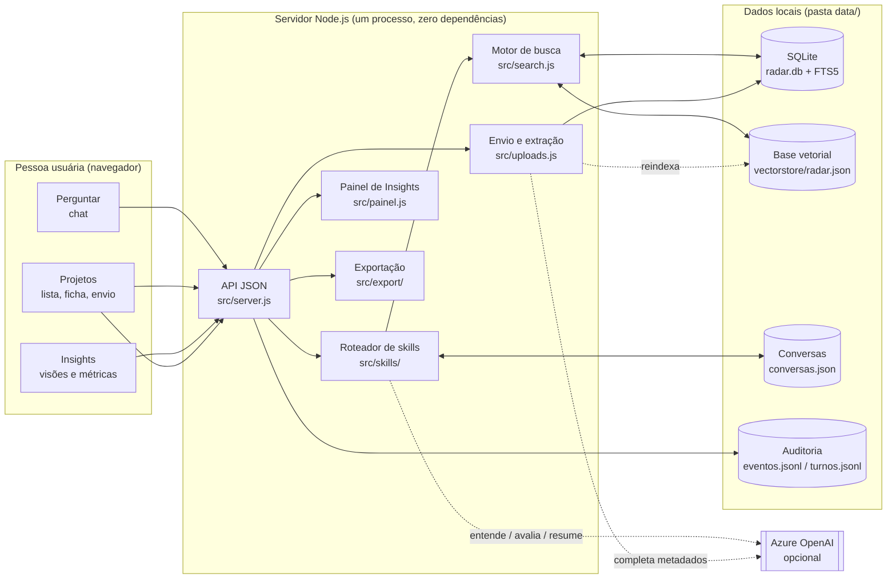

Em uma frase: **o navegador conversa com um único servidor Node; o servidor decide que tipo de pedido é, consulta o SQLite e a base vetorial sempre com o filtro de permissão do perfil, pede à IA só o que é de linguagem (entender, avaliar, resumir) e devolve uma resposta com fontes.**

---

## 3. Arquitetura e componentes

### 3.1 Restrições que moldaram a arquitetura

- **Somente Node.js na VM**, sem banco externo, sem Docker → tudo roda em **um processo Node ≥ 22.13** com **zero dependências npm** (`package.json` não tem `dependencies`). O banco é o SQLite embutido no Node (`node:sqlite`).
- **Servidor pequeno** (limite de 220 MB de RAM no ambiente publicado) → base vetorial em arquivo JSON e embeddings calculados localmente.
- **IA externa só com dados simulados** (DEC-0007, DEC-0008, risco R10) → a IA é **opcional**; sem chave, tudo funciona por regras.

### 3.2 Camadas

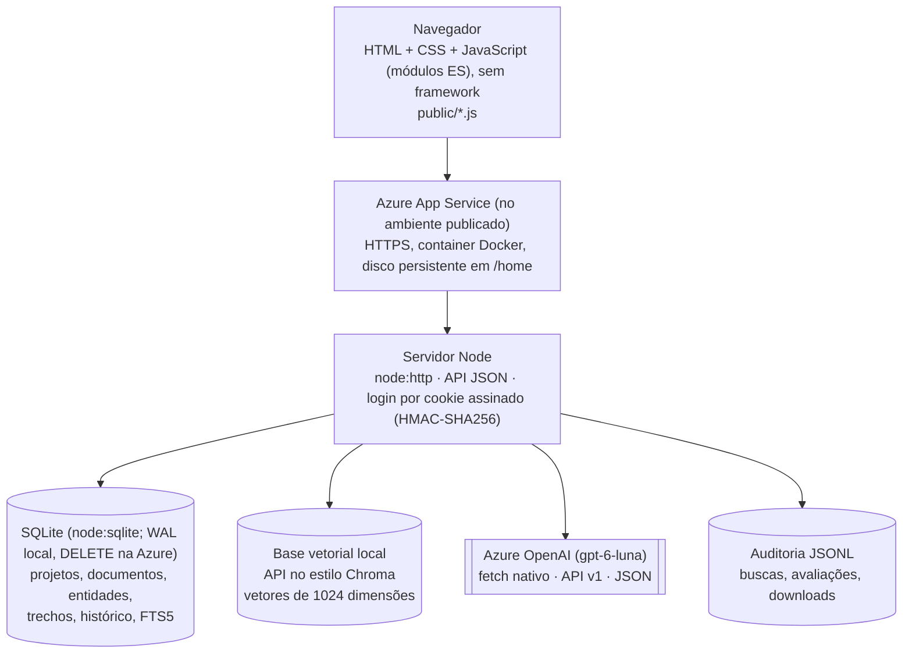

Localmente, nada disso é necessário: `npm start` sobe o servidor em `http://localhost:3000`. O passo a passo da publicação está em [DEPLOY-AZURE.md](DEPLOY-AZURE.md).

### 3.3 Componentes e arquivos

| Componente | Arquivo(s) | Responsabilidade |
|---|---|---|
| Servidor HTTP e API | `src/server.js` | Rotas `/api/*`, arquivos estáticos, login, download, exportação. |
| Login e sessão | `src/auth.js` | Cookie `HttpOnly`, `Secure`, `SameSite=Lax`, assinado com HMAC-SHA256, válido 7 dias. Só liga com `RADAR_LOGIN_USER` e `RADAR_LOGIN_PASS`. |
| Permissões | `src/permissions.js`, `data/usuarios.json` | Capacidades por perfil, checadas no servidor. |
| Repositório relacional | `src/db/repo.js`, `src/db/schema.sql` | Consultas SQL com o filtro de permissão embutido, FTS5, agregações, histórico. |
| Indexação | `src/ingest.js`, `src/text.js`, `src/embedder.js`, `src/vectorstore.js` | Trechos, embeddings, base vetorial, projetos relacionados. |
| Motor de busca | `src/search.js`, `src/lexicon.js`, `src/intents.js` | Roteamento por intenção, busca híbrida, score, conflito de fontes. |
| Registro de skills | `src/skills/index.js` + um arquivo por skill | Intenções, regras do roteador, "o que você pode fazer?", exemplos testados. |
| IA | `src/deepseek.js` (cliente no padrão OpenAI: Azure OpenAI ou DeepSeek), `src/llm.js` (MockLLM, regras) | Entender, avaliar, resumir, chamar ferramentas; fallback automático. |
| Envio e extração | `src/uploads.js`, `src/analysis.js`, `src/extract/*` | Pipeline de 7 etapas, sugestões com confiança, revisão. |
| Mascaramento | `src/sensitive.js` | Troca dados pessoais por marcadores antes de gravar ou enviar à IA. |
| Conversas | `src/conversations.js` | Memória, salvamento, favoritas, grupos, arquivadas. |
| Insights | `src/painel.js` | As cinco visões e as manchetes por regra. |
| Métricas e auditoria | `src/audit.js` | Eventos e indicadores da hipótese. |
| Exportação | `src/export/*` | PPTX, DOCX e PDF gerados sem bibliotecas. |
| Qualidade | `src/qualidade.js`, `src/roteiro.js` | Feedbacks, tickets, roteiro de testes por versão. |
| Ajuda (tela e chat) | `public/ajuda-conteudo.js`, `public/notas-versao.js`, `src/skills/conhecimento.js` | Uma fonte só para a tela de ajuda e para as respostas de dúvida de uso no chat. |

### 3.4 Ferramentas e bibliotecas

| Camada | Tecnologia | Uso |
|---|---|---|
| Runtime | Node.js ≥ 22.13 (ESM) | Servidor, extração, indexação, busca. |
| Banco | `node:sqlite` em modo WAL | Persistência relacional. |
| Busca textual | SQLite FTS5, BM25, tokenizer `unicode61 remove_diacritics` | Busca por palavras sem acento. |
| Embeddings | `hashing-tfidf-v1` (próprio) | Texto → vetor sem rede e sem modelo externo. |
| Base vetorial | `LocalVectorStore` (próprio, API no estilo Chroma) | Similaridade de cosseno com filtro `where`. |
| Extração | `zlib` nativo + leitor ZIP próprio | DOCX, PPTX, XLSX e PDF. |
| IA generativa | Azure OpenAI (implantação `gpt-6-luna`) via `fetch`; DeepSeek como alternativa local | Linguagem: entender, avaliar, resumir, ferramentas. |
| Testes | `node:test` + `node:assert` | 96 testes automatizados (`npm test`). |

---

## 4. Modelo de dados

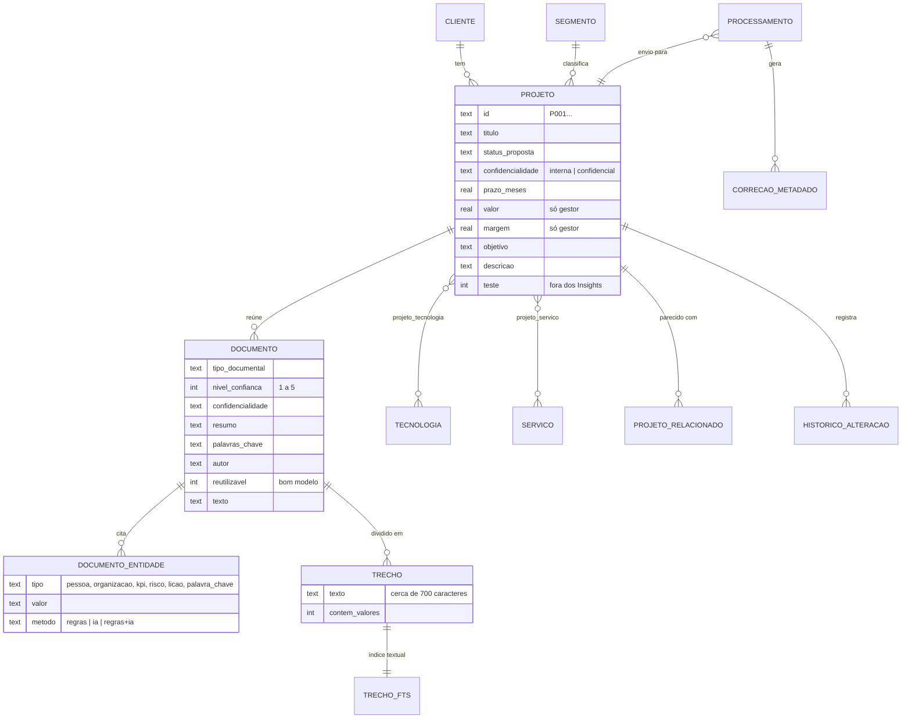

| Tabela | Guarda |
|---|---|
| `projeto`, `cliente`, `segmento` | O cadastro do projeto. Status possíveis: Em elaboração, Enviada, Em negociação, Vendida, Em execução, Entregue, Perdida, Cancelada. |
| `documento` | Cada arquivo, com tipo, confiança (1–5), confidencialidade, resumo, palavras-chave, autor, versão, link, notas do revisor e o texto extraído. |
| `documento_entidade` | Pessoas, organizações, resultados (KPIs), riscos, lições e palavras-chave, com o trecho de origem e o método. |
| `trecho` + `trecho_fts` | Pedaços de ~700 caracteres; a tabela virtual FTS5 é mantida por gatilhos. |
| `projeto_tecnologia`, `projeto_servico` | Taxonomia controlada (N–N). |
| `projeto_relacionado` | Projetos parecidos, recalculados a cada indexação. |
| `processamento` | Cada envio: etapas, sugestões, status e texto extraído. |
| `correcao_metadado` | O que o revisor mudou em relação à sugestão e qual método errou. |
| `historico_alteracao` | Antes e depois de cada edição, com usuário, data e ação (criar, editar, excluir, exportar, sugerir). |

**Vocabulário controlado** (`src/intents.js`): 10 segmentos (Utilities / Energia, Varejo, Serviços Financeiros, Seguros, Saúde, Telecom, Agronegócio, Setor Público, Logística, Manufatura), 15 tecnologias e 11 serviços. Só o gestor cria termos novos.

**Níveis de acesso:** o catálogo tem `publica`, `interna` e `confidencial`, mas os perfis do piloto só usam `interna` (consultor e gestor) e `confidencial` (gestor). O acesso de um documento nunca fica mais aberto que o do projeto dele (`stricterConf`).

---

## 5. Da base piloto ao índice: indexação

A base piloto tem **11 projetos, 51 documentos e 118 trechos** em 8 segmentos: 11 propostas comerciais, 11 apresentações, 11 estimativas preliminares, 11 transcrições de reunião, 6 cases de sucesso e 1 ata de análise de perda. Um projeto (P005, Cooperativa de Crédito Horizonte) é **confidencial**. Há também **2 oportunidades** com briefing (O-2026-01 Norte Energia, O-2026-02 Proteção Total Seguros), usadas na visão Pré-venda.

Na primeira execução, o banco e o índice são criados sozinhos (cerca de 1 s). Depois de cada aprovação de envio, edição de projeto ou de documento, a base vetorial é **reconstruída** a partir do banco.

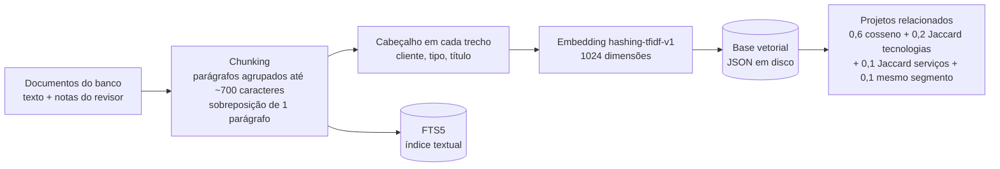

### Como o embedding é calculado (`src/embedder.js`)

1. **Tokenização** em português: minúsculas, sem acento, sem stopwords, com stemming leve.
2. **Features:** cada palavra e cada par de palavras vizinhas (bigrama, ex.: `perdas_tecnicas`).
3. **Feature hashing:** cada feature vira uma posição de 0 a 1023 pelo hash FNV-1a.
4. **Peso:** `(1 + log tf) × idf`, com `idf = log((1 + N) / (1 + df)) + 1` calculado sobre todos os trechos.
5. **Normalização L2:** a similaridade entre dois vetores vira o cosseno do ângulo entre eles.

O embedder é intercambiável: um modelo neural só precisa implementar `fit`, `embed` e `toJSON`, e a base vetorial pode ser trocada pelo Chroma sem mudar o motor de busca.

Cada trecho guarda a marca `contem_valores` (se tem preço, margem ou valor). Ela é usada para esconder esses trechos de quem não pode ver valores (seção 15).

---

## 6. O caminho de uma pergunta no chat

Toda pergunta passa pela rota `POST /api/buscar`. O servidor primeiro decide **que tipo de pedido é**; só o pedido "projetos parecidos" percorre a busca semântica completa.

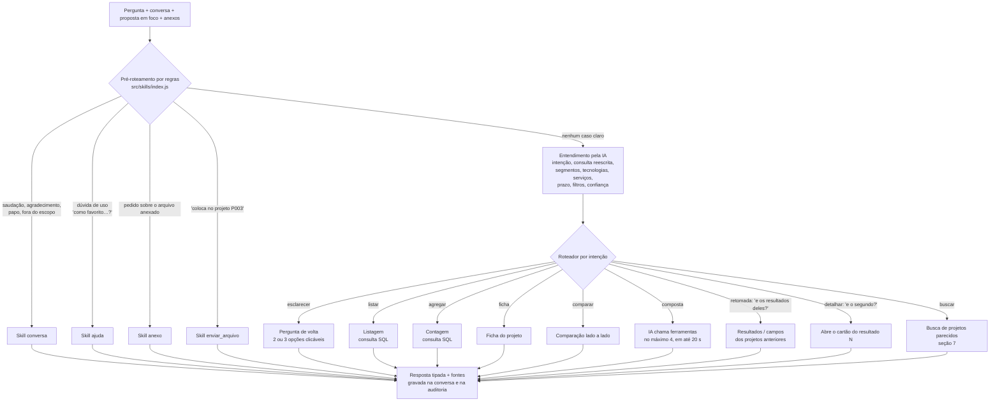

Pontos de controle:

- **Casos claros não chamam a IA** (mais rápido, mais barato e previsível): saudação, agradecimento, dúvida de uso, pedidos sobre o arquivo anexado e envio de arquivo.
- **Segunda opinião por regras:** se a IA disser "buscar", mas a pergunta for claramente uma listagem ou contagem, as regras corrigem (`classificar` em `src/intents.js`).
- **Esclarecer só com opções e nunca duas vezes seguidas** (`src/search.js`, `route`). Abaixo de confiança 0,45 a IA pode pedir esclarecimento.
- **Sem assunto, sem contexto e sem foco**, o Radar responde "não entendi" com exemplos, em vez de "não encontrei".
- **"Bom dia, liste…"** cumprimenta em meia frase e segue com o pedido.
- **Projeto pedido pelo código que o perfil não pode ver**: a resposta é "Não encontrei o P005 entre os projetos que o seu perfil pode ver", sem revelar se ele existe.

Cada resposta leva um `tipoResposta` que vira a **etiqueta** da tela: Projetos parecidos, Listagem, Contagem, Ficha do projeto, Comparação, Resultados, Resposta em etapas, Pergunta de volta, Conversa, Dúvida de uso, Arquivo da conversa, Envio de arquivo.

---

## 7. Busca de projetos parecidos e o percentual de semelhança

### 7.1 Pipeline

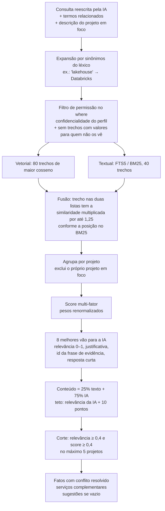

### 7.2 Critérios e pesos (`src/search.js`, `WEIGHTS`)

| Critério | Peso de partida | Como é medido |
|---|---|---|
| Descrição, objetivo e escopo (conteúdo) | 0,40 | 70% do melhor trecho + 30% da média dos 3 melhores, em escala **absoluta**: semelhança 0,10 = 0% e 0,22 = 100%. Com IA, vira 25% disso + 75% da relevância da IA. |
| Segmento | 0,15 | 1 se o projeto é do segmento pedido (ou do foco), 0 se não é. |
| Tecnologias | 0,15 | Proporção das tecnologias pedidas que o projeto usa. |
| Serviços / área | 0,15 | Proporção dos serviços pedidos que o projeto envolve. |
| Prazo / porte | 0,10 | `1 − |prazo do projeto − prazo pedido| / maior dos dois`. |
| Status | 0,05 | Entregue 1,0 · Vendida 0,9 · Em execução 0,85 · Em negociação 0,6 · Enviada 0,5 · Perdida 0,3 (outros 0,5), **multiplicado pela nota do conteúdo**: só desempata. |

**Critérios sem sinal na pergunta saem da conta** e os pesos dos que ficam são redistribuídos para somar 100%. Uma pergunta só sobre conteúdo usa só o conteúdo (e o status como desempate).

### 7.3 A avaliação da IA (escala fixa, `src/deepseek.js`)

| Relevância | Quando |
|---|---|
| 0,9 a 1 | Mesmo problema ou objetivo e mesmo segmento de cliente. |
| 0,7 a 0,85 | Mesmo problema em outro segmento, ou mesmo segmento com escopo bem parecido. |
| 0,5 a 0,65 | Semelhança parcial que ainda ajuda a montar a proposta. |
| 0,3 a 0,45 | Só tecnologia, palavra ou setor vizinho em comum. |
| abaixo de 0,3 | Sem relação útil. |

Regras finais: o percentual **nunca passa da relevância da IA + 10 pontos**; o projeto só aparece com **relevância ≥ 0,4 e score ≥ 0,4**; no máximo **5** projetos. A IA só cita no texto projetos com relevância ≥ 0,5. Rótulos na tela: **Muito parecido** (≥ 75%), **Parecido** (50–74%), **Relacionado** (< 50%).

### 7.4 Exemplo calculado — "Já fizemos projetos de churn em telecom?"

A pergunta cita segmento (Telecom) e serviço (Data Science / ML), sem tecnologia nem prazo. Ficam 4 critérios: 0,40 + 0,15 + 0,15 + 0,05 = 0,75, redistribuídos → conteúdo 53%, segmento 20%, serviços 20%, status 7%.

| Critério (peso) | P008 · ConectaFibra Telecom (Entregue) | P004 · ModaViva E-commerce (Perdida) |
|---|---|---|
| Conteúdo (53%) | IA 0,95 + texto muito parecido → nota 96% → **51 pontos** | IA 0,7 (mesmo problema, outro segmento) → 78% → **41,5** |
| Segmento (20%) | Telecom = Telecom → **20** | Varejo ≠ Telecom → **0** |
| Serviços (20%) | ciência de dados → **20** | ciência de dados → **20** |
| Status (7%) | Entregue 1,0 × 96% → **6,5** | Perdida 0,3 × 78% → **1,5** |
| **Total** | **98% · Muito parecido** | **63% · Parecido** |

Uma pergunta sem referência na base (ex.: "projeto para uma funilaria de carros") não tem nenhum candidato com relevância ≥ 0,4: o Radar diz que não encontrou nada relevante e sugere até 3 buscas próximas (segmentos e tecnologias dos projetos mais parecidos que o perfil pode ver).

### 7.5 Travas contra alucinação

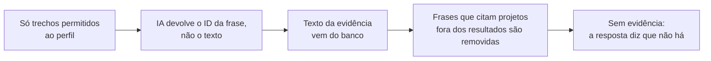

- A IA recebe só trechos já filtrados por permissão; para quem não vê valores, frases com preço são retiradas antes.
- A evidência é citada por **id** (`P001-3`); o texto mostrado vem da base.
- `onlyCitedResults` remove frases da resposta que citam projetos fora dos cartões exibidos, e descarta blocos "Recomendação:" e "Perfis sugeridos:".
- A resposta tem no máximo ~70 palavras; o que reaproveitar fica no cartão (escopo, resultados, lições).

---

## 8. Os outros tipos de resposta (skills)

As capacidades do chat ficam num **registro de skills** (`src/skills/index.js`). Cada skill declara: a intenção, a regra para a IA escolher, o que mostra em "o que você pode fazer?" (filtrado por perfil) e frases de exemplo que **devem** e que **não devem** ativá-la — testadas automaticamente a cada `npm test`.

| Skill / intenção | Exemplo | Como responde | Usa IA? |
|---|---|---|---|
| `buscar` | "Já fizemos fraude em seguros?" | Seção 7. | Sim (entender e avaliar) |
| `listar` | "Liste os projetos entregues em 2025" | SQL com filtros e permissão: total, tabela, distribuição. Botão "Abrir em Projetos". | Só para entender |
| `agregar` | "Quantos projetos por tecnologia?" | Contagem distinta. "Áreas" é ambíguo: responde por segmento e oferece prática NTT e serviço. | Só para entender |
| `ficha` | "Qual o prazo e o responsável do P003?" | Campos do cadastro; valor e margem com cadeado para o consultor. | Só para entender |
| `comparar` | "Compare o P001 com o P006", "compare os dois" | Tabela lado a lado (2 a 4 projetos, citados ou da resposta anterior). | Só para entender |
| `composta` | "Liste os de varejo e compare os dois" | A IA chama ferramentas (listar, contar, localizar, ficha, parecidos, trechos), no máximo 4, em até 20 s; o servidor executa cada uma com as permissões do usuário. | Sim (obrigatória) |
| `detalhar` | "Detalhe o segundo" | Abre o cartão do resultado N da resposta anterior. | Só para entender |
| Retomada | "Quais os resultados neles?" | Seção "Resultados" do case ou da ata dos projetos da resposta anterior. | Não |
| `esclarecer` | Pergunta ambígua | 2 ou 3 opções clicáveis. | Sim |
| `conversa` | "olá", "tudo bem?", "o que você pode fazer?" | Saudação, papo, capacidades (cartões por perfil), agradecimento, despedida, crítica (com "Enviar feedback"), fora do escopo, "não entendi". | IA para o texto; sem IA, modelo fixo |
| `ajuda` | "Como favorito uma conversa?" | Seção 8.1. | IA para resumir; sem IA, linhas literais |
| `anexo` | "resuma", "qual o prazo?" | Seção 10. | Sim; sem IA, regras |
| `enviar_arquivo` | "coloca no projeto P003" | O servidor decide o destino: código = certeza; nome = opções para confirmar; sem citação, vale o foco. | Não |

### 8.1 Como o chat responde dúvidas de uso (o "treinamento conversacional")

O chat **não foi treinado** com um modelo próprio: ele **consulta a mesma ajuda que aparece na tela**. Assim, a tela e o chat nunca divergem.

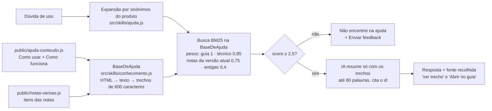

- **Quando uma pergunta é dúvida de uso** (`ehDuvidaDeUso`): começa como dúvida ("como", "onde", "por que", "quem pode", "o que significa"…) e cita uma parte do produto (conversa, envio, foco, permissões, download, Página de status, Modo regras, Curadoria…). "Como foi o projeto P003?" não é dúvida de uso.
- **Sinônimos do produto** aproximam a pergunta das palavras do guia (ex.: "desarquivo" → "Desarquivar, caixa Arquivadas").
- **Notas superadas:** um item das notas que foi substituído por outro da mesma versão tem o campo `substituido`; o chat usa o texto do que vale hoje e não o lista em "o que mudou nesta versão?".
- **Novidades:** "o que mudou nesta versão?" lista os itens das notas da versão atual.
- O conjunto de avaliação de intenções fica em `test/avaliacao-intencoes.js`; os exemplos de cada skill são testados em `test/skills.test.js`.

---

## 9. Memória da conversa e proposta em foco

### 9.1 Memória

- Cada conversa guarda as **últimas 8 perguntas** como memória (`MEMORY_TURNS = 8`, `src/conversations.js`). A tela mostra "lembrando N perguntas".
- A IA lê **as 6 mais recentes** para interpretar a pergunta nova (`history.slice(-6)`) e **as 3 mais recentes** para avaliar candidatos e para as perguntas compostas.
- A memória guarda os projetos **mostrados** em cada resposta: é isso que permite "compare os dois", "e o segundo?" e "quais os resultados neles?".
- Toda conversa com uma pergunta é **salva automaticamente** em `data/conversas/conversas.json`. Cada conversa pertence a um usuário: outro perfil não lê, não altera e não continua.
- "✕" em "lembrando N perguntas" ou "Nova conversa" começa do zero.

### 9.2 Proposta em foco

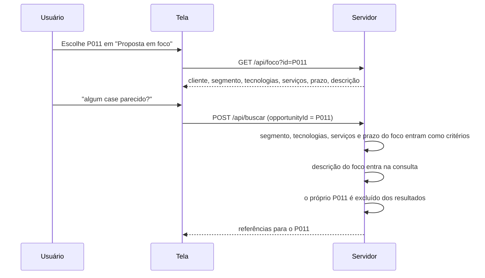

O foco é salvo com a conversa e volta quando ela é reaberta. Com foco, um arquivo anexado pelo clipe vai direto para o projeto (para revisão). O foco aceita qualquer projeto visível ao perfil ou uma das oportunidades cadastradas.

---

## 10. Arquivo lido na conversa

O clipe do chat **não coloca nada na base**: o arquivo vira contexto da conversa.

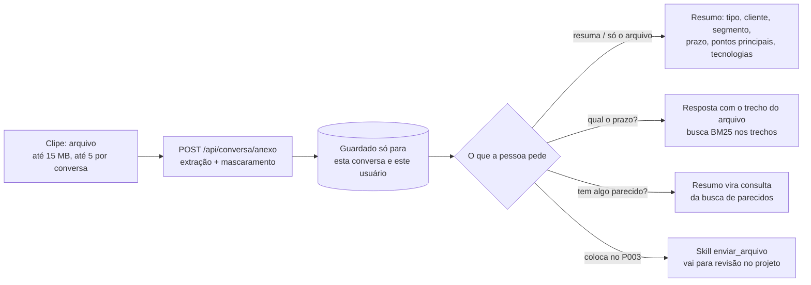

- Arquivo longo: o Radar guarda até 200 mil caracteres por arquivo (acima disso, o cartão avisa "arquivo longo: li o início"); para resumir, a IA lê os primeiros 7.000 e os últimos 2.000 caracteres quando o texto passa de 9.000. Perguntas sobre o arquivo buscam os trechos mais relacionados (BM25) em todo o texto guardado.
- O texto extraído é mascarado e apagado quando a conversa é excluída (e, na partida do servidor, os de conversas que não existem mais).
- Numa conversa nova, os arquivos ainda anexados são lidos de novo.

---

## 11. Envio de documentos: as 7 etapas e a revisão humana

Os arquivos entram **sempre dentro de um projeto** (bloco "Enviar arquivo" da ficha), **pela conversa** ou, para o gestor, como **projeto novo a partir de arquivo**. Não existe aba de envio.

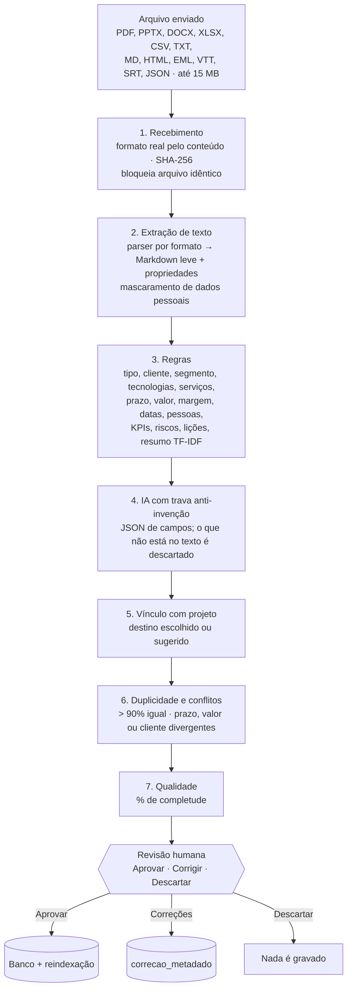

### 11.1 Leitura por formato (`src/extract/formats.js`)

| Formato | Como o texto é obtido |
|---|---|
| DOCX · PPTX · XLSX | ZIP com XML. Leitor ZIP próprio + `zlib.inflateRawSync`. Títulos, listas, slides, notas do apresentador, linhas de planilha como "coluna: valor"; autor e título de `docProps/core.xml`. |
| PDF | Streams FlateDecode descompactados; operadores de texto `Tj`, `TJ`, `'`, `"`. Sem OCR: PDF só de imagem não tem texto. |
| EML | Cabeçalhos MIME decodificados e corpo em texto. |
| VTT · SRT | Mantém quem falou e o minuto; descarta numeração e tempos. |
| HTML · MD · TXT · CSV · JSON | Texto limpo; scripts e estilos do HTML descartados. |

### 11.2 Trava anti-invenção da IA

Para arquivos longos (mais de 14.000 caracteres), a IA recebe os primeiros 10.000 e os últimos 4.000. Cliente, pessoas, prazo e valor sugeridos pela IA que **não aparecem no texto são descartados**. Quando IA e regras concordam, a confiança sobe e o método vira `regras+ia`. Cada campo sugerido traz **valor, confiança (0 a 1), método e o trecho** que o sustenta — a tela marca com "confira" os de baixa confiança.

### 11.3 Vínculo com projeto (`src/uploads.js`)

```
score = 0,6 × semelhança de conteúdo (cosseno)
      + 0,45 se for o mesmo cliente (com confiança suficiente)
      + 0,1  se o título tiver 2+ palavras em comum
```

Com score ≥ 0,6 o projeto vem marcado como destino; sem candidato forte, o Radar propõe **criar projeto novo** com os campos já extraídos (só gestor). Ao enviar pela ficha ou com foco, o destino é o projeto escolhido.

### 11.4 Regras de aprovação

- Documento que **se declara confidencial** só é aprovado por quem tem acesso a confidencial (gestor).
- A confidencialidade final nunca é mais aberta que a do projeto.
- "Atualizar a ficha do projeto": o revisor marca o que o arquivo traz de diferente (prazo, data e, para o gestor, valor e margem).
- Cada sugestão alterada vira uma linha em `correcao_metadado` e aparece em Insights › Curadoria ("Onde a IA mais erra no envio?").

---

## 12. Conflito entre fontes

Quando documentos do mesmo projeto discordam (prazo, valor), vale a fonte de **maior confiança** (`src/corpus.js`, `TRUST_LABEL`):

| Nível | Rótulo na tela | Tipos |
|---|---|---|
| 5 | Oficial | Proposta final aprovada, SOW, contrato |
| 4 | Enviado | Case aprovado, apresentação final, proposta enviada |
| 3 | Interno | Estimativa preliminar, ata validada, ficha cadastrada |
| 2 | Informal | Transcrição, e-mail, documento técnico |
| 1 | Rascunho | Rascunho não validado |

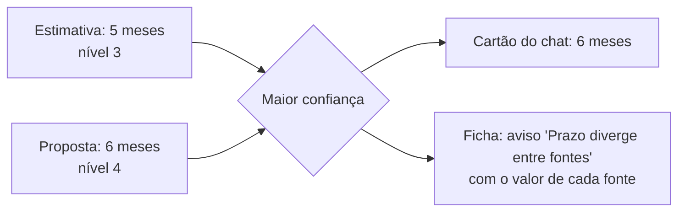

O valor só entra na comparação para quem pode ver valores.

---

## 13. Insights e métricas do piloto

### 13.1 Cinco visões sobre a mesma base (`src/painel.js`)

| Visão | Pergunta | Sugerida para |
|---|---|---|
| Negócio | Onde estamos ganhando e onde crescer? | Gestor |
| Técnica | Sabemos entregar o que vendemos? | — |
| Pipeline | Que propostas precisam de atenção agora? | — |
| Pré-venda | Estamos prontos para uma nova oportunidade? | Consultor |
| Curadoria | Dá para confiar nos dados da base? | — |

Regras de cálculo:

- **Visão não é permissão:** tudo é calculado só com o que o perfil pode ver; valor e margem só entram para quem pode ver valores.
- **Manchetes por regra, não por texto livre da IA.** Cada manchete tem tom (Ponto forte, Atenção, Para saber), número em destaque, legenda e mini-gráfico.
- **Amostra mínima = 3:** abaixo disso, aviso "poucos dados" e barra hachurada.
- **Selos de origem:** "Calculado da base"; "IA · confira antes de usar" (extraído sem revisão humana); "IA · revisado".
- **Projetos marcados como teste** ficam fora dos números (exceto na Curadoria). O Radar sugere suspeitos por regra (título com "teste", texto aleatório, curto demais); só o gestor marca e desmarca.
- **Pipeline:** alertas de proposta parada há 7+ dias, margem fora da faixa dos ganhos, cadastro incompleto, parecida com uma perdida.
- **Pré-venda:** prontidão de cada oportunidade = 0,4 × mesmo segmento + 0,35 × Jaccard de serviços + 0,25 × Jaccard de tecnologias contra a base.

### 13.2 Métricas do piloto (`src/audit.js`)

Indicadores da hipótese, calculados de `data/auditoria/eventos.jsonl` e `turnos.jsonl`:

| Indicador | Definição |
|---|---|
| Buscas | Perguntas feitas no chat (dica: número de conversas). |
| Sem resultado | % de perguntas sem evidência na base (lacunas de conteúdo). |
| Úteis entre os 3 primeiros | % de 👍 nos 3 primeiros resultados (dica: % útil geral). |
| Até a 1ª referência útil | Tempo médio da primeira pergunta ao primeiro 👍 da conversa. |
| Reaproveitamentos | Abrir projeto, Copiar escopo e Usar como base a partir de uma resposta. |
| Fontes abertas | Documentos de origem abertos (dica: cartões abertos). |
| Tempo de resposta | Média até a resposta do chat. |
| Por que não ajudou | Motivos dos 👎. |
| O que pedem ao chat | Perguntas por tipo de pedido e quantas ficaram sem resposta. |

---

## 14. Exportação de proposta

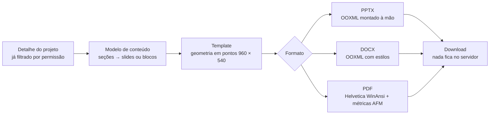

| Modelo | Formatos | Seções |
|---|---|---|
| Apresentação para o cliente | PPTX ou PDF (16:9) | Capa, Contexto e desafio, Objetivo, Solução proposta, Escopo e prazo, Investimento (gestor), Resultados, Cases de referência, Riscos e mitigação, Lições aprendidas (desmarcada por padrão), Fontes |
| Resumo executivo | DOCX ou PDF (A4) | As mesmas seções, todas marcadas por padrão |

O conteúdo vem só da base (nenhum texto gerado por IA). Seções sem conteúdo aparecem desabilitadas com o motivo. Listas longas viram slides "(cont.)" com até 6 tópicos. Para o consultor, valores nunca entram e projetos confidenciais não aparecem nem como referência. Cada exportação fica no registro de atividades.

---

## 15. Permissões, privacidade e segurança

### 15.1 Perfis do piloto (`data/usuarios.json`, `src/permissions.js`)

| | Consultor (Marina Costa) | Gestor (Thiago Ramos) |
|---|---|---|
| Níveis de acesso | interna | interna, confidencial |
| Vê valores e margens | Não | Sim |
| Cadastrar projeto, cliente, termo novo | Não | Sim |
| Excluir projeto | Não | Sim |
| Marcar cadastro como teste | Não | Sim |
| Registro de atividades | Não | Sim |

O "Ver como" é uma **demonstração**: troca de perfil sem login individual. Some quando houver SSO.

### 15.2 Onde o filtro é aplicado

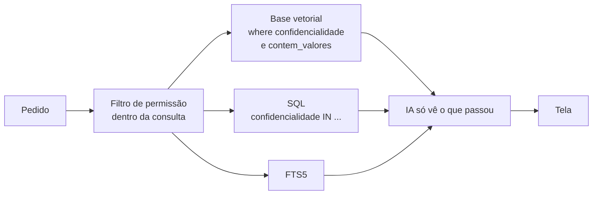

O filtro está **dentro** de todas as consultas: chat, exploração, ficha, insights, lista de clientes, foco, download e exportação. A tela apenas esconde botões; a regra vale no servidor.

### 15.3 Valores no download do original (`src/server.js`, `download`)

| Formato | Consultor |
|---|---|
| Texto (MD, TXT, CSV, HTML, JSON, VTT, SRT, EML) | Baixa; linhas de preço e margem viram `[valor oculto para o seu perfil]`; dados pessoais saem mascarados. |
| PDF, DOCX, PPTX, XLSX **sem** valor/margem cadastrados | Baixa como foi enviado. |
| PDF, DOCX, PPTX, XLSX **com** valor ou margem cadastrados | **Recusado (HTTP 403)**: "peça o original ao gestor do projeto". |

### 15.4 Mascaramento de dados pessoais (`src/sensitive.js`)

CPF, RG, e-mail, telefone, número de cartão (validado por Luhn), senhas e chaves (ex.: `sk-…`, `AKIA…`, JWT) são trocados por marcadores **antes de gravar, indexar ou enviar à IA** — no envio, cadastro, sugestão, edição, perguntas e arquivos lidos na conversa. O envio nunca é bloqueado; o registro guarda só o tipo e a quantidade. CNPJ, CPF, e-mail e telefone também são detectados na extração para sugerir confidencialidade (CPF sugere "confidencial").

### 15.5 Outras proteções

- Sessão em cookie `HttpOnly`, `Secure`, `SameSite=Lax`, HMAC-SHA256, 7 dias; atraso fixo em erro de senha.
- Chave da IA só no servidor (`.env`, fora do git).
- Termo de uso aceito uma vez por perfil e por versão (janela "Bem-vindo ao Radar").
- Registro de atividades somente leitura: não há API para alterar ou apagar eventos.
- Endpoints de relatório para agentes (`/api/relatorio/qualidade` e `/api/relatorio/insights`) só existem com `RADAR_RELATORIO_TOKEN` (24+ caracteres) e leem como um perfil sem confidenciais (valores só com `RADAR_RELATORIO_VALORES=1`).

---

## 16. Funcionamento sem IA (modo regras)

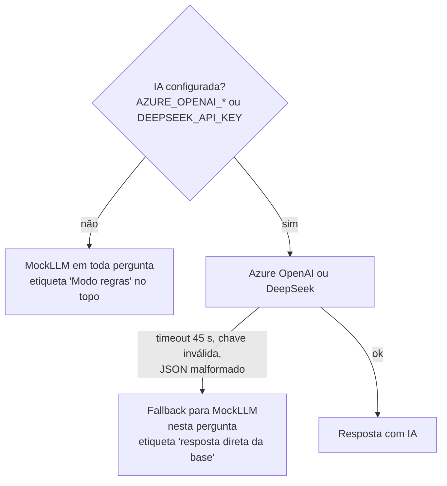

Sem IA, regras de palavras-chave classificam a intenção, o léxico extrai entidades, o ranking usa só o score multi-fator (com corte de conteúdo mínimo) e a resposta é montada a partir dos fatos. Perguntas compostas ("liste e compare") precisam da IA; sem ela, as regras classificam o pedido como um tipo só (em geral a listagem) e respondem essa parte. Com a DeepSeek, cada pergunta leva de 5 a 10 s; no modo regras é instantâneo.

---

## 17. Qualidade: testes, roteiro e tickets

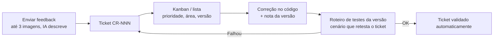

- **Testes automatizados:** 96 testes (`npm test`, `node:test`), cobrindo extração, permissões, busca, percentual, upload, edição, skills, ajuda e Insights. Rodam numa pasta temporária.
- **Roteiro de testes V0.0.2:** 116 cenários manuais (57 de conversas, 33 de projetos, 18 de envio, 8 de Insights), com seletor de versão; a V0.0.1 fica arquivada.
- **Página de status** (`/status`): versões, tickets e feedbacks, com link para compartilhar.

---

## 18. API do servidor

Principais rotas (todas JSON; `userId` identifica o perfil de demonstração):

| Rota | Para quê |
|---|---|
| `GET /api/contexto` | Usuários, catálogo (segmentos, tecnologias, formatos, limite de envio) e números da base. |
| `POST /api/buscar` | Pergunta do chat (todas as skills). |
| `POST /api/conversa/anexo` | Anexar arquivo à conversa. |
| `GET /api/conversas`, `GET /api/conversa` | Lista e conteúdo das conversas. |
| `POST /api/conversa/{salvar,favoritar,grupo,arquivar,desfazer-ultima,excluir}` | Gestão das conversas. |
| `POST /api/evento` | 👍/👎, motivo, abrir fonte, reaproveitar (métricas). |
| `GET /api/projetos`, `GET /api/projeto` | Exploração com filtros e ficha. |
| `POST /api/projetos`, `POST /api/projeto/{atualizar,excluir,comentar,teste}` | Cadastro e edição. |
| `POST /api/projetos/sugerir` | "Sugerir campos" a partir de texto livre. |
| `POST /api/upload`, `GET /api/upload(s)`, `POST /api/upload/{confirmar,rejeitar}` | Envio e revisão. |
| `GET /api/documentos`, `GET /api/documento`, `GET /api/documento/baixar` | Documentos e download. |
| `POST /api/projeto/exportar` | Exportação. |
| `GET /api/painel`, `GET /api/metricas` | Insights e métricas. |
| `GET /api/atividades` | Registro de atividades (gestor). |
| `POST /api/feedback`, `POST /api/tickets/*`, `POST /api/testes/resultado` | Qualidade. |
| `GET /api/sessao`, `POST /api/login`, `POST /api/logout` | Sessão. |

---

## 19. O que é real e o que é simulado; limites conhecidos

| Parte | No V0 | Caminho para produção |
|---|---|---|
| Banco, busca textual, base vetorial | Real, só com Node | PostgreSQL + pgvector (ou Chroma) |
| Embeddings | Real, porém simples (hashing TF-IDF, offline) | Modelo multilíngue (ex.: `multilingual-e5`) |
| IA | Real com Azure OpenAI (assinatura NTT), com fallback por regras | Aprovação de segurança e jurídico para dados reais (R10) |
| Upload, extração, metadados | Real | OCR para PDF escaneado; arquivos do SharePoint |
| Usuários e perfis | Fixos, com "Ver como" | SSO corporativo |

Limites conhecidos:

- Embedding por hashing entende sinônimos do léxico, não o sentido de qualquer frase; a semântica fina vem da IA (entendimento e reavaliação).
- Base vetorial reconstruída inteira a cada alteração (~200 ms para 50 documentos); para milhares, indexação incremental.
- Sem OCR: PDF escaneado não tem texto.
- Busca da ajuda e do arquivo anexado é por palavras (BM25 com sinônimos).
- Dados enviados à IA: vão ao Azure OpenAI da assinatura NTT. Dados reais de projetos só com aprovação de segurança e jurídico (R10).
- Um único servidor pequeno.

---

## 20. Glossário

| Termo | Significado |
|---|---|
| **BM25 / FTS5** | Ranking de busca por palavras do SQLite. |
| **Chunk / trecho** | Pedaço de ~700 caracteres de um documento, unidade da busca. |
| **Embedding** | Vetor numérico que representa um texto; textos parecidos têm vetores próximos. |
| **Cosseno** | Medida de semelhança entre dois vetores (0 a 1). |
| **Jaccard** | Interseção ÷ união de dois conjuntos (ex.: tecnologias). |
| **Skill** | Capacidade do chat registrada em `src/skills/`, com intenção e exemplos testados. |
| **Fallback** | Plano B automático por regras quando a IA falha. |
| **Proposta em foco** | Projeto escolhido como contexto de todas as perguntas da conversa. |
| **Nível de confiança** | 1 a 5, define qual fonte prevalece num conflito. |
| **Cadastro de teste** | Projeto marcado pelo gestor para ficar fora dos números dos Insights. |
