# Como usar o Radar de Propostas & Cases

> **Versão descrita:** V0.0.2 · **Revisado contra o app em:** 16/11/2026
> **Público:** quem usa o Radar no dia a dia (consultores e gestores de pré-vendas) e a banca avaliadora.
> **Documento irmão:** [Como funciona o Radar](./COMO-FUNCIONA-O-RADAR.md) (arquitetura, regras e cálculos).
> **No app:** o mesmo conteúdo está em **menu ⋮ → Como usar o Radar**, e o chat responde dúvidas de uso com base nele (ex.: *"como favorito uma conversa?"*).
> **Tudo é fictício:** pode testar à vontade; nenhum cliente real é afetado.

---

## Sumário

1. [Em 1 minuto](#1-em-1-minuto)
2. [Como rodar e abrir o Radar](#2-como-rodar-e-abrir-o-radar)
3. [A tela principal](#3-a-tela-principal)
4. [Primeiro acesso](#4-primeiro-acesso)
5. [Perguntar ao Radar (chat)](#5-perguntar-ao-radar-chat)
6. [Como ler um cartão de projeto](#6-como-ler-um-cartão-de-projeto)
7. [Proposta em foco](#7-proposta-em-foco)
8. [Ler um arquivo na conversa](#8-ler-um-arquivo-na-conversa)
9. [Conversas salvas](#9-conversas-salvas)
10. [Explorar projetos](#10-explorar-projetos)
11. [Ficha do projeto](#11-ficha-do-projeto)
12. [Cadastrar projeto (gestor)](#12-cadastrar-projeto-gestor)
13. [Enviar documentos e aprovar](#13-enviar-documentos-e-aprovar)
14. [Exportar proposta](#14-exportar-proposta)
15. [Insights: visões e métricas do piloto](#15-insights-visões-e-métricas-do-piloto)
16. [Permissões: consultor e gestor](#16-permissões-consultor-e-gestor)
17. [Menu ⋮, versão, feedback e testes](#17-menu--versão-feedback-e-testes)
18. [Jornadas completas (roteiros de uso)](#18-jornadas-completas-roteiros-de-uso)
19. [Dúvidas frequentes](#19-dúvidas-frequentes)
20. [Atalhos de teclado](#20-atalhos-de-teclado)

---

## 1. Em 1 minuto

O Radar é a **memória de propostas e cases** da equipe. Você pergunta em linguagem natural ("já fizemos fraude em seguros?") e ele mostra **projetos parecidos que já fizemos** e **de onde veio cada informação**.

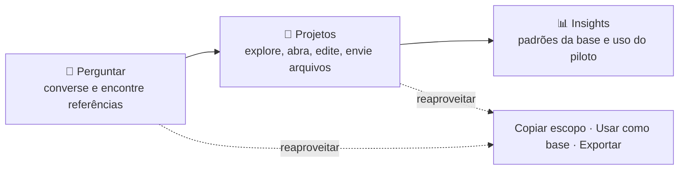

| Aba | Para que serve | Quando usar |
|---|---|---|
| **Perguntar** | Chat que busca pelo significado, lista, conta, compara, lê arquivos anexados e tira dúvidas sobre o próprio Radar. | No começo de uma proposta: "já fizemos algo assim?" |
| **Projetos** | Lista com filtros, ficha completa, documentos, comentários e o bloco "Enviar arquivo". | Quando você sabe o que procura, quer comparar ou guardar um documento. |
| **Insights** | Cinco visões da base (Negócio, Técnica, Pipeline, Pré-venda, Curadoria) e as Métricas do piloto. | Para entender onde ganhamos e o que pede atenção. |

> Não há aba de envio: arquivos entram **sempre dentro de um projeto** (ficha → "Enviar arquivo") ou **pela conversa** (clipe).

---

## 2. Como rodar e abrir o Radar

Pré-requisito: **Node.js 22.13 ou maior**. Não há `npm install` (zero dependências).

```bash
cd radar-v0
node -v        # v22.13.0 ou maior
npm start      # abra http://localhost:3000
```

| Situação | O que acontece |
|---|---|
| Sem `DEEPSEEK_API_KEY` no `.env` | Funciona em **Modo regras** (etiqueta no topo); respostas instantâneas. |
| Com a chave | Respostas com IA (5 a 10 s por pergunta). |
| Com `RADAR_LOGIN_USER` e `RADAR_LOGIN_PASS` | Pede login; o menu ⋮ ganha "Sair". |

O passo a passo completo (problemas comuns, variáveis) está no [README do radar-v0](../README.md#como-rodar-localmente-passo-a-passo).

---

## 3. A tela principal

```
┌──────────────────────────────────────────────────────────────────────────────┐
│ ◎ Radar [V0.0.2]   💬 Perguntar   📁 Projetos   📊 Insights   [Modo regras]  │
│                                                         (MC Marina ▾)  [⋮]   │
├───────────────────────┬──────────────────────────────────────────────────────┤
│ [+ Nova conversa]     │ [▤] Nova conversa ✎                            ☆     │
│ 🔍 Buscar conversas   │                                                      │
│                       │          ◎  O que você procura?                      │
│ ▸ ★ Favoritas         │   Encontre propostas, cases e lições de 11 projetos  │
│ ▸ 📁 Grupos           │                                                      │
│ ▸ 🗄 Arquivadas       │   [Já fizemos fraude em seguros?] [Quais segmentos…] │
│ 🕘 Recentes           │                                                      │
│   • Churn em telecom  │                                                      │
│   • Fraude em seguros │                                                      │
│                       │  lembrando 2 perguntas ✕                             │
│ ? Como usar o Radar   │ ┌──────────────────────────────────────────────────┐ │
│ 💬 Enviar feedback    │ │ ◎ Proposta em foco ▾  📎  Pergunte…          ➤  │ │
│                       │ └──────────────────────────────────────────────────┘ │
└───────────────────────┴──────────────────────────────────────────────────────┘
```

| Elemento | Onde | O que faz |
|---|---|---|
| **Selo da versão** (V0.0.2) | Ao lado de "Radar" | Abre as notas da versão. |
| **Abas** | Topo | Perguntar, Projetos, Insights. |
| **Modo regras** | Topo, só se a IA não estiver configurada | Avisa que as respostas usam regras e busca por palavras. |
| **Botão de conta** (iniciais, nome, perfil) | Canto superior direito | Mostra quem está ativo e tem o **Ver como (demonstração)**: troca entre Consultor (Marina Costa) e Gestor (Thiago Ramos). |
| **Menu ⋮** | Ao lado do botão de conta | Tema, documentos, métricas, registro, ajuda, versão, status, política, sair (seção 17). |
| **Coluna de conversas** | Esquerda (no celular, no botão ▤) | Nova conversa, busca, caixas Favoritas/Grupos/Arquivadas/Recentes, atalhos de ajuda e feedback. |
| **Caixa de pergunta** | Embaixo | Proposta em foco (alvo), clipe, campo de texto e enviar. |

---

## 4. Primeiro acesso

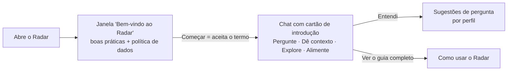

1. Aparece **Bem-vindo ao Radar**, com as boas práticas e a política de dados do piloto. **Começar** aceita o termo (vale por perfil e por versão do termo).
2. O chat mostra um cartão com 4 passos. **Entendi** esconde o cartão; **Ver o guia completo** abre a ajuda.
3. Os botões de sugestão fazem uma pergunta com um clique. Mudam com o perfil:
   - Consultor: *Já fizemos fraude em seguros?* · *Quais segmentos já atendemos?* · *Liste os projetos entregues em 2025* · *Compare o P001 com o P002*.
   - Gestor: *Propostas perdidas e o que aprendemos* · *Quantos projetos por status?* · *Qual o prazo, o valor e a margem do P001?* · *Liste os projetos de varejo e compare os dois*.
   - Com proposta em foco: *Projetos parecidos com …*, *O que já fizemos para …?*, *Que riscos costumam aparecer nesse tipo de projeto?*

---

## 5. Perguntar ao Radar (chat)

### 5.1 Passo a passo

1. Clique em **Perguntar** e escreva como falaria com um colega. **Enter** envia (o botão ➤ só acende com texto).
2. Olhe a **etiqueta** acima da resposta: ela diz o tipo de resposta.
3. Leia a resposta curta: diz direto se há referências e por que cada uma serve.
4. Abaixo vêm tabelas ou **cartões de projeto**, do mais parecido ao menos.
5. Errou? A última pergunta tem um **✎ lápis**: edite e reenvie; a pergunta e a resposta antigas são trocadas ("Editando a última pergunta · Cancelar").

### 5.2 O que dá para pedir

| Pedido | Exemplo | Etiqueta / resposta |
|---|---|---|
| Projetos parecidos | *"Já fizemos fraude em seguros?"* | **Projetos parecidos**: cartões com porquê e fontes |
| Listar a base | *"Liste os projetos entregues em 2025"* | **Listagem**: tabela + "Abrir em Projetos" |
| Contar e agrupar | *"Quantos projetos por tecnologia?"* | **Contagem**: barras clicáveis (abrem Projetos filtrado) |
| Ficha de um projeto | *"Qual o prazo e o responsável do P003?"* | **Ficha do projeto** (valores só para o gestor) |
| Comparar | *"Compare o P001 com o P006"*, *"compare os dois"* | **Comparação**: tabela lado a lado |
| Em etapas | *"Liste os de seguros e compare os dois primeiros"* | **Resposta em etapas** (precisa da IA ligada) |
| Retomar a anterior | *"Quais os resultados neles?"* | **Resultados** dos projetos da resposta anterior |
| Detalhar | *"Detalhe o segundo"* | Abre o cartão do 2º resultado |
| Ler um arquivo | Clipe + *"resuma"* | **Arquivo da conversa** (seção 8) |
| Dúvida de uso | *"Como favorito uma conversa?"*, *"o que mudou nesta versão?"* | **Dúvida de uso**: explicação + "Fonte: … ver trecho" e "Abrir no guia" |
| Conversa | *"olá"*, *"o que você pode fazer?"*, *"valeu"* | **Conversa**: capacidades em cartões, conforme o perfil |
| Pergunta ambígua | — | **Pergunta de volta**: 2 ou 3 opções clicáveis |

### 5.3 O cabeçalho da resposta

```
[◎ Projetos parecidos] [≡ continuando a conversa] [⚙ resposta direta da base]   ⓘ
```

- **continuando a conversa**: a pergunta foi interpretada com as anteriores.
- **resposta direta da base**: a IA falhou nesta pergunta e a resposta veio das regras. Repita para ter a análise da IA.
- **ⓘ**: quantos projetos foram avaliados, tempo, quem respondeu (DeepSeek ou regras) e "Entendi como: …" quando a pergunta foi reescrita.

### 5.4 Bons exemplos

| Objetivo | Pergunta |
|---|---|
| Achar referência | *"Propostas de utilities com Databricks"* |
| Checar experiência | *"Já fizemos fraude em seguros?"* |
| Aprender com perdas | *"Propostas perdidas e o que aprendemos"* |
| Estimar | *"Quanto tempo levou um projeto de churn?"* |
| Riscos | *"Que riscos aparecem em projetos de IA generativa?"* |
| Continuar | *"Quais os resultados neles?"* |

### 5.5 Quando não há nada na base

O Radar diz *"Não encontrei nada relevante na base"* e oferece até **3 buscas próximas** (botões que sempre trazem resultado para o seu perfil), além de **Explorar projetos**, **Perguntar sem o foco em …** (se houver foco) e **Nova conversa, sem o contexto anterior** (se houver memória). Pedido de um projeto que o seu perfil não pode ver: o Radar só diz que não o encontrou entre os que você pode ver.

### 5.6 Memória da conversa

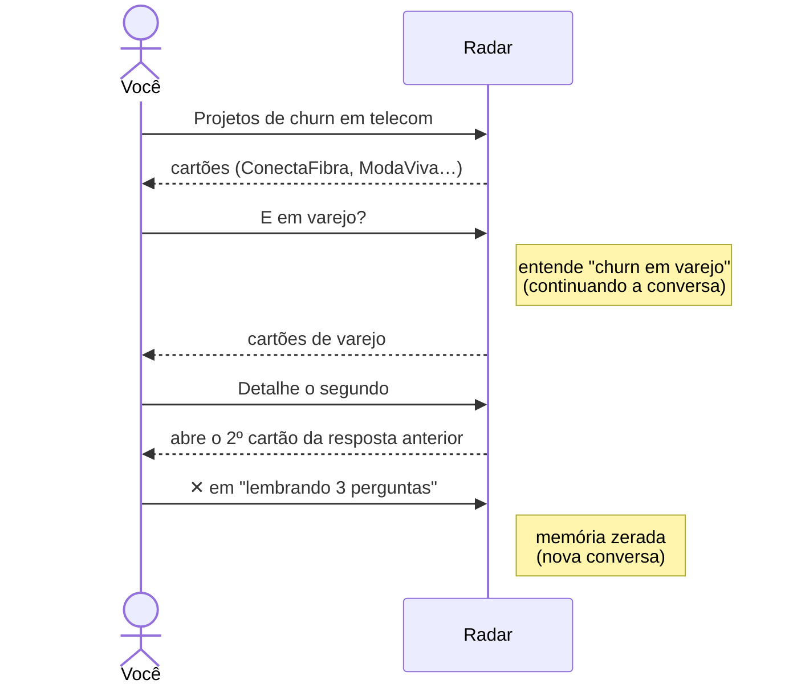

O Radar guarda as **últimas 8 perguntas** ("lembrando N perguntas"); a IA usa as 6 mais recentes para interpretar a nova. Mudou de assunto? Clique no **✕** ou em **Nova conversa**.

### 5.7 Avaliar

Cada cartão tem 👍 e 👎. 👎 pergunta o motivo: **Não é parecido**, **Informação errada**, **Desatualizado**, **Outro**. As avaliações alimentam as Métricas do piloto.

---

## 6. Como ler um cartão de projeto

```
┌────────────────────────────────────────────────────────────────┐
│ 📡 Predição de churn em tempo real                    👍 👎  ▾ │
│    [98% Muito parecido] ConectaFibra Telecom · ● Entregue      │
├────────────────────────────────────────────────────────────────┤
│ 📡 Telecom   🕒 7 meses   🔒 preço e margem restritos           │
│ Mesmo problema e mesmo segmento… Evidência: "…"  (justificativa)│
│ Resumo (objetivo do projeto)                                   │
│ [📁 Abrir projeto] [⧉ Copiar escopo] [❐ Usar como base]        │
│ ▸ Escopo, resultados e lições                                  │
│ ▸ Trechos que sustentam a resposta                             │
│ ▸ Por que apareceu nesta posição   (barras por critério)       │
│ Tecnologias: [Kafka] [Databricks] [Python]   ← abrem Projetos  │
│ Fontes: 📄 Proposta comercial  📄 Case de sucesso              │
└────────────────────────────────────────────────────────────────┘
Também costumam entrar: Engenharia de Dados, Analytics & BI
```

| Parte | Significado |
|---|---|
| **Percentual e rótulo** | **Muito parecido** (≥ 75%), **Parecido** (50–74%), **Relacionado** (< 50%). É exigente: só passa de 75% quem trata do mesmo problema, de preferência no mesmo segmento. |
| **Fatos** | Segmento, prazo e preço (gestor) ou "preço e margem restritos" (consultor). Resultados dos cases aparecem para todos. |
| **Justificativa** | Por que o projeto é parecido, seguida da frase de evidência tirada do documento. |
| **Itens que abrem** (um por vez) | Escopo, resultados e lições · Trechos que sustentam a resposta · Por que apareceu nesta posição (quanto cada critério somou; passe o mouse para ver nota × peso). |
| **Tecnologias** | Clicáveis: abrem Projetos filtrado. |
| **Fontes** | Documentos de origem, com rótulo de confiança: **Oficial** (proposta aprovada, SOW), **Enviado** (proposta, case), **Interno** (estimativa, ata), **Informal** (transcrição, e-mail), **Rascunho**. |
| **Também costumam entrar** | Serviços frequentes nos parecidos que você não citou. |

**Reaproveitar:**

| Ação | O que faz |
|---|---|
| Abrir projeto | Abre a ficha completa. |
| Copiar escopo | Copia título, cliente e escopo para colar na sua proposta. |
| Usar como base (gestor) | Abre um projeto novo preenchido com segmento, tecnologias, serviços, prazo e objetivo; com foco, cliente e título vêm do foco. |

**Como o percentual é calculado** (resumo — detalhes em [Como funciona, seção 7](./COMO-FUNCIONA-O-RADAR.md#7-busca-de-projetos-parecidos-e-o-percentual-de-semelhança)):

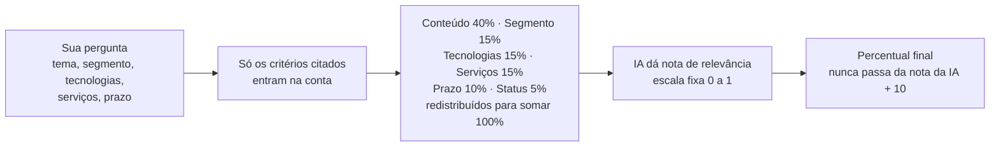

Dica: diga o **segmento** e as **tecnologias** ou use a **Proposta em foco** para mais critérios entrarem na conta. Percentual baixo em tudo = a base ainda não tem boa referência para o tema.

---

## 7. Proposta em foco

Escolha o projeto que você está montando e cada pergunta passa a considerar **cliente, segmento, tecnologias, serviços e prazo** dele.

```
┌──────────────────────────────────────────────┐
│ Escolha a proposta que você está montando…   │
│ 🔍 [ energ                               ]   │
│ 🔍 Sem foco — busca geral em toda a base     │
│ EM ANDAMENTO                                 │
│ ● Energia Litoral Transmissora · P011        │
│ OUTROS PROJETOS                              │
│ ● Energisul Distribuidora · P001             │
└──────────────────────────────────────────────┘
```

1. Clique no **ícone de alvo** na ponta esquerda da caixa de pergunta.
2. Digite parte do cliente, do título ou o código (*"energ"*, *"P011"*).
3. Escolha com o mouse ou com ↑ ↓ e **Enter**. Projetos **Em andamento** (em elaboração, enviada, em negociação) vêm primeiro.
4. O botão mostra **"Foco: Cliente"** (✕ tira) e o chat mostra **"Respondendo com foco em …"**.
5. Pergunte curto: *"algum case parecido?"*, *"que riscos considerar?"*.

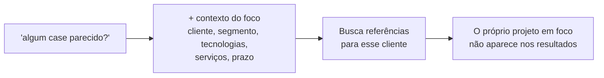

- Com foco, um arquivo anexado pelo clipe **vai direto para esse projeto** (para revisão).
- **Sem foco** ou o ✕ volta à busca geral. O foco fica salvo na conversa.

---

## 8. Ler um arquivo na conversa

Anexe um documento e o Radar **lê, resume e responde sobre ele, sem colocar nada na base**.

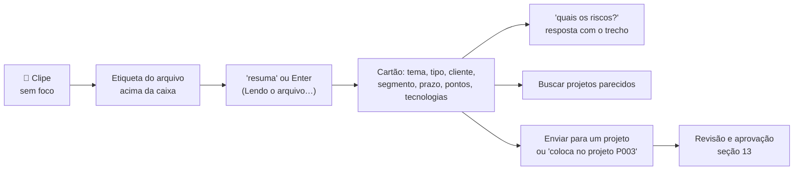

1. Sem proposta em foco, clique no **📎** e escolha o arquivo (o ✕ da etiqueta tira).
2. Escreva *"leia esse arquivo"* ou *"resuma"* (enviar só o arquivo vale como "resuma").
3. Continue: *"qual o prazo?"* (mostra o trecho), **Buscar projetos parecidos**.
4. Para guardar na base: **Enviar para um projeto** ou *"coloca no projeto P003"*. Com o **código**, envia direto; com um **nome** (*"o projeto de energia"*), o Radar mostra opções; nada é enviado antes de você escolher. O gestor também vê **Criar projeto com este arquivo**.

> O arquivo fica **só nesta conversa e só para você**, é apagado com a conversa, e dados pessoais são mascarados antes da leitura pela IA. Formatos: PDF com texto, PPTX, DOCX, XLSX, CSV, TXT, MD, HTML, EML, VTT, SRT, JSON; até **15 MB**; até **5 arquivos por conversa**. Arquivo muito longo: o cartão avisa "arquivo longo: li o início".

---

## 9. Conversas salvas

Toda conversa é **salva automaticamente** na primeira pergunta. A lista fica em caixas: **Favoritas**, **Grupos**, **Arquivadas** (as três abrem e fecham; o Radar lembra) e **Recentes** (sempre visível).

| Quero… | Como |
|---|---|
| Renomear | Lápis ao lado do título no topo do chat → **Enter** salva, **Esc** cancela. Ou menu ⋯ → Renomear. |
| Favoritar | ⭐ da conversa (no computador aparece ao passar o mouse) ou ☆ no topo do chat. |
| Organizar por cliente/proposta | Menu ⋯ → **Mover para grupo** (escolha um ou digite um novo e clique +). Uma favorita num grupo aparece nos dois lugares. |
| Tirar do grupo | Menu ⋯ → **Tirar do grupo** (volta para Recentes). |
| Arquivar / Desarquivar | Menu ⋯ → **Arquivar**; na caixa Arquivadas, menu ⋯ → **Desarquivar**. |
| Apagar | Menu ⋯ → **Excluir** e confirme. Arquivos lidos nela são apagados junto. |
| Encontrar | "Buscar conversas" (com busca, todas as caixas abrem). |
| Continuar | Abra a conversa: memória e foco voltam. |

> Cada conversa é de quem a criou: ao trocar o perfil em "Ver como", a lista mostra só as conversas daquele perfil.

---

## 10. Explorar projetos

```
┌──────────────────────────────────────────────────────────────────────────┐
│ [📁 Projetos | 📄 Documentos]                                            │
│ 🔍 Buscar no conteúdo…  [⚲ Filtros 3]  [⇅ Relevância ▾]                  │
│                         [⬆ Novo a partir de arquivo] [+ Projeto]  ← gestor│
│ Segmento: Varejo ✕   Tecnologia: Databricks ✕   Limpar tudo              │
│ ┌───────────────┐ ┌───────────────┐ ┌───────────────┐                    │
│ │ P003 · Varejo │ │ P004 · Varejo │ │ …             │   20 por página    │
│ │ ● Entregue    │ │ ● Perdida     │ │ ⬆ 2 para aprovar                   │
│ └───────────────┘ └───────────────┘ └───────────────┘                    │
└──────────────────────────────────────────────────────────────────────────┘
```

- **Projetos | Documentos:** troca para a lista de todos os documentos (projeto, tipo, rótulo de confiança, filtro por nome/cliente/tipo). É a mesma de menu ⋮ → Todos os documentos.
- **Busca no conteúdo:** procura dentro do texto dos documentos, sem acento; escolha **todas as palavras** ou **qualquer**.
- **Filtros:** Meus projetos · cliente · prazo (meses) · valor (gestor) · data · "Citado nos documentos" (pessoa, organização, resultado, risco, lição, palavra-chave) · facetas com contagem: segmento, status, tecnologias, serviços, tipo de documento. Em tecnologias e serviços, **todas** exige todas; **qualquer** aceita uma.
- O painel aplica na hora e fecha em **Ver N projetos** (ou **Esc**). Filtros ativos viram **etiquetas** com ✕ e "Limpar tudo". Filtros vindos do chat ou dos Insights aparecem do mesmo jeito.
- **Ordenar:** Relevância, Recentes, Prazo, Valor, A–Z, Documentos.
- O card mostra mês/ano e, se houver, **"N para aprovar"**.
- Nada aparece? **Limpar filtros** ou **Perguntar ao Radar**.

---

## 11. Ficha do projeto

```
┌──────────────────────────────────────────────────────────────────────────────┐
│ P001 · ● Entregue                         [⬇ Exportar] [💬 Perguntar]        │
│ Redução de perdas não técnicas ✎          [❐ Usar como base] ⬆ ✎ 🗑 ✕        │
│ 🏢 Energisul Distribuidora · Utilities / Energia                             │
├──────────┬────────────┬─────────────┬────────────┬────────────┬──────────────┤
│ 🕒 Prazo │ 💰 Valor    │ 👤 Respons. │ 📅 Refer.  │ 📄 Docs    │ ✔ Cadastro   │
│ 6 meses  │ R$… (gest.)│ …           │ …          │ 5          │ 92% ▓▓▓▓▓░   │
├──────────┴────────────┴─────────────┴────────────┴────────────┴──────────────┤
│ ⚠ Prazo diverge entre fontes. Prevalece Proposta: 6 meses. (Estimativa: 5)   │
├───────────────────────────────────────────────┬──────────────────────────────┤
│ Objetivo ✎ · Contexto ✎                       │ Ficha (cliente, segmento,    │
│ ▸ Resultados · ▸ Lições · ▸ Riscos             │ área, status, acesso, origem,│
│ ▸ Documentos (editar ✎ · baixar ⬇)            │ criado por, atualizado,      │
│ ⬆ Enviar arquivo: arraste ou escolha          │ pasta SharePoint)            │
│   Aguardando aprovação: [cartões]             │ ▸ Tecnologias ✎ · Serviços ✎ │
│ 💬 Comentários e histórico                    │ Pessoas · Organizações       │
│   [Escreva um comentário…] [Comentar]         │ ▸ Palavras-chave             │
│   balões + cartões antes → depois (5 por vez) │ ▸ Projetos parecidos         │
│                                               │ Falta no cadastro → Completar│
└───────────────────────────────────────────────┴──────────────────────────────┘
```

| Área | O que tem |
|---|---|
| **Ações no alto** | Exportar · Perguntar (vai ao chat com título e cliente escritos) · Usar como base (gestor) · ⬆ enviar documento · ✎ editar tudo num formulário · 🗑 Excluir (gestor; apaga documentos, comentários e histórico; não pode ser desfeito). |
| **Indicadores** | Prazo, valor e margem (gestor; "restrito" para consultor), responsável, data de referência, nº de documentos, % do cadastro completo (dica mostra o que falta). |
| **Divergência** | "Prazo (ou Valor) diverge entre fontes", com o que prevaleceu e o valor de cada fonte. |
| **Conteúdo** | Objetivo, contexto; resultados, lições e riscos extraídos dos documentos. |
| **Documentos** | Resumo, tipo, status, data, formato, tamanho, palavras-chave, autor, selos (dados pessoais, enviado e revisado por…, bom modelo). Clique no nome para ler; ✎ editar informações; ⬇ baixar original. |
| **Enviar arquivo** | Bloco acima de "Comentários e histórico", com os envios "Aguardando aprovação". |
| **Comentários e histórico** | Comentários em balões e cada alteração (antes → depois), 5 por vez ("Mostrar mais"). |
| **Lateral** | Ficha, tecnologias, serviços, pessoas, organizações, palavras-chave, projetos parecidos, Falta no cadastro. |

**Editar no lugar:** passe o mouse num campo e clique no ✎. **Enter** salva, **Esc** cancela; em textos longos (objetivo, contexto), **Ctrl + Enter** salva. Tecnologias, serviços e cliente vêm de listas: o consultor escolhe entre as opções existentes; só o gestor cria opções e clientes novos. Toda edição entra no histórico.

**Baixar original (consultor):** arquivo de texto sai com preço e margem como "[valor oculto para o seu perfil]"; PDF, Word, PowerPoint ou Excel com valor ou margem cadastrados **não é baixado** ("peça o original ao gestor do projeto").

---

## 12. Cadastrar projeto (gestor)

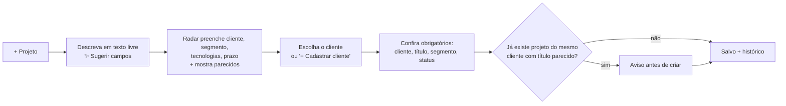

Também é possível criar a partir de um arquivo: **Novo a partir de arquivo** (Projetos) ou **Criar projeto com este arquivo** (conversa). O consultor não cadastra projetos nem clientes: envia documentos para projetos existentes.

---

## 13. Enviar documentos e aprovar

### 13.1 Por onde enviar

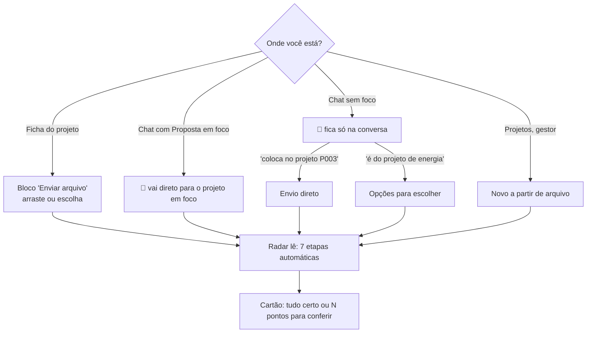

Formatos (nesta ordem na tela): **PDF** (com texto), **PPTX**, **DOCX**, **XLSX**, CSV, TXT, MD, HTML, EML, VTT, SRT, JSON. Até **15 MB** cada, vários de uma vez. Formato não aceito é avisado antes; envio com erro tem **Trocar arquivo** e **Remover da lista**.

### 13.2 O que o Radar faz sozinho

| Etapa | O que acontece |
|---|---|
| Recebido | Tamanho, formato real e impressão digital (SHA-256). |
| Texto | Extrai texto e propriedades (título, autor, data, páginas, slides). |
| Regras | Tipo, cliente, segmento, tecnologias, serviços, prazo, valor, datas, pessoas, riscos, lições, dados pessoais. |
| IA | Complementa pelo significado; o que não estiver no texto é descartado. |
| Projeto | Usa o projeto onde você enviou (ou sugere um, quando é projeto novo). |
| Conflitos | Bloqueia arquivo idêntico; avisa se prazo, valor ou cliente divergem; conteúdo > 90% igual. |
| Qualidade | % de campos preenchidos. |

### 13.3 Conferir e aprovar

```
┌─────────────────────────────────────────────────────┐
│ 📄 proposta-banco-aurora.docx                        │
│ Proposta comercial · ⚠ 2 pontos para conferir        │
│ [Aprovar]  [Descartar]  [Mais detalhes]              │
└─────────────────────────────────────────────────────┘
        │ Mais detalhes
        ▼
┌─ Conferir e aprovar (1 de 3) ───────────────────────┐
│ Tipo · Título · Acesso                               │
│ Vai para: (●) Banco Aurora  ( ) Criar projeto novo   │
│ Atualizar a ficha do projeto: [ ] prazo [ ] data     │
│                               [ ] valor [ ] margem   │
│ Prazo [6 meses] (confira)   alternativas: [5] [8]    │
│ ▸ Mais detalhes: autor, versão, link, por que é      │
│   relevante, ⭐ bom modelo, tecnologias, pessoas,     │
│   resultados, lições, riscos                         │
│                          [Descartar] [Aprovar]       │
└─────────────────────────────────────────────────────┘
```

1. Cada arquivo vira um **cartão** (na ficha, em "Aguardando aprovação", e na conversa): **tudo certo** ou **N pontos para conferir**.
2. **Aprovar** (usa o que o Radar leu), **Descartar** (não grava nada) ou **Mais detalhes** (janela "Conferir e aprovar"; com vários arquivos, "1 de N").
3. Na janela: tipo, título, acesso; **Vai para** (destino, com opção de trocar); **Atualizar a ficha do projeto** (prazo, data e, para o gestor, valor e margem).
4. Campos com **confira** têm baixa confiança: passe o mouse para ver o trecho de origem; botões cinza são **alternativas** de um clique.
5. Em **Mais detalhes**: autor, versão, link, **por que é relevante** (entra na busca), ⭐ **bom modelo para reaproveitar**, tecnologias, serviços, pessoas, resultados, lições e riscos (✕ remove; digite + Enter acrescenta).
6. Vários arquivos sem pontos para conferir: **Aprovar os N prontos**.

> Corrigir é tão valioso quanto aprovar: cada correção é registrada e aparece em Insights › Curadoria. Documento que se declara **confidencial** só é aprovado pelo gestor.

---

## 14. Exportar proposta

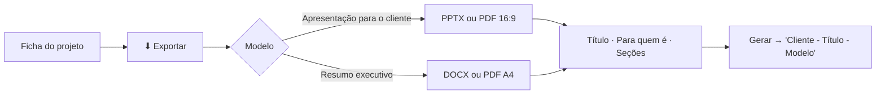

1. Na ficha, **Exportar**.
2. Escolha o modelo e o formato.
3. Ajuste **título** e **para quem é**.
4. Marque as **seções** (Marcar todas / Limpar). Seções sem conteúdo ficam desabilitadas, com o motivo.
5. **Gerar**: o arquivo é baixado.

| Seção | O que entra |
|---|---|
| Capa | Título, cliente, segmento, data |
| Contexto e desafio · Objetivo | Textos do cadastro |
| Solução proposta | Serviços e tecnologias |
| Escopo e prazo | Prazo, status, responsável, área, data |
| Investimento | Valor e margem (só gestor) |
| Resultados · Riscos e mitigação · Lições aprendidas | Extraídos dos documentos (Lições vem desmarcada na apresentação) |
| Cases de referência | Projetos parecidos que você pode ver |
| Fontes | Documentos usados, com rótulo de confiança |

Nada é inventado por IA. PowerPoint e Word saem editáveis. Para o consultor, valores nunca entram e confidenciais não aparecem nem como referência.

---

## 15. Insights: visões e métricas do piloto

### 15.1 Visões

```
┌────────────────────────────────────────────────────────────────────┐
│ [📊 Visões] [⏱ Métricas do piloto]                                 │
│ ┌──────────────┐ ┌──────────────┐ ┌──────────────┐ ┌─────────────┐ │
│ │ Pré-venda    │ │ Negócio      │ │ Técnica      │ │ Pipeline …  │ │
│ │ sugerido p/  │ │ Onde estamos │ │ Sabemos      │ │             │ │
│ │ você         │ │ ganhando?    │ │ entregar?    │ │             │ │
│ └──────────────┘ └──────────────┘ └──────────────┘ └─────────────┘ │
├────────────────────────────────────────────────────────────────────┤
│ Segmento ▾  Prática ▾  Desde ▾          [⧉ Copiar resumo]          │
│ EM RESUMO                                                          │
│ ┌ ✔ Ponto forte ─────┐ ┌ ⚠ Atenção ─────────┐ ┌ ⓘ Para saber ─────┐ │
│ │ 67%                │ │ 2                  │ │ +12%              │ │
│ │ taxa de ganho      │ │ propostas paradas  │ │ acima da estimat. │ │
│ │ ▓▓▓▓░  Ver números→│ │        Ver números→│ │       Ver números→│ │
│ └────────────────────┘ └────────────────────┘ └───────────────────┘ │
│ OS NÚMEROS POR TRÁS  (gráficos · "com base em N" · Ver projetos →) │
└────────────────────────────────────────────────────────────────────┘
```

| Visão | Pergunta | Para quem | O que mostra |
|---|---|---|---|
| Negócio | Onde estamos ganhando e onde crescer? | Diretoria e comercial (sugerida ao gestor) | Carteira, taxa de ganho por segmento, quadrante "ganhamos onde sabemos entregar?", margem (gestor), pacotes mais vendidos, resultados para citar. |
| Técnica | Sabemos entregar o que vendemos? | Liderança técnica | Profundidade segmento × tecnologia, tendências, lições que se repetem, riscos que aconteceram, estimativa × proposta, capacidades esfriando, com quem falar. |
| Pipeline | Que propostas precisam de atenção agora? | Gestão comercial, toda semana | Alertas (parada há 7+ dias, margem fora da faixa, cadastro incompleto, parecida com perdida), funil, por que perdemos; "Copiar aviso". |
| Pré-venda | Estamos prontos para uma nova oportunidade? | Quem monta proposta (sugerida ao consultor) | Prontidão por oportunidade, o que reaproveitar, porte de referência, com quem falar. |
| Curadoria | Dá para confiar nos dados da base? | Quem cuida da base | Documentos revisados, cadastros de teste, termos suspeitos, fichas incompletas, onde a IA mais erra no envio, uso do Radar. |

1. Escolha uma visão (a sugerida vem primeiro, com "sugerido para você"). O Radar lembra a última.
2. **Em resumo**: manchetes com tom (**Ponto forte**, **Atenção**, **Para saber**), número, significado, mini-gráfico e frase.
3. **Ver os números** leva ao gráfico em **Os números por trás**; **Ver projetos** abre Projetos filtrado.
4. Recorte por **Segmento**, **Prática** e **Desde** (Negócio, Técnica, Pipeline). **Copiar resumo** leva as manchetes para e-mail ou Teams.

Como ler: **"com base em N"** = quantos itens entram na conta; **poucos dados** (menos de 3, barra hachurada) = indício; **Calculado da base** = conta sobre cadastros; **IA · confira antes de usar** = extraído sem revisão; **IA · revisado** = conferido por pessoa.

**Cadastros de teste (gestor):** em Curadoria › "Que cadastros são de teste?", **Marcar como teste** tira o projeto dos números sem apagar nada; **Voltar aos números** desfaz.

### 15.2 Métricas do piloto

Aba ao lado de Visões (o item do menu ⋮ abre direto nela):

| Indicador | O que mede |
|---|---|
| Buscas | Perguntas no chat (dica: nº de conversas). |
| Sem resultado | Perguntas sem evidência: lacunas de conteúdo. |
| Úteis entre os 3 primeiros | % de 👍 nos 3 primeiros resultados. |
| Até a 1ª referência útil | Da primeira pergunta ao primeiro 👍. |
| Reaproveitamentos | Abrir projeto, Copiar escopo, Usar como base a partir de uma resposta. |
| Fontes abertas | Documentos de origem abertos (dica: cartões abertos). |
| Tempo de resposta | Média até a resposta. |
| Por que não ajudou | Motivos dos 👎. |
| O que pedem ao chat | Perguntas por tipo de pedido e quantas ficaram sem resposta. |

---

## 16. Permissões: consultor e gestor

Troque o perfil no **botão de conta → Ver como (demonstração)**.

| | Consultor | Gestor |
|---|---|---|
| Documentos e projetos internos | ✔ | ✔ |
| Documentos e projetos confidenciais | — (não aparecem em nenhuma tela) | ✔ |
| Preço e margem das propostas | ocultos em todas as telas e na exportação | ✔ |
| Baixar original | texto com valores ocultos; PDF/Office com valor ou margem não baixa | ✔ |
| Editar campos da ficha e comentar | ✔ | ✔ |
| Enviar documento para projeto existente | ✔ | ✔ |
| Aprovar documento que se declara confidencial | — | ✔ |
| Classificar algo como confidencial | — | ✔ |
| Cadastrar projeto e cliente (inclusive a partir de arquivo) | — | ✔ |
| Excluir projeto | — | ✔ |
| Criar tecnologia, serviço ou segmento novo | escolhe entre os existentes | ✔ |
| Exportar apresentação e resumo | ✔ (sem valores) | ✔ |
| Marcar cadastro como teste | — | ✔ |
| Registro de atividades | — | ✔ |

- O filtro é aplicado **antes** da busca e da IA: o que você não pode ver nunca entra na resposta.
- CPF, RG, e-mail, telefone, cartão, senhas e chaves são trocados por marcadores (ex.: `[e-mail removido]`) antes de gravar ou de ir para a IA.
- O acesso de um documento nunca fica mais aberto que o do projeto.

---

## 17. Menu ⋮, versão, feedback e testes

| Item do menu ⋮ | O que faz |
|---|---|
| Tema | Auto (segue o sistema), Claro ou Escuro. |
| Todos os documentos | Abre Projetos na visão Documentos. |
| Métricas do piloto | Abre Insights na aba Métricas do piloto. |
| Registro de atividades | Só gestor: quem criou, editou, excluiu ou exportou; somente leitura. |
| Como usar o Radar | Este guia, no app. |
| Como o Radar funciona | Explicação técnica, no app. |
| Processo SDLC | Como a versão foi construída. |
| Versão: notas, feedbacks e testes | Notas, Enviar feedback, Tickets, Roteiro de testes, Acompanhamento. |
| Página de status | Abre `/status` numa aba nova (versões, tickets, feedbacks), com link para compartilhar. |
| Política de dados | Regras do piloto para dados. |
| Sair | Só com login ligado; sessão de 7 dias. |

**Versão: notas, feedbacks e testes**

| Seção | Para que serve |
|---|---|
| Notas da versão | O que entrou em cada versão (antes → agora) e os tickets ligados. Itens superados mostram "Na época" e "Hoje". |
| Enviar feedback | Onde, tipo e descrição + até 3 capturas (também Ctrl+V); a IA descreve as imagens. Vira ticket **CR-NNN**. |
| Tickets | Lista ou kanban; filtros Situação, Prioridade, Área, Tipo, Aberto na versão, Aberto por. |
| Roteiro de testes | Cenários passo a passo (116 na V0.0.2), com seletor de versão; marque OK, Falhou ou Bloqueado. Falha abre ticket; OK num reteste valida o ticket. |
| Acompanhamento | Andamento do roteiro e tickets por situação. |

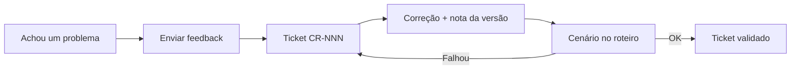

---

## 18. Jornadas completas (roteiros de uso)

### 18.1 Consultor montando uma proposta

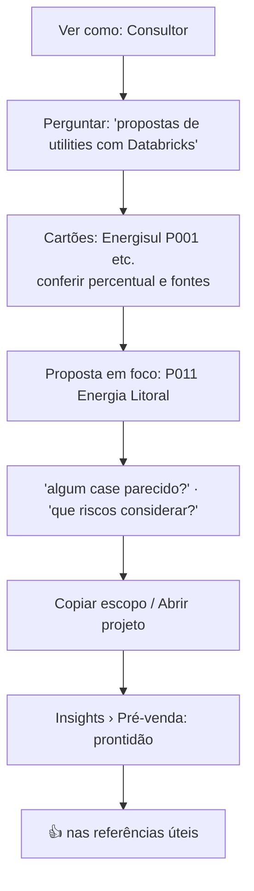

### 18.2 Gestor alimentando a base

1. **Ver como → Gestor**.
2. Projetos → **Novo a partir de arquivo** → `amostras/proposta-banco-aurora-antifraude.docx`.
3. Acompanhe as etapas; repare que o documento é sugerido como **confidencial** e o Radar propõe criar o projeto "Banco Aurora".
4. Confira e **Aprove**. No chat: *"fraude em PIX"* → o projeto aparece.
5. **Ver como → Consultor**: o projeto some de todas as telas.

### 18.3 Envio para cliente existente com conflito

1. Abra a ficha do **P001 (Energisul)** → Enviar arquivo → `amostras/apresentacao-energisul-fase2.pptx`.
2. O Radar aponta o **conflito de prazo** (5 × 6 meses) e diz qual fonte prevalece.

### 18.4 Exploração e reaproveitamento

1. Projetos → Filtros: Databricks + Azure (**todas**), depois **qualquer**.
2. Busque "perdas" e filtre "Citado nos documentos › Pessoa: Marina".
3. **+ Projeto** → descreva em uma frase → **✨ Sugerir campos**.

### 18.5 Fora do domínio

Pergunte *"receita de bolo"*: o Radar diz com educação que isso foge do que ele faz, em vez de inventar.

---

## 19. Dúvidas frequentes

| Situação | O que fazer |
|---|---|
| A resposta trouxe projetos sem relação. | 👎 com o motivo; reformule com segmento/objetivo ou use o foco. |
| "Não encontrei nada relevante na base." | A base não tem o assunto: use as buscas próximas ou envie documentos. |
| O Radar disse que não entendeu. | Escreva o assunto (cliente, segmento, tecnologia, problema) ou use um exemplo mostrado. |
| Mudei de assunto e as respostas ficaram estranhas. | Clique no ✕ de "lembrando N perguntas". |
| Anexei um arquivo e só quero entender o que é. | Escreva "resuma": nada vai para a base sem você pedir. |
| Não acho um projeto em Projetos. | Limpe os filtros. Confidencial não aparece para o consultor. |
| Enviei um PDF e não veio texto. | Provavelmente é imagem escaneada (sem OCR no V0): envie Word ou PDF com texto. |
| "O arquivo já existe." | Um arquivo idêntico já está na base. |
| Aparece "resposta direta da base". | A IA falhou nesta pergunta; repita para ter a análise da IA. |
| Aparece "Modo regras" no topo. | Ambiente sem IA configurada; perguntas em etapas são respondidas por partes. |
| Percentual baixo em todos os resultados. | Falta referência para o tema; cite segmento e tecnologias ou use o foco. |
| Não consigo baixar o original (consultor). | PDF/Office com preço ou margem: peça ao gestor. Texto baixa com valores ocultos. |
| Não vejo "+ Projeto" nem "Novo a partir de arquivo". | Só o gestor cadastra projetos. |
| Não consigo aprovar um documento. | Se ele se declara confidencial, só o gestor aprova. |
| Minhas conversas sumiram. | Confira o perfil em "Ver como"; veja também Arquivadas e Grupos (começam fechadas). |
| Um cadastro de teste distorce os Insights. | O gestor usa "Marcar como teste" em Insights › Curadoria. |
| "poucos dados" num gráfico. | Menos de 3 itens na conta: leia como indício. |
| Encontrei um problema ou tenho uma ideia. | "Enviar feedback" (rodapé das conversas ou menu ⋮ → Versão). |

---

## 20. Atalhos de teclado

| Tecla | Onde | Efeito |
|---|---|---|
| Enter | Caixa de pergunta | Envia (só com texto ou arquivo anexado). |
| Enter / Esc | Título da conversa, renomear na lista | Salva / cancela. |
| ↑ ↓ Enter / Esc | Lista da Proposta em foco | Navega e escolhe / fecha. |
| Enter / Esc | Campo da ficha em edição | Salva / cancela. |
| Ctrl + Enter | Objetivo e contexto em edição | Salva. |
| Enter | Listas de pessoas, resultados, lições e riscos na revisão | Acrescenta o item digitado. |
| Esc | Menu ⋮, botão de conta, painel de filtros | Fecha. |
| Ctrl + V | Enviar feedback | Cola uma captura de tela. |
