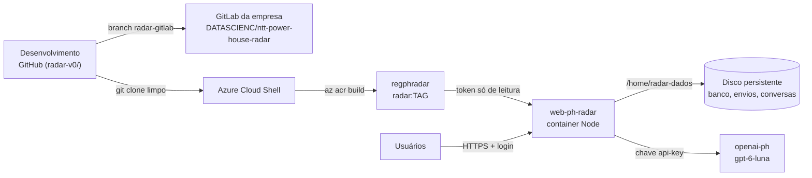

# Deploy do Radar na Azure (container)

Como o Radar foi publicado no **Azure App Service** em 27/11/2026 e como publicar novas versões. Recursos do grupo `rg-ph`, na assinatura Poc Bees Data:

| Recurso | Tipo | Papel no deploy |
|---|---|---|
| `regphradar` | Container Registry (ACR, Standard) | Guarda as imagens do Radar (`radar:<versão>`) |
| `plan-ph-radar` | Plano do App Service (Linux, F1 gratuito) | Máquina onde o app roda |
| `web-ph-radar` | App Service (web app) | O Radar no ar, com HTTPS e login |
| `openai-ph` | Azure OpenAI | IA generativa, implantação `gpt-6-luna` |

Endereço: `https://web-ph-radar-dbdfa4d7c8gehwd0.westus3-01.azurewebsites.net`



## Regras que valem sempre

- **Monte a imagem a partir de um clone limpo**, nunca da pasta de trabalho de alguém: a pasta pode ter `.env`, tokens e arquivos soltos. O `.dockerignore` é uma lista de permissão (só `package.json`, `src`, `public`, `amostras` e a massa piloto de `data/`), mas o clone limpo é a primeira barreira.
- **Segredos não aparecem na tela.** Os comandos guardam chaves e senhas em variáveis, usam `-o none` e, quando a Azure insiste em imprimir um aviso com a senha, `2>/dev/null`. Se um segredo aparecer na tela ou num chat, gere outro (veja o passo 3).
- **Uma instância só.** O SQLite e os arquivos JSON supõem um único container. Não aumente o número de instâncias.

## 0. Onde rodar os comandos

No **Azure Cloud Shell**: no portal, clique no ícone `>_` da barra do topo e escolha **Bash**. Se ele perguntar sobre armazenamento, escolha **"Não é necessária uma conta de armazenamento"**. A sessão é temporária, e o código vem do GitHub a cada vez. O Cloud Shell já tem `az`, `git` e `openssl`, e você entra logado.

Toda sessão nova começa pelas variáveis:

```bash
RG=rg-ph; APP=web-ph-radar; PLANO=plan-ph-radar; ACR=regphradar; AOAI=openai-ph
```

## 1. Conferir acessos

```bash
az account show --query name -o tsv                 # Poc Bees Data 1855163
az appservice plan show -g $RG -n $PLANO --query "{tipo:kind, sku:sku.tier}" -o json      # linux
az acr show -n $ACR --query "{servidor:loginServer, sku:sku.name}" -o json
az cognitiveservices account show -g $RG -n $AOAI --query "{endpoint:properties.endpoint, semChave:properties.disableLocalAuth}" -o json
az cognitiveservices account deployment list -g $RG -n $AOAI --query "[].{implantacao:name, modelo:properties.model.name}" -o table
```

`semChave: null` (ou `false`) significa que o recurso aceita chave.

## 2. Montar a imagem

```bash
cd ~
git clone -b radar-gitlab https://github.com/ivanltds/ntt-power-house.git radar
cd radar
TAG=$(git rev-parse --short HEAD)
az acr build -r $ACR -t radar:$TAG -t radar:latest .
```

O fim esperado é `Run ID: ... was successful`. A branch `radar-gitlab` tem o mesmo conteúdo da `main` do GitLab (veja a seção 7).

## 3. Ligar o web app à imagem (primeira vez)

A conta usada no deploy não pode atribuir papéis (`roleAssignments/write`). Por isso o web app não usa a identidade gerenciada para baixar a imagem. Ele usa um **token do registro só de leitura e só do repositório `radar`**, o acesso mínimo.

```bash
ACR_PASS=$(az acr token create -n radar-pull -r $ACR --repository radar content/read metadata/read --query "credentials.passwords[0].value" -o tsv 2>/dev/null)
[ -n "$ACR_PASS" ] && echo "TOKEN OK"
az webapp config container set -g $RG -n $APP \
  --container-image-name $ACR.azurecr.io/radar:$TAG \
  --container-registry-url https://$ACR.azurecr.io \
  --container-registry-user radar-pull \
  --container-registry-password "$ACR_PASS" -o none && echo "CONTAINER OK"
```

Para **trocar a senha do token**, por exemplo se ela vazar, gere uma nova e repita o `container set` acima:

```bash
ACR_PASS=$(az acr token credential generate -n radar-pull -r $ACR --password1 --query "passwords[0].value" -o tsv 2>/dev/null)
[ -n "$ACR_PASS" ] && echo "SENHA NOVA OK"
```

A senha antiga deixa de valer na hora. Se aparecer só `CONTAINER OK`, sem `SENHA NOVA OK`, pare: a variável ficou vazia.

Quando alguém com permissão de atribuir papéis puder ajudar, dá para trocar o token pela identidade gerenciada, que já foi criada no web app. É preciso dar o papel `AcrPull` no registro e ligar `acrUseManagedIdentityCreds`.

## 4. Configuração do Radar (primeira vez)

O usuário e a senha do Radar são digitados na hora; a senha não aparece na tela. A chave do OpenAI é lida direto da Azure.

```bash
read -p "Usuário do Radar: " RUSER
read -s -p "Senha do Radar: " RPASS; echo
AOAI_KEY=$(az cognitiveservices account keys list -g $RG -n $AOAI --query key1 -o tsv 2>/dev/null)
[ -n "$AOAI_KEY" ] && echo "CHAVE OPENAI OK"
az webapp config appsettings set -g $RG -n $APP -o none --settings \
  WEBSITES_PORT=8080 \
  WEBSITES_ENABLE_APP_SERVICE_STORAGE=true \
  WEBSITES_CONTAINER_START_TIME_LIMIT=600 \
  RADAR_DATA_DIR=/home/radar-dados \
  RADAR_SQLITE_JOURNAL=DELETE \
  RADAR_LOGIN_USER="$RUSER" RADAR_LOGIN_PASS="$RPASS" \
  RADAR_LOGIN_SECRET=$(openssl rand -hex 32) \
  RADAR_RELATORIO_TOKEN=$(openssl rand -hex 24) \
  LLM_PROVIDER=azure \
  AZURE_OPENAI_ENDPOINT=https://openai-ph.openai.azure.com/ \
  AZURE_OPENAI_DEPLOYMENT=gpt-6-luna \
  AZURE_OPENAI_API_KEY="$AOAI_KEY" && echo "CONFIG OK"

az webapp update -g $RG -n $APP --https-only true -o none
az webapp log config -g $RG -n $APP --docker-container-logging filesystem -o none
az webapp restart -g $RG -n $APP
```

| Variável | Por quê |
|---|---|
| `WEBSITES_PORT=8080` | Porta em que o container escuta |
| `WEBSITES_ENABLE_APP_SERVICE_STORAGE=true` | Liga o `/home` persistente: os dados sobrevivem a reinícios e a novas versões |
| `RADAR_DATA_DIR=/home/radar-dados` | Grava banco, índice, envios, conversas e auditoria no disco persistente |
| `RADAR_SQLITE_JOURNAL=DELETE` | O `/home` é disco de rede, onde o modo WAL do SQLite não funciona |
| `WEBSITES_CONTAINER_START_TIME_LIMIT=600` | Folga para a primeira subida, que monta a base (cerca de 30 s) |
| `RADAR_LOGIN_SECRET` | Fixa a assinatura do login: reiniciar o app não derruba as sessões |
| `RADAR_RELATORIO_TOKEN` | Chave do endpoint `/api/relatorio/qualidade` para agentes |
| `AZURE_OPENAI_*` | Endpoint, implantação e chave. Se o modelo for de raciocínio, o Radar ajusta os parâmetros sozinho |

Para trocar só a senha do Radar, rode o `read -s` e depois `az webapp config appsettings set -g $RG -n $APP -o none --settings RADAR_LOGIN_PASS="$RPASS"`.

Para ler a chave do relatório para agentes:

```bash
az webapp config appsettings list -g $RG -n $APP --query "[?name=='RADAR_RELATORIO_TOKEN'].value" -o tsv
```

## 5. Conferir

```bash
az webapp log tail -g $RG -n $APP      # Ctrl+C para sair. Se cair ("Log stream interrupted"), rode de novo
```

No plano gratuito, o container só sobe quando alguém acessa. Abra o endereço do Radar numa aba (pode levar de 1 a 3 minutos) e acompanhe o log. Devem aparecer:
- `Base preparada: 511 projetos, …`, só na primeira subida;
- `Radar V0 em http://localhost:8080`;
- `Login: ativo`;
- `IA: Azure OpenAI (gpt-6-luna)`.

No app:
1. Entre com o usuário e a senha.
2. Pergunte "churn em telecom com Kafka". A resposta deve trazer um texto comparando as referências, e a linha de informações deve dizer **"IA: Azure OpenAI"**.
3. A página `/status` abre com o roteiro da versão.

Se o topo mostrar **"Modo regras"**, confira as variáveis `AZURE_OPENAI_*`. Se uma resposta disser **"IA: regras do Radar"**, a chamada à IA falhou naquela pergunta.

## 6. Publicar uma nova versão

```bash
RG=rg-ph; APP=web-ph-radar; ACR=regphradar
cd ~ && rm -rf radar
git clone -b radar-gitlab https://github.com/ivanltds/ntt-power-house.git radar && cd radar
TAG=$(git rev-parse --short HEAD)
az acr build -r $ACR -t radar:$TAG -t radar:latest .
az webapp config container set -g $RG -n $APP --container-image-name $ACR.azurecr.io/radar:$TAG -o none && echo "CONTAINER OK"
az webapp restart -g $RG -n $APP
```

O `rm -rf radar` apaga só a cópia temporária do Cloud Shell. Os dados em `/home/radar-dados` são mantidos.

Para **voltar a uma versão anterior**, rode o `container set` com a TAG antiga. Para ver as tags:

```bash
az acr repository show-tags -n $ACR --repository radar -o table
```

## 7. Código no GitLab da empresa

O repositório oficial é o GitLab `DATASCIENC/ntt-power-house-radar`, com o conteúdo de `radar-v0` na raiz e todo o histórico dele. O desenvolvimento acontece no GitHub (pasta `radar-v0/`). A cada versão:

1. **No GitHub:** `git subtree split --prefix=radar-v0 -b radar-gitlab` e `git push origin radar-gitlab`.
2. **Na máquina da empresa**, no clone que tem o remoto `gitlab`:

```powershell
git fetch origin
git checkout radar-gitlab
git merge origin/radar-gitlab
git push gitlab radar-gitlab:main
```

Antes do push, `git ls-tree --name-only HEAD` deve listar só os arquivos do Radar. Arquivos soltos na pasta, como tokens e planilhas, não entram, porque o push só leva o que está nos commits. Mesmo assim, não deixe segredos dentro da pasta do projeto.

## Observações

- **Plano gratuito (F1).** O app "dorme" depois de uns 20 minutos sem uso e demora para acordar no primeiro acesso. Não há Always On, então a coleta de sinais da madrugada não roda. Há uma cota diária de processador, e o disco tem 1 GB (os dados ocupam cerca de 40 MB).
- **Dados.** A Azure começou com a massa piloto. Os dados do ambiente antigo da AWS não foram migrados.
- **Regiões.** O web app está em West US 3 e o OpenAI em East US. Funciona, com alguns milissegundos a mais por chamada.
- **Rodar localmente com a Azure OpenAI:** no `.env`, preencha `AZURE_OPENAI_ENDPOINT`, `AZURE_OPENAI_DEPLOYMENT` e `AZURE_OPENAI_API_KEY` (ver `.env.example`).
