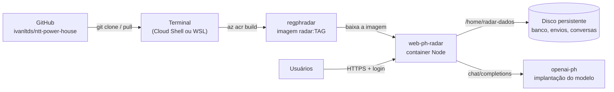

# Deploy do Radar na Azure (container)

Passo a passo para publicar o Radar no **Azure App Service** como container, usando os recursos do grupo `rg-ph` na assinatura Poc Bees Data:

| Recurso | Tipo | Papel no deploy |
|---|---|---|
| `regphradar` | Container Registry (ACR) | Guarda a imagem do Radar |
| `plan-ph-radar` | Plano do App Service | Máquina onde o app roda (precisa ser Linux) |
| `web-ph-radar` | App Service (web app) | O Radar no ar, com HTTPS |
| `openai-ph` | Azure OpenAI | IA generativa (substitui a DeepSeek) |



A imagem é montada **dentro da Azure** (`az acr build`). Ninguém precisa de Docker na máquina.

## 0. Onde rodar os comandos

Os comandos abaixo são de **bash** e precisam da **Azure CLI** (`az`). Há dois caminhos:

**A. Azure Cloud Shell (recomendado: não instala nada).**
1. No portal da Azure, clique no ícone `>_` da barra do topo.
2. Escolha **Bash**.
3. Se perguntar sobre armazenamento, escolha **"Não é necessária uma conta de armazenamento"**. A sessão fica temporária, o que basta, porque o código vem do GitHub a cada vez.

O Cloud Shell já vem com `az`, `git` e você logado. Se a política da empresa bloquear o Cloud Shell, use o caminho B.

**B. WSL na máquina.** WSL (Windows Subsystem for Linux) é um Linux (Ubuntu) que roda dentro do Windows, com um terminal próprio.
1. No PowerShell **como administrador**, rode `wsl --install` e reinicie a máquina.
2. Abra o **Ubuntu** pelo menu Iniciar e crie um usuário e uma senha do Linux.
3. Instale as ferramentas:

```bash
sudo apt update && sudo apt install -y git
curl -sL https://aka.ms/InstallAzureCLIDeb | sudo bash
az login --use-device-code
```

## 1. Variáveis e testes de acesso

```bash
RG=rg-ph; APP=web-ph-radar; PLANO=plan-ph-radar; ACR=regphradar; AOAI=openai-ph

az account list -o table
az account set --subscription "<nome ou id da assinatura Poc Bees Data>"
az resource list -g $RG -o table

# O plano precisa ser Linux (linux: true) e de nível Basic ou acima (para o Always On)
az appservice plan show -g $RG -n $PLANO --query "{sku:sku.name, linux:reserved}" -o json
az webapp show -g $RG -n $APP --query "{estado:state, url:defaultHostName}" -o json
az acr show -n $ACR --query "{servidor:loginServer, sku:sku.name}" -o json

# Azure OpenAI: endpoint, se aceita chave (semChave=false) e o nome da implantação do modelo
az cognitiveservices account show -g $RG -n $AOAI --query "{endpoint:properties.endpoint, semChave:properties.disableLocalAuth}" -o json
az cognitiveservices account deployment list -g $RG -n $AOAI --query "[].{implantacao:name, modelo:properties.model.name, versao:properties.model.version}" -o table
```

Anote o **endpoint** e o **nome da implantação**. No `AZURE_OPENAI_DEPLOYMENT` vai o nome da implantação, que pode ser diferente do nome do modelo.

## 2. Código e imagem

```bash
git clone https://github.com/ivanltds/ntt-power-house.git   # na primeira vez
cd ntt-power-house && git checkout main && git pull
cd radar-v0

TAG=$(git rev-parse --short HEAD)
az acr build -r $ACR -t radar:$TAG -t radar:latest .
```

Se `az acr build` for recusado (ACR Tasks desligado na assinatura), monte a imagem com Docker no WSL e envie com `az acr login -n $ACR && docker push`.

## 3. Ligar o web app à imagem

O web app baixa a imagem com a própria identidade gerenciada, sem senha:

```bash
az webapp identity assign -g $RG -n $APP -o none
PRINC=$(az webapp identity show -g $RG -n $APP --query principalId -o tsv)
az role assignment create --assignee-object-id $PRINC --assignee-principal-type ServicePrincipal \
  --role AcrPull --scope $(az acr show -n $ACR --query id -o tsv) -o none
az webapp config set -g $RG -n $APP --generic-configurations '{"acrUseManagedIdentityCreds": true}' -o none

az webapp config container set -g $RG -n $APP \
  --container-image-name $ACR.azurecr.io/radar:$TAG \
  --container-registry-url https://$ACR.azurecr.io -o none
```

Se `az role assignment create` falhar por falta de permissão (exige Owner ou User Access Administrator), há duas saídas:
- peça a atribuição a quem administra a assinatura;
- como alternativa de piloto, use o usuário administrador do registro:

```bash
az acr update -n $ACR --admin-enabled true -o none
az webapp config container set -g $RG -n $APP \
  --container-image-name $ACR.azurecr.io/radar:$TAG --container-registry-url https://$ACR.azurecr.io \
  --container-registry-user $ACR \
  --container-registry-password "$(az acr credential show -n $ACR --query 'passwords[0].value' -o tsv)" -o none
```

## 4. Configuração do Radar (variáveis do app)

A senha do Radar é digitada sem aparecer na tela. Os segredos ficam só nas configurações do web app e nunca entram na imagem. Todos os comandos usam `-o none` para não imprimir valores.

```bash
read -p "Usuário do Radar: " RUSER
read -s -p "Senha do Radar: " RPASS; echo
AOAI_ENDPOINT=$(az cognitiveservices account show -g $RG -n $AOAI --query properties.endpoint -o tsv)
read -p "Nome da implantação do modelo (passo 1): " AOAI_DEPLOY

az webapp config appsettings set -g $RG -n $APP -o none --settings \
  WEBSITES_PORT=8080 \
  WEBSITES_ENABLE_APP_SERVICE_STORAGE=true \
  WEBSITES_CONTAINER_START_TIME_LIMIT=600 \
  RADAR_DATA_DIR=/home/radar-dados \
  RADAR_SQLITE_JOURNAL=DELETE \
  RADAR_LOGIN_USER="$RUSER" RADAR_LOGIN_PASS="$RPASS" \
  RADAR_LOGIN_SECRET=$(openssl rand -hex 32) \
  RADAR_RELATORIO_TOKEN=$(openssl rand -hex 24) \
  LLM_PROVIDER=azure \
  AZURE_OPENAI_ENDPOINT="$AOAI_ENDPOINT" \
  AZURE_OPENAI_DEPLOYMENT="$AOAI_DEPLOY"
```

Para o acesso à IA, use **uma** das duas formas:

```bash
# (a) Chave do recurso, se semChave=false no passo 1
az webapp config appsettings set -g $RG -n $APP -o none --settings \
  AZURE_OPENAI_API_KEY="$(az cognitiveservices account keys list -g $RG -n $AOAI --query key1 -o tsv)"

# (b) Identidade gerenciada, obrigatória se semChave=true (também exige permissão para atribuir papéis)
az role assignment create --assignee-object-id $PRINC --assignee-principal-type ServicePrincipal \
  --role "Cognitive Services OpenAI User" --scope $(az cognitiveservices account show -g $RG -n $AOAI --query id -o tsv) -o none
```

O que cada variável faz:

| Variável | Por quê |
|---|---|
| `WEBSITES_PORT=8080` | Porta em que o container escuta |
| `WEBSITES_ENABLE_APP_SERVICE_STORAGE=true` | Liga o `/home` persistente: os dados sobrevivem a reinícios e novas versões |
| `RADAR_DATA_DIR=/home/radar-dados` | Grava banco, índice, envios, conversas e auditoria no disco persistente |
| `RADAR_SQLITE_JOURNAL=DELETE` | O `/home` é disco de rede, onde o modo WAL do SQLite não funciona |
| `WEBSITES_CONTAINER_START_TIME_LIMIT=600` | A primeira subida monta a base (cerca de 1 a 2 minutos no disco de rede) |
| `RADAR_LOGIN_SECRET` | Fixa a assinatura do login: reiniciar o app não derruba as sessões |
| `RADAR_RELATORIO_TOKEN` | Chave do endpoint `/api/relatorio/qualidade` para agentes |
| `AZURE_OPENAI_*` | Endpoint e implantação do modelo. Se ele for de raciocínio, o Radar ajusta os parâmetros sozinho |

Por fim, deixe o app sempre ligado (a coleta de sinais roda de madrugada) e só com HTTPS:

```bash
az webapp config set -g $RG -n $APP --always-on true -o none
az webapp update -g $RG -n $APP --https-only true -o none
az webapp log config -g $RG -n $APP --docker-container-logging filesystem -o none
az webapp restart -g $RG -n $APP
```

## 5. Conferir

```bash
az webapp log tail -g $RG -n $APP      # Ctrl+C para sair
```

No log devem aparecer, nesta ordem:
- `Base preparada: … projetos` (só na primeira subida);
- `Radar V0 em http://localhost:8080`;
- `Login: ativo`;
- `IA: Azure OpenAI (<implantação>)`.

Depois, abra `https://<url do passo 1>` e confira:
1. A tela de login aparece e entra com o usuário e a senha do passo 4.
2. Faça uma pergunta no chat. A linha de informações da resposta deve dizer **"IA: Azure OpenAI"**.
3. Envie um arquivo. A revisão deve mostrar **"Lido com IA"**.
4. A página `/status` abre com o roteiro da versão.

Se o topo mostrar **"Modo regras"**, a IA não foi configurada: confira as variáveis `AZURE_OPENAI_*` e o acesso (chave ou papel). Se a IA falhar numa chamada, a resposta mostra **"IA: regras do Radar"** e o motivo vai para o log.

Para ler a chave do relatório para agentes:

```bash
az webapp config appsettings list -g $RG -n $APP --query "[?name=='RADAR_RELATORIO_TOKEN'].value" -o tsv
```

## 6. Publicar uma nova versão

```bash
cd ntt-power-house && git pull && cd radar-v0
TAG=$(git rev-parse --short HEAD)
az acr build -r $ACR -t radar:$TAG -t radar:latest .
az webapp config container set -g $RG -n $APP --container-image-name $ACR.azurecr.io/radar:$TAG -o none
```

Os dados em `/home/radar-dados` são mantidos. Para voltar a uma versão anterior, use o mesmo último comando com a TAG antiga. As tags ficam listadas em `az acr repository show-tags -n $ACR --repository radar -o table`.

## Observações

- **Dados da AWS.** Resultados de teste, tickets, envios e conversas do ambiente da AWS não vão automaticamente para a Azure: a Azure começa com a massa piloto. Se precisar migrar, copie a pasta de dados da AWS para `/home/radar-dados` (pelo Kudu: `https://<app>.scm.azurewebsites.net`) com o app parado.
- **Uma instância só.** O SQLite e os arquivos JSON supõem um único container. Não aumente o número de instâncias do plano.
- **Regiões.** O web app está em West US 3 e o OpenAI em East US. Funciona, com alguns milissegundos a mais por chamada.
- **Rodar localmente com a Azure OpenAI:** no `.env`, preencha `AZURE_OPENAI_ENDPOINT`, `AZURE_OPENAI_DEPLOYMENT` e `AZURE_OPENAI_API_KEY` (ver `.env.example`).
