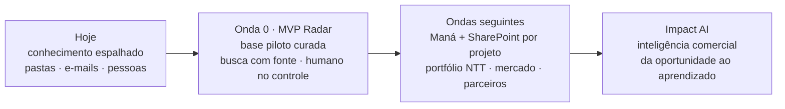
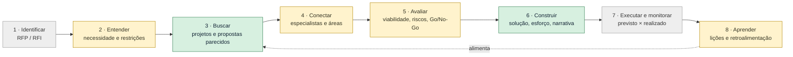
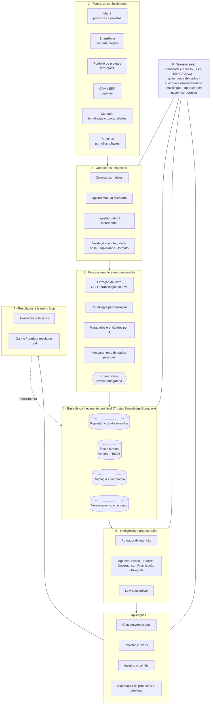
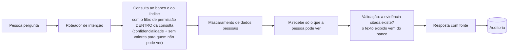
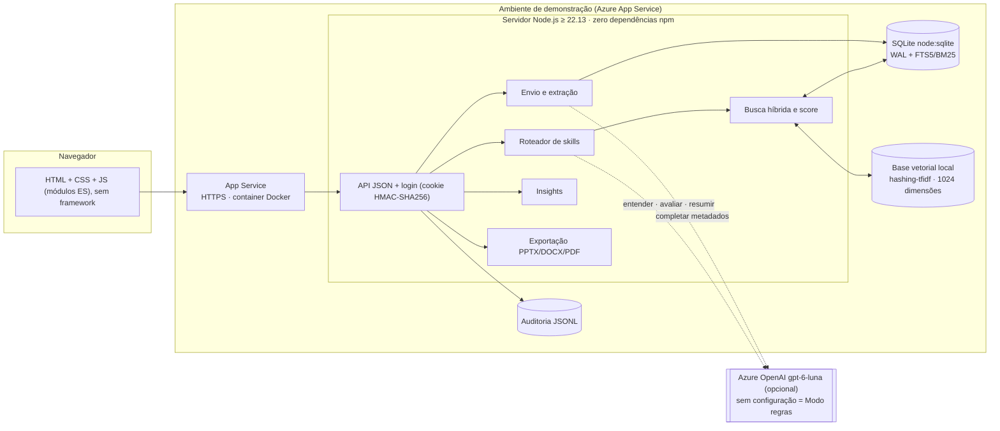
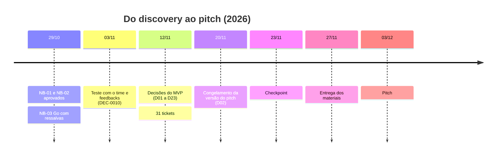
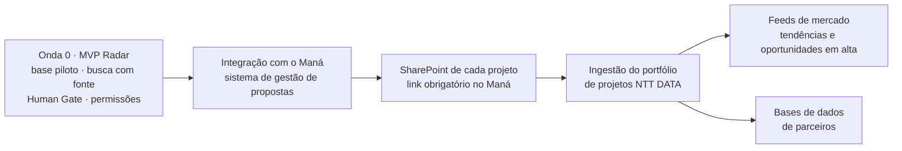
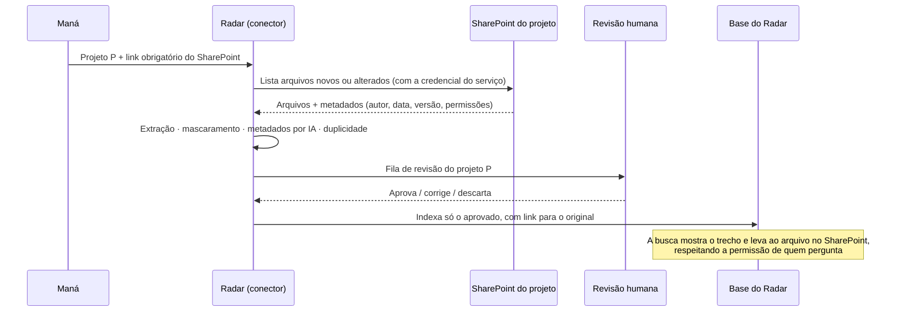
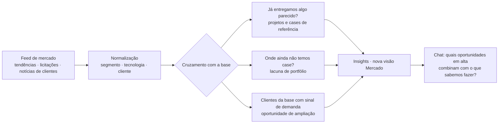

# Impact AI · Radar de Propostas & Cases — Documentação do Projeto

*NTT DATA · Ideias em Ação: Pessoas, Tecnologia e Impacto*

| | |
|---|---|
| **Documento** | Documentação executiva e técnica do projeto e do MVP |
| **Iniciativa** | Impact AI · Inteligência Comercial |
| **Produto do MVP** | Radar de Propostas & Cases (`radar-v0`, versão **V0.0.2**) |
| **Data** | 17/11/2026 |
| **Product Owner** | Ivan Lucio Teles de Souza |
| **Situação** | MVP 0 (POC) publicado para testes do time. Gate NB-03 (viabilidade) aguardando o comitê. |

> **Impact AI e Radar.** *Impact AI* é a iniciativa: a plataforma-alvo de inteligência comercial descrita nas seções 2 a 6. O *Radar de Propostas & Cases* é o MVP dessa iniciativa (Onda 0), a primeira peça construída e testada. Quando este documento diz "o Radar", fala do que **já existe e roda**. Quando diz "a plataforma" ou "o Impact AI", fala do **destino**.

Documentos irmãos, na mesma pasta:

- [Como usar o Radar](COMO-USAR-O-RADAR.md): passo a passo de cada tela.
- [Como funciona o Radar](COMO-FUNCIONA-O-RADAR.md): arquitetura, busca, cálculo de semelhança, envio, permissões e segurança, com referência ao código.

---

## Sumário

1. [Sumário executivo](#1-sumário-executivo)
2. [Propósito: missão, visão, objetivos e princípios](#2-propósito-missão-visão-objetivos-e-princípios)
3. [O problema e o diagnóstico](#3-o-problema-e-o-diagnóstico)
4. [A proposta](#4-a-proposta)
5. [Arquitetura-alvo da plataforma](#5-arquitetura-alvo-da-plataforma)
6. [Governança por design](#6-governança-por-design)
7. [O MVP: Radar de Propostas & Cases (Onda 0)](#7-o-mvp-radar-de-propostas--cases-onda-0)
8. [Como o projeto é implementado](#8-como-o-projeto-é-implementado)
9. [Roadmap futuro](#9-roadmap-futuro)
10. [Riscos, dependências e mitigações](#10-riscos-dependências-e-mitigações)
11. [Como medimos o sucesso](#11-como-medimos-o-sucesso)
12. [O que é visão e o que já está no MVP](#12-o-que-é-visão-e-o-que-já-está-no-mvp)
13. [Glossário](#13-glossário)
14. [Referências](#14-referências)

---

## 1. Sumário executivo

Na NTT DATA, o conhecimento produzido em propostas e projetos está espalhado em pastas, e-mails, SharePoints de cada iniciativa e na memória de quem participou. Para responder a uma RFP com prazo curto, o time depende de saber **a quem perguntar**. Projetos parecidos, arquiteturas que já funcionaram e lições de propostas perdidas ficam fora do alcance de quem mais precisa delas.

O **Impact AI** propõe uma plataforma que conecta esse acervo: propostas, cases, execuções reais, pessoas, mercado e parceiros. A IA generativa responde perguntas em linguagem natural **sempre com a fonte**, dentro de uma fronteira de conhecimento confiável e respeitando a confidencialidade de cada documento.

O **Radar de Propostas & Cases** é o MVP (Onda 0). Ele valida a hipótese central com uma base piloto simulada: **11 projetos e 51 documentos** de 11 clientes simulados. O que ele já faz:

- Responde "já fizemos algo assim?" com até 5 projetos parecidos. Cada um vem com percentual de semelhança explicado, trechos literais e documento de origem.
- Lista, conta, compara e mostra a ficha de projetos, sempre a partir do banco, nunca do texto livre da IA.
- Recebe documentos em 12 tipos de arquivo, extrai metadados com IA e só os coloca na base depois de revisão humana.
- Aplica as permissões dentro de cada consulta. O consultor não vê projetos confidenciais nem preço e margem.
- Mascara dados pessoais antes de gravar e antes de enviar texto à IA.
- Exporta a proposta em PPTX, DOCX ou PDF e mostra cinco visões de Insights (Negócio, Técnica, Pipeline, Pré-venda e Curadoria).
- Funciona **sem IA** ("Modo regras") quando a chave não está configurada ou quando a IA falha.
- Tem 96 testes automatizados e um ambiente de demonstração publicado no Azure App Service (container), com login e IA no Azure OpenAI.

**Próximos passos:** o roadmap (seção 9) leva o MVP às fontes reais da NTT DATA:

- integração com o **Maná** (sistema de gestão de propostas);
- leitura do **SharePoint de cada projeto**, a partir do link que o Maná torna obrigatório;
- **ingestão do portfólio de projetos da NTT DATA**;
- **feeds de tendências de mercado e oportunidades em alta** para prospecção;
- **bases de dados de parceiros**.

---

## 2. Propósito: missão, visão, objetivos e princípios

### 2.1 Missão

**Colocar o conhecimento coletivo da NTT DATA ao alcance de quem está montando uma proposta, no momento em que precisa e com a fonte à vista,** para que cada nova oportunidade comece do que a empresa já sabe, e não do zero.

### 2.2 Visão

Ser a **memória comercial e técnica da NTT DATA**: um único lugar onde propostas, entregas, pessoas, mercado e parceiros se conectam. A equipe consulta esse lugar como consultaria um colega experiente. A diferença é que cada resposta mostra de onde veio.

### 2.3 Objetivos de negócio

| # | Objetivo | Como o MVP comprova |
|---|---|---|
| O1 | Reduzir o tempo para encontrar uma proposta ou um case de referência | Indicador "Até a 1ª referência útil" (tempo da primeira pergunta ao primeiro 👍) |
| O2 | Aumentar o reaproveitamento do conhecimento já produzido | Indicador "Reaproveitamentos" (Abrir projeto, Copiar escopo, Usar como base) |
| O3 | Explicar por que uma referência é relevante, com fonte rastreável | Percentual de semelhança dividido por critério, trecho literal e documento de origem em cada cartão |
| O4 | Sugerir áreas e serviços complementares de escopo, como possibilidade e nunca como decisão | "Também costumam entrar" nas respostas e visão Pré-venda dos Insights |
| O5 | Validar a hipótese barato, antes de investir em integrações completas | Base piloto simulada, zero dependências, custo incremental baixo (NB-03) |
| O6 | Diminuir a dependência de poucas pessoas que concentram a memória histórica | Responsável e documentos de cada projeto acessíveis pelo chat e pela ficha |

### 2.4 Hipótese

> Se disponibilizarmos uma base confiável de propostas históricas e cases, com metadados mínimos, busca semântica e consulta em linguagem natural com fontes rastreáveis, os times reduzirão o tempo para encontrar referências e aumentarão o reaproveitamento de conhecimento em novas oportunidades.
>
> — NB-01, aprovado em 29/10/2026

### 2.5 Princípios de desenho

| Princípio | O que significa na prática |
|---|---|
| **Nunca inventar** (*no-evidence response*) | A IA só recebe trechos que a pessoa pode ver, cita a evidência por identificador e o texto exibido vem do banco. Sem evidência, o Radar responde que não encontrou e sugere buscas próximas. Números, listas e fichas saem sempre de consultas ao banco. |
| **Sempre mostrar a fonte** | Cada resultado traz os documentos de origem e o nível de confiança de cada um. As respostas de ajuda citam a seção do guia. |
| **Humano no controle** (*Human Gate*) | Nenhum documento entra na base sem revisão humana. Cada correção da leitura automática fica registrada. |
| **Governança desde o desenho** (*Governance by Design*) | A permissão é aplicada dentro da consulta, antes do ranqueamento, e não depois, na tela. Dados pessoais são mascarados antes de gravar. |
| **IA substituível e opcional** | A camada de IA é desacoplada do provedor. Sem IA, o produto continua funcionando por regras. |
| **Começar pequeno e medir** | O MVP é um piloto com base controlada e métricas da hipótese embutidas no produto. Cada onda seguinte só começa com evidência da anterior. |

---

## 3. O problema e o diagnóstico

### 3.1 O que o discovery encontrou

O diagnóstico vem de entrevistas com diretores, *Delivery Partners* e lideranças comerciais, e dos testes do MVP com o time.

| Sintoma | Consequência |
|---|---|
| **Não existe repositório único.** Propostas enviadas ficam em pastas isoladas, e-mails e iniciativas de cada área. | Busca manual e lenta; documentos repetidos ou desatualizados. |
| **A rede de contatos é tácita.** Achar especialista, case ou arquitetura validada depende do *networking* e da senioridade de cada pessoa. | Quem é novo ou está em outra área não acha. O conhecimento fica com poucas pessoas. |
| **Os prazos são críticos.** RFPs e RFIs são respondidas sob pressão. | Não dá tempo de explorar o acervo, e a proposta começa do zero. |
| **O aprendizado não volta para a proposta.** Desvio de escopo, margem praticada e lições aprendidas não chegam às propostas seguintes. | O mesmo erro se repete; a precificação e o escopo ficam inconsistentes. |

O problema **não é genérico**. O que falta é uma busca por **significado** (não só por nome de arquivo), sobre uma base **curada**, com **fontes rastreáveis** e **respeito à confidencialidade**.

### 3.2 As quatro lentes executivas

| Lente | Pergunta que a plataforma precisa responder |
|---|---|
| **Data / Financial Services** | Como transformar o acervo histórico em inteligência reutilizável para decisões comerciais? |
| **Comercial / Banking** | Como mobilizar rápido as áreas certas, proteger a proposta de riscos e apresentar uma "NTT DATA única"? |
| **DX / Experience** | A solução é útil, clara e integra as disciplinas? |
| **Production / Delivery** | Dá para antecipar, já na pré-venda, o risco que vai aparecer na entrega? |

### 3.3 Para quem

| Perfil | Momento de uso | Pergunta-guia |
|---|---|---|
| Comercial e pré-vendas | Ao receber uma oportunidade ou RFP | "Já fizemos algo assim? O que reaproveitar? Que erro não repetir?" |
| Consultoria | Ao desenhar a solução | "Que arquitetura e que serviços entraram em projetos parecidos?" |
| Dono da proposta | Ao terminar uma entrega ou proposta | "Como coloco este material na base com qualidade?" |
| Gestor comercial | Na revisão semanal do pipeline | "O que está parado, fora do padrão ou em risco?" |
| Executivo / diretoria | Antes de reunião com cliente e em revisões de portfólio | "Onde ganhamos, onde crescer, que case posso citar?" |
| Curador da base | Na rotina de manutenção | "O que está sujo, faltando ou esperando revisão?" |

---

## 4. A proposta

### 4.1 O que é

Uma plataforma de **inteligência comercial com IA generativa** que:

1. **Reúne** o conhecimento comercial e de entrega numa base única e governada.
2. **Organiza** cada material com metadados, confidencialidade e nível de confiança, sempre com revisão humana.
3. **Responde** em linguagem natural, mostrando fontes, trechos e o porquê de cada referência.
4. **Recomenda** referências, serviços complementares, riscos conhecidos e pessoas, sempre como sugestão com evidência.
5. **Aprende** com o uso (avaliações, buscas sem resultado, correções) e com o resultado real dos projetos.

### 4.2 Jornada da oportunidade ao aprendizado

A plataforma acompanha as oito etapas da jornada comercial. O MVP atua com mais força em **Buscar**, **Avaliar** e **Construir**. As outras etapas entram nas ondas seguintes.

| Etapa | Hoje (sem a plataforma) | No MVP Radar | Na plataforma-alvo |
|---|---|---|---|
| 1 · Identificar | E-mail ou reunião; avaliação de urgência no feeling | — | Feeds de oportunidades em alta e de tendências de mercado (Onda 5 do roadmap) |
| 2 · Entender | Anotações soltas | Ler um arquivo da oportunidade no chat (resumir, perguntar, achar parecidos); proposta em foco | Briefing estruturado com perguntas sugeridas |
| 3 · Buscar | Perguntar a colegas, procurar em pastas | **Projetos parecidos com percentual explicado, fonte e trecho; listar, contar, comparar** | Base completa: Maná, SharePoint de cada projeto, portfólio NTT DATA |
| 4 · Conectar | Networking pessoal | Responsável e dono de cada projeto na ficha | Mapa de especialistas e capabilities; bases de parceiros |
| 5 · Avaliar | Experiência individual | Lições de propostas perdidas; alertas da visão Pipeline; visão Pré-venda | Score de risco com o histórico de entrega e com o mercado |
| 6 · Construir | Copiar e colar de propostas antigas | **Usar como base, Copiar escopo, exportar PPTX/DOCX/PDF; "Também costumam entrar"** | Assistência à redação e precificação com referência |
| 7 · Executar e monitorar | Planilhas da entrega | — | Previsto × realizado vindo do Maná e dos sistemas de entrega |
| 8 · Aprender | Lições perdidas | Avaliações 👍/👎, buscas sem resultado, correções registradas, métricas do piloto | Lições de entrega voltando automaticamente para a busca |

### 4.3 Proposta de valor

| Para | Valor |
|---|---|
| Pré-vendas e comercial | Minutos, em vez de dias, para achar a referência certa, com a prova (o trecho e o documento) para usar na proposta. |
| Consultoria | Arquiteturas e serviços que já funcionaram, e riscos que já apareceram em projetos parecidos. |
| Gestão | Pipeline com alertas, conversão por segmento e onde investir, com cada número rastreável até os projetos. |
| NTT DATA | Menos dependência de pessoas-chave, mais consistência entre propostas e reaproveitamento real do que já foi pago para produzir. |

---

## 5. Arquitetura-alvo da plataforma

A plataforma é **modular e desacoplada**: cada camada pode evoluir ou trocar de fornecedor sem reescrever as outras. O MVP já segue essa divisão em escala de piloto (seção 7.4).

| Camada | Responsabilidade | Onde está no MVP |
|---|---|---|
| 1 · Fontes | Origem do conhecimento | Base piloto simulada (`data/corpus/`, 11 projetos, 51 documentos) e documentos enviados pela tela |
| 2 · Conectores e ingestão | Trazer o conteúdo com integridade | Upload manual de 12 tipos de arquivo, até 15 MB; hash SHA-256 e detecção de quase-duplicata |
| 3 · Processamento | Extrair, enriquecer, proteger e revisar | Pipeline de 7 etapas, IA com trava anti-invenção, mascaramento, revisão humana obrigatória |
| 4 · Base confiável | Guardar e indexar só o que foi aprovado | SQLite com FTS5/BM25, base vetorial local, histórico de alterações |
| 5 · Inteligência | Entender o pedido e orquestrar | Registro de skills (buscar, listar, agregar, ficha, comparar, composta, anexo, ajuda…) e Azure OpenAI (opcional) com fallback por regras |
| 6 · Aplicações | Uso pelas pessoas | Telas Perguntar, Projetos e Insights; exportação PPTX/DOCX/PDF |
| 7 · Learning loop | Aprender com o uso | 👍/👎 com motivo, buscas sem resultado, correções da IA, métricas do piloto |
| 8 · Transversais | Segurança e operação | Login, perfis consultor e gestor, filtro de permissão na consulta, auditoria JSONL, HTTPS e container no Azure App Service |

---

## 6. Governança por design

### 6.1 Dimensões de classificação

A plataforma-alvo classifica cada ativo em cinco dimensões. O MVP implementa as duas que sustentam a hipótese e a segurança do piloto: confidencialidade e força da evidência. As outras três entram com as integrações reais.

| Dimensão | Valores na plataforma-alvo | No MVP Radar |
|---|---|---|
| **1. Confidencialidade** | Público, Interno, Restrito, Confidencial | **Implementada com 3 níveis:** `publica`, `interna` e `confidencial`, por projeto e por documento. Consultor vê `interna`; gestor vê `interna` e `confidencial`. Nenhum perfil do piloto vê `publica`, reservada para conteúdo externo futuro. O nível *Restrito* entra junto com o SSO e os grupos corporativos. |
| **2. Permissão de uso pela IA** | Permitido, Não permitido | **Regra geral, não campo por documento:** no piloto só há dados simulados, então todo conteúdo aprovado pode ir à IA (DEC-0007, risco R10). Dados pessoais são mascarados antes do envio. O campo por documento entra antes de ingerir conteúdo real. |
| **3. Escopo de reutilização** | Mesmo cliente, mesma BU, NTT DATA Brasil, Global | **Parcial:** o documento tem a marca `reutilizavel`. Os quatro níveis entram com o portfólio multi-BU. |
| **4. Capability** | Data & AI, Cloud, Digital Experience, Application Services, Outros | **Parcial:** o projeto tem área, serviços e tecnologias com taxonomia controlada (segmento e tecnologia novos só pelo gestor). A taxonomia oficial de capabilities entra com o Maná. |
| **5. Força da evidência** | Proposta, Proposta ganha, Projeto executado, Projeto + resultados | **Implementada como nível de confiança de 1 a 5** por documento (`src/corpus.js`), usado para resolver conflito entre fontes e exibido como rótulo em cada fonte. |

Hierarquia de confiança aplicada hoje:

| Nível | Fonte |
|---|---|
| 5 | Proposta final aprovada, SOW, contrato |
| 4 | Case aprovado, apresentação final, proposta enviada |
| 3 | Estimativa preliminar, ata validada, ficha de cadastro |
| 2 | Transcrição, e-mail, documento técnico |
| 1 | Rascunho não validado |

Quando duas fontes divergem num dado (por exemplo, prazo), vale a de nível mais alto. A resposta declara qual prevaleceu e por quê, e o cartão mostra o aviso de divergência.

### 6.2 Controles que valem em todo o produto

- **Confidencial é invisível para quem não pode ver.** Não aparece em busca, lista, contagem, Insights nem download (decisão D07). Ao negar, o Radar avisa e oferece, numa frase, ver projetos parecidos não confidenciais (D08).
- **Valor e margem** só aparecem para quem tem permissão de ver valores. Para o consultor, arquivos de texto saem com o valor oculto; arquivo binário com valor cadastrado não baixa.
- **Mascaramento automático, sem bloqueio:** CPF, RG, e-mail, telefone, cartão (validado por Luhn), senhas e chaves são trocados por marcadores antes de gravar e antes de enviar à IA (DEC-0010).
- **Termo de uso** aceito uma vez por perfil e versão, explicando a boa prática de não incluir dados sensíveis da NTT DATA enquanto houver IA externa (RN-V0-01).
- **Auditoria:** buscas, avaliações, downloads, exportações e alterações ficam registrados, e os gestores consultam o registro na tela.

---

## 7. O MVP: Radar de Propostas & Cases (Onda 0)

### 7.1 Objetivo do MVP

Provar, com uma base pequena e controlada, que **busca semântica + chat com fontes rastreáveis** encurta o caminho até a referência certa, **antes** de investir em integrações com sistemas corporativos.

### 7.2 Escopo

**Dentro do MVP**

- Base piloto curada e simulada (sem dado real de cliente).
- Cadastro e edição de projetos (cadastro de projeto e de cliente novo só pelo gestor).
- Envio de documentos com extração, metadados sugeridos pela IA e **revisão humana obrigatória**.
- Busca conversacional com 3 a 5 resultados, percentual de semelhança explicado, trechos e fontes.
- Respostas sem evidência declaradas como tal, com sugestão de buscas próximas.
- Controle de acesso por perfil, aplicado no servidor.
- Memória da conversa, conversas salvas, favoritas, grupos e arquivadas.
- Avaliação 👍/👎 por resultado e métricas do piloto.
- Resolução de conflito entre fontes pela hierarquia de confiança.
- Sugestão de serviços complementares com evidência.
- Exportação de proposta e Insights em cinco visões.

**Fora do MVP** (entra no roadmap da seção 9)

- Integração automática com Maná, SharePoint, CRM, ERP, JIRA.
- Conteúdo real ou confidencial de clientes na base.
- OCR de PDF escaneado e transcrição de áudio/vídeo (o MVP lê transcrições já em texto: VTT e SRT).
- Login individual corporativo (SSO); o piloto usa login próprio e a troca de perfil "Ver como".
- Precificação automática, aprovações de alçada e gestão de *staffing*.
- Geração automática da proposta completa (o MVP exporta a proposta montada a partir de um projeto da base).
- Grupos de conversa que limitam a busca aos documentos do grupo (D15).
- Vocabulário de sinônimos curado pelo produto (no MVP a IA infere, D05).

### 7.3 O que o MVP entrega

| Tela / capacidade | O que faz | Caso de uso |
|---|---|---|
| **Perguntar (chat)** | Entende a intenção e escolhe a skill: buscar parecidos, listar, contar, ficha, comparar, pedido em etapas, detalhar um resultado, ler arquivo anexado, enviar arquivo a um projeto, dúvida de uso, conversa. | UC03, UC05, UC06, UC14 |
| **Cartão de resultado** | Percentual de semelhança, "Por que apareceu nesta posição" (contribuição de cada critério, de 0 a 100%), trechos, fontes com nível de confiança, divergência entre fontes, Abrir projeto, Copiar escopo, Usar como base, 👍/👎. | UC03.7–UC03.13 |
| **Proposta em foco** | Fixa um projeto como contexto para as próximas perguntas. | UC03.3 |
| **Arquivo na conversa** | Lê o arquivo anexado sem colocá-lo na base: resume, responde perguntas, acha parecidos; pode virar envio para um projeto ou um projeto novo. | UC14 |
| **Projetos** | Lista com filtros combinados e facetas, "Meus projetos", visão Documentos, ficha com edição no lugar e histórico, envio de documento e cadastro a partir de arquivo. | UC07, UC08 |
| **Envio e revisão** | 7 etapas: recebimento (formato real e SHA-256), extração de texto com mascaramento, regras, IA com trava anti-invenção, vínculo com projeto, duplicidade e conflitos, qualidade. Depois, revisão humana: aprovar, corrigir ou descartar. Nada entra sem aprovação. | UC02 |
| **Exportação** | Apresentação para o cliente (PPTX/PDF) e resumo executivo (DOCX/PDF), com escolha das seções. | UC10 |
| **Insights** | Cinco visões (Negócio, Técnica, Pipeline, Pré-venda, Curadoria), manchetes por regra, selo de origem, aviso de poucos dados e métricas do piloto. | UC09 |
| **Registro de atividades** | Consulta de eventos para o gestor. | UC11 |
| **Qualidade** | Envio de feedback com imagens, tickets, roteiro de testes por versão, notas da versão e página de status. | — |

### 7.4 Arquitetura do MVP

Decisões técnicas e o motivo de cada uma:

| Decisão | Motivo |
|---|---|
| **Um processo Node, zero dependências** | O ambiente-alvo do piloto é uma VM com acesso restrito: sem banco externo, sem Docker, sem `npm install`. Também reduz a superfície de ataque e o custo de manutenção. |
| **SQLite embutido (`node:sqlite`) com FTS5** | Banco relacional e busca textual BM25 sem servidor de banco. Exige Node 22.13 ou superior (risco R11). |
| **Embeddings locais (`hashing-tfidf-v1`)** | Na POC a IA era a DeepSeek, sem API de embeddings, e o piloto não tinha orçamento para outro provedor (NB-03, P2). A busca semântica funciona sem rede. O roadmap prevê trocar por um modelo de embeddings multilíngue. |
| **Busca híbrida** (80 trechos vetoriais + 40 textuais) | O vetor acha pelo sentido, e o BM25 garante termos exatos (siglas, nomes de cliente). |
| **IA só para linguagem** | A IA entende a pergunta, dá uma nota de relevância numa escala fixa, resume e escolhe ferramentas. Números, listas e fichas vêm do banco. Isso limita a alucinação ao mínimo. |
| **IA opcional, com MockLLM** | O produto não para quando a IA falha ou fica sem crédito; a etiqueta "Modo regras" deixa claro para a pessoa. |
| **Exportação sem bibliotecas** | PPTX, DOCX e PDF gerados pelo próprio código, mantendo a regra de zero dependências. |

O cálculo completo do percentual de semelhança (pesos 40/15/15/15/10/5, nota da IA, teto e limiares) está em [Como funciona o Radar, seção 7](COMO-FUNCIONA-O-RADAR.md#7-busca-de-projetos-parecidos-e-o-percentual-de-semelhança).

### 7.5 A base piloto

| Item | Valor |
|---|---|
| Projetos | 11 (P001 a P011), de 11 clientes simulados em segmentos como utilities, saneamento, varejo, e-commerce, cooperativa de crédito, seguros, saúde, telecom, agro e logística |
| Documentos | 51: propostas comerciais, apresentações, estimativas, cases de sucesso, transcrições de kickoff e outros |
| Amostras para testar o envio | 8 arquivos em `amostras/` (DOCX, PPTX, XLSX, PDF, VTT, EML, HTML, CSV) |
| Origem dos dados | **Dados simulados.** Clientes, pessoas, valores e resultados foram simulados, para poder usar a IA externa sem risco (R10). |
| Perfis de demonstração | Consultor e gestor, com pessoas de demonstração responsáveis por alguns projetos (D19). |

### 7.6 Evidências de qualidade

- **96 testes automatizados** (`npm test`, `node:test`), entre eles:
  - intenções do chat;
  - permissões;
  - mascaramento;
  - envio;
  - exportação;
  - ajuda conferida com o código.
- **Conjunto de avaliação de intenções** com as perguntas reais do teste com o time: 30/30 com regras e 30/30 com a DeepSeek (`test/avaliacao-intencoes.js`).
- **Homologação manual** em computador e celular, nos temas claro e escuro.
- **Tickets do teste com o time** registrados no próprio Radar, com roteiro de reteste por versão.
- **Ambiente de demonstração** publicado no Azure App Service (container), com HTTPS, login e IA no Azure OpenAI. Código no GitLab da empresa.

---

## 8. Como o projeto é implementado

### 8.1 Método: SDLC com agentes de IA e gates humanos

O projeto segue um ciclo de 13 etapas em três fases. Agentes de IA preparam cada artefato e as evidências, e **uma pessoa responsável aprova ou reprova cada gate**. Nenhum agente aprova a própria saída nem pula etapa. Cada decisão de escopo fica registrada em `docs/sdlc/DECISIONS.md`.

```mermaid
flowchart LR
  subgraph N["Fase 1 · Negócio"]
    NB01[NB-01<br/>Discovery] --> NB02[NB-02<br/>Requisitos] --> NB03[NB-03<br/>Viabilidade] --> NB04[NB-04<br/>UI/UX]
  end
  subgraph D["Fase 2 · Desenvolvimento"]
    DEV01[DEV-01<br/>Arquitetura] --> DEV02[DEV-02<br/>Plano BDD] --> DEV03[DEV-03<br/>TDD] --> DEV04[DEV-04<br/>Code review]
  end
  subgraph Q["Fase 3 · Testes e entrega"]
    QA01[QA-01<br/>Testes autom.] --> QA02[QA-02<br/>Homologação] --> QA03[QA-03<br/>CI/CD] --> QA04[QA-04<br/>UAT] --> QA05[QA-05<br/>Produção]
  end
  NB04 --> DEV01
  DEV04 --> QA01

  classDef ok fill:#d7f0e0,stroke:#2e7d4f,color:#123
  classDef wip fill:#fff3cd,stroke:#b38600,color:#332
  classDef todo fill:#eee,stroke:#999,color:#333
  class NB01,NB02 ok
  class NB03,NB04,DEV01,DEV02,DEV03,DEV04,QA01,QA02,QA03 wip
  class QA04,QA05 todo
```

Legenda: verde = gate aprovado; amarelo = em aprovação, ou exercida na POC com gate formal pendente; cinza = pendente.

| Etapa | Situação em 17/11/2026 |
|---|---|
| NB-01 Discovery | Aprovado em 29/10/2026 (DEC-0005) |
| NB-02 Requisitos | Aprovado em 29/10/2026 (DEC-0006); adendos 2 a 5 aguardam o comitê junto com o NB-03 |
| NB-03 Viabilidade | Recomendação **Go com ressalvas**; aguarda o comitê do time |
| NB-04 a QA-02 | Exercidas na POC, com evidências no `radar-v0`; formalização dos gates pendente |
| QA-03 CI/CD | Parcial: imagem versionada no Azure Container Registry e deploy no App Service por comandos; falta pipeline de CI |
| QA-04 UAT e QA-05 Produção | Pendentes |

> **Exceção registrada:** a POC foi construída antes do gate NB-03 para que o comitê decidisse vendo o produto funcionando (DEC-0007 e DEC-0008). "Exercida na POC" significa que a etapa tem evidência, mas ainda não tem aprovação formal, e a aprovação não é preenchida pela IA.

### 8.2 Construção incremental

O MVP foi construído em incrementos curtos. Cada um passou pelo ciclo especificar → construir → testar → testar com o time.

| # | Incremento | Registro |
|---|---|---|
| 1 | Busca conversacional com score explicável | NB-02 |
| 2 | IA (DeepSeek) com fallback, memória da conversa, conversas salvas e favoritas | DEC-0007 |
| 3 | Upload real multiformato, cadastro de projetos, exploração com filtros, Insights, base relacional e MER | DEC-0008 |
| 4 | Login, tema claro/escuro, guias de uso, melhorias do "Preencher com IA" | Ajustes de usabilidade |
| 5 | Exportação, permissões de cadastro, registro de atividades, "Meus projetos" | DEC-0009 |
| 6 | Chat por intenção, mascaramento sem bloqueio, card rápido | DEC-0010 |
| 7 | V0.0.2: tickets do MVP (CR-0xx), Insights com cinco visões, ajuda no chat, conferência da documentação | Notas da versão no app |

### 8.3 Cronograma da reta final

Depois do congelamento em 20/11, só entram correções de erros que apareçam no roteiro do pitch (D02).

### 8.4 Papéis

| Papel | Quem | Responsabilidade |
|---|---|---|
| Product Owner e sponsor | Ivan Lucio Teles de Souza | Aprovar gates de negócio, decidir escopo, curar a base piloto; conduz o desenvolvimento com agentes de IA |
| Time de produto | Isabelle, Vanessa, Vania | Testar, abrir e retestar tickets, decidir regras de produto (permissões, sinônimos, card, grupos) |
| Comitê do time | — | Aprovar o NB-03 e os adendos depois da apresentação e dos testes |
| Agentes de IA (SDLC) | Maestro e agentes de cada etapa | Preparar artefatos, código, testes e evidências; nunca aprovar a própria saída |

### 8.5 Do MVP à produção

Para ir do piloto a uma base real, estes passos vêm antes de qualquer integração:

1. **Go do comitê** no NB-03 e formalização dos gates exercidos na POC.
2. **Aprovação de segurança da informação e jurídico** para enviar conteúdo real a um provedor de IA (R10), ou troca por um provedor aprovado pela NTT DATA.
3. **Ambiente corporativo** definitivo, com pipeline de CI/CD e artefato versionado (QA-03).
4. **SSO corporativo**, com perfis vindos dos grupos de acesso da empresa.
5. **Classificação por documento** das dimensões que faltam (uso pela IA, escopo de reutilização, capability), antes da primeira ingestão real.

---

## 9. Roadmap futuro

### 9.1 Visão geral

O roadmap leva o Radar da base piloto para as **fontes reais** da NTT DATA, numa ordem em que cada passo apoia o seguinte. Primeiro vem a fonte oficial de propostas e projetos (Maná). Depois, os documentos de cada projeto (SharePoint, cujo link o Maná torna obrigatório). Em seguida, a escala (portfólio NTT DATA). Por fim, o contexto externo (mercado e parceiros).

A ordem acima é **lógica**, de dependência entre as entregas. As datas de cada etapa serão definidas depois do Go do comitê e da priorização do portfólio.

### 9.2 Integração com o Maná (sistema de gestão de propostas)

**O que é:** ligar o Radar ao Maná, o sistema da NTT DATA onde as propostas e os projetos são registrados.

**Por que importa:** o Maná vira a **fonte oficial** dos dados cadastrais (cliente, segmento, status, responsável, área, datas, valores). Assim, o cadastro manual do MVP deixa de ser necessário e os dados não divergem entre os dois sistemas.

| Aspecto | Como funciona |
|---|---|
| O que vem do Maná | Ficha do projeto ou proposta: identificador, cliente, segmento, área, responsável, status (Em elaboração, Enviada, Em negociação, Vendida, Em execução, Entregue, Perdida, Cancelada), datas, valor e margem (só para perfis autorizados) e o **link do SharePoint do projeto**. |
| Sentido | Leitura: o Maná é a fonte de verdade do cadastro, e o Radar não escreve no Maná. |
| Frequência | Sincronização incremental (só o que mudou), com carga inicial completa. |
| Mudança de status | Vendida/perdida e resultado real atualizam a força da evidência e alimentam a visão Pipeline e as lições de propostas perdidas. |
| Permissões | A confidencialidade e o acesso vêm do Maná e do SSO, e continuam aplicados dentro de cada consulta. |

**O que o MVP já tem pronto:**

- o modelo de dados de `projeto` já tem os campos do Maná (cliente, segmento, área, dono, status, valor, margem, datas e `link_sharepoint`);
- o campo `origem` já distingue `seed`, `cadastro` e `upload` e recebe um valor novo para o Maná;
- o histórico de alterações registra quem mudou o quê.

**Pré-requisitos:** API ou extração autorizada do Maná, mapeamento dos campos e dos status, aprovação de segurança.

### 9.3 Integração com o SharePoint de cada projeto

**O que é:** ler os documentos do repositório SharePoint específico de cada projeto. O link desse repositório é **informação obrigatória no Maná**, e é isso que permite **centralizar a documentação do projeto de forma acessível a quem precisa**.

| Aspecto | Como funciona |
|---|---|
| Descoberta | O conector usa o link que veio do Maná. Sem link, o projeto aparece na visão Curadoria como pendência. |
| Ingestão | Incremental: arquivos novos e alterados, comparados por hash para não duplicar. |
| Revisão | Continua obrigatória. Uma confiança mínima de leitura pode permitir aprovação em lote; essa regra ainda precisa ser decidida. |
| Permissão | A busca respeita a permissão do SharePoint e a confidencialidade do Radar; quem não pode abrir o arquivo no SharePoint também não vê o trecho no Radar. |
| Original | O Radar guarda o texto extraído e o **link** para o original, sem duplicar o arquivo. |

**O que o MVP já tem pronto:**

- pipeline de envio de 7 etapas para 12 tipos de arquivo;
- detecção de duplicata por hash e de quase-duplicata;
- vínculo automático com o projeto certo;
- revisão humana;
- campos `link_sharepoint` (projeto) e `link_origem` (documento).

O requisito RF28 (avaliar uma pasta específica do SharePoint) já estava no NB-02 como pós-MVP.

**Pré-requisitos:** credencial de serviço com leitura nos sites dos projetos (Microsoft Graph), política de retenção, OCR para PDF escaneado.

### 9.4 Ingestão de projetos da NTT DATA

**O que é:** sair da base piloto e carregar o **portfólio de projetos da NTT DATA**, primeiro de uma BU e depois de outras.

| Aspecto | Como funciona |
|---|---|
| Fontes | Maná e SharePoints dos projetos (9.2 e 9.3), mais repositórios corporativos de cases, metodologias e templates. |
| Escala | De dezenas para milhares de documentos: troca do índice vetorial local por um banco vetorial gerenciado e dos embeddings por um modelo semântico multilíngue. |
| Curadoria | Vocabulário de sinônimos curado pelo produto (adendo pós-MVP de sinônimos), registro de buscas sem resultado e taxonomia de capabilities. |
| Governança | As cinco dimensões da seção 6.1 preenchidas por documento, incluindo **permissão de uso pela IA** e **escopo de reutilização**. |
| Pessoas | Mapa de especialistas a partir de responsáveis e participantes dos projetos (etapa 4 · Conectar). |

**Por que importa:** é o passo que transforma o piloto em memória corporativa. O valor cresce com a cobertura: quanto mais projetos, maior a chance de achar uma referência boa.

### 9.5 Feeds de prospecção: tendências de mercado e oportunidades em alta

**O que é:** integrar uma ferramenta online de **tendências de mercado e oportunidades de negócio em alta**, para que o Radar cruze o que o mercado está pedindo com o que a NTT DATA já entregou.

| Aspecto | Como funciona |
|---|---|
| Uso | Etapa 1 da jornada (Identificar): o comercial vê oportunidades em alta já com os projetos de referência da NTT DATA ao lado. |
| Separação de fontes | Conteúdo externo fica marcado como **externo**, nunca se mistura com evidência interna, e entra com nível de confiança próprio. A resposta diz claramente o que é mercado e o que é histórico da NTT DATA. |
| Confidencialidade | Conteúdo de mercado é o candidato natural ao nível `publica`, que já existe no modelo de dados. |
| Pré-requisitos | Escolha e contratação da ferramenta, termos de uso dos dados, frequência de atualização. |

### 9.6 Bases de dados de parceiros

**O que é:** incluir portfólios, soluções, certificações e cases de **parceiros** (fabricantes e integradores), para que a proposta combine o que a NTT DATA faz com o que o ecossistema oferece.

| Aspecto | Como funciona |
|---|---|
| Uso | "Que parceiro tem acelerador para este caso?", "Já usamos esta solução com algum cliente?". Também alimenta a sugestão de serviços complementares. |
| Fontes | Portais e bases dos parceiros, catálogos de aceleradores, certificações do time. |
| Governança | Fonte marcada como de parceiro, com escopo de reutilização e restrições de uso definidos por contrato. |
| Pré-requisitos | Acordos com os parceiros sobre o uso dos dados e formato de troca (API, arquivo periódico). |

### 9.7 Evoluções de produto já mapeadas

Itens levantados nos testes e decisões do MVP, que acompanham as integrações:

| Evolução | Origem |
|---|---|
| Login individual por **SSO** corporativo, com perfis vindos dos grupos da empresa | D19 |
| **Vocabulário de sinônimos curado** pelo produto e lista de buscas sem resultado para o gestor | D05, adendo de sinônimos pós-MVP |
| **Embeddings semânticos** multilíngues e banco vetorial gerenciado | NB-03 (P2) |
| **OCR** de PDF escaneado e **transcrição** de áudio/vídeo | NB-03 (R7) |
| Grupos de conversa que **limitam a busca** aos documentos do grupo | D15 |
| Visões Executiva e Técnica do projeto e taxonomia "Área do cliente" | DEC-0010 (F1), discovery rodada 2 |
| Resumo periódico dos Insights (e-mail, Teams, agente de relatório) | Discovery rodada 3 |
| Previsto × realizado da entrega voltando para a busca (*learning loop*) | Etapas 7 e 8 da jornada |

### 9.8 Encaixe nas ondas do Impact AI

| Onda do Impact AI | Itens deste roadmap |
|---|---|
| **Onda 0 · MVP** | Radar V0.0.2 (este documento, seção 7) |
| **Onda 1 · Knowledge Foundation** | Maná (9.2), SharePoint de cada projeto (9.3), ingestão do portfólio NTT DATA (9.4), SSO, sinônimos curados, embeddings semânticos, OCR |
| **Onda 2 · Intelligence Workspace** | Leitura de RFP com cruzamento contra a base; grupos que limitam a busca |
| **Onda 3 · Proposal Intelligence** | Assistência à redação da proposta, a partir do "Usar como base" e da exportação atuais |
| **Onda 4 · Enterprise Integration** | CRM/ERP, *staffing*, financeiro; **bases de parceiros** (9.6) |
| **Onda 5 · Delivery & Learning Loop** | Previsto × realizado e lições de entrega; **feeds de mercado e oportunidades** (9.5) fechando o ciclo de prospecção |
| **Onda 6 · Agentic Impact AI** | Agentes especializados (Busca, Análise, Governança, Precificação, Proposta) sobre o registro de skills atual |
| **Onda 7 · Global Scale** | Multi-BU, multilíngue, regulações internacionais |

A posição de cada item nas ondas é uma **proposta** deste documento, para validação do comitê e do sponsor.

---

## 10. Riscos, dependências e mitigações

| # | Risco | Impacto | Mitigação | Situação |
|---|---|---|---|---|
| R1 | Escopo do MVP não cabe no prazo | Alto | Faseamento em ondas (NB-03); congelamento em 20/11 (D02) | Tratado |
| R2 | IA sem crédito ou indisponível | Alto | IA opcional com Modo regras; embeddings locais; provedor substituível | Tratado |
| R3 | Vazamento de informação confidencial | Muito alto | Filtro de permissão dentro da consulta, antes do ranqueamento; testes de autorização; confidencial invisível (D07) | Tratado no MVP |
| R4 | Alucinação: trechos ou scores inventados | Alto | Evidência citada por id e validada; texto exibido vem do banco; resposta "sem evidência"; números só do banco | Tratado no MVP |
| R5 | Base piloto pequena ou pouco representativa | Alto | Curadoria deliberada (11 projetos em segmentos diferentes); a ingestão real é a Onda 1 | Mitigado |
| R6 | Score mal calibrado | Médio | Pesos do RF19 como ponto de partida; calibração com 👍/👎 e motivos | Em andamento |
| R7 | PDF escaneado e áudio sem texto | Médio | Fora do MVP; OCR e transcrição no roadmap | Aceito |
| R8 | Baixa adoção ou desconfiança do score | Alto | Score explicado por critério; usuários-chave nos testes; ajuda dentro do chat | Mitigado |
| R10 | Conteúdo real enviado à IA (na POC, DeepSeek fora do Brasil; hoje, Azure OpenAI da assinatura NTT) conflitar com a política de segurança e a LGPD | Alto | Só dados simulados no piloto; mascaramento automático; aprovação de segurança antes de conteúdo real | **Aberto: bloqueia a Onda 1** |
| R11 | Node da VM abaixo de 22.13 | Médio | Conferir antes; alternativa: SQLite em WebAssembly | Mitigado |
| R12 | Acesso ao Maná e aos SharePoints não liberado | Alto | Começar por uma BU e um conjunto de projetos; manter o upload manual como caminho garantido | Aberto (roadmap) |
| R13 | Link do SharePoint ausente ou desatualizado no Maná | Médio | Campo obrigatório no Maná; pendência na visão Curadoria | Aberto (roadmap) |
| R14 | Mistura de dado externo (mercado, parceiros) com evidência interna | Alto | Fonte marcada como externa ou de parceiro; nível de confiança próprio; resposta separa as duas | Aberto (roadmap) |

---

## 11. Como medimos o sucesso

Os indicadores da hipótese são calculados pelo próprio Radar, a partir do registro de uso (`src/audit.js`), e aparecem em **Insights → Métricas do piloto**:

| Indicador | O que mede | Objetivo |
|---|---|---|
| Até a 1ª referência útil | Tempo médio da primeira pergunta ao primeiro 👍 da conversa | O1 |
| Úteis entre os 3 primeiros | % de 👍 nos três primeiros resultados | O1, O3 |
| Sem resultado | % de perguntas sem evidência na base (lacunas de conteúdo) | O1, O5 |
| Reaproveitamentos | Abrir projeto, Copiar escopo e Usar como base a partir de uma resposta | O2 |
| Fontes abertas | Documentos de origem abertos | O3 |
| Por que não ajudou | Motivos dos 👎 | Calibração |
| O que pedem ao chat | Perguntas por tipo e quantas ficaram sem resposta | Roadmap |
| Correções da IA | Campos corrigidos na revisão, por método | Qualidade da extração |
| Tempo de resposta | Média até a resposta do chat | Experiência |

**Linha de base pendente:** o tempo atual gasto procurando referências ("antes") ainda não foi medido com os usuários. Sem esse número, o ganho "antes × depois" não pode ser calculado. A coleta deve acontecer antes do go-live com usuários reais (NB-03, seção 5).

Fórmula de valor do NB-03: `nº de usuários × horas por semana em busca × % de redução × custo-hora`.

---

## 12. O que é visão e o que já está no MVP

Esta tabela evita confundir o destino da plataforma com o que o MVP faz hoje.

| Tema | Visão (Impact AI) | Realidade do MVP (Radar V0.0.2) |
|---|---|---|
| Prazo do MVP | Prova de valor curta (3 a 4 semanas no plano executivo) | Meta de 4 a 6 semanas (NB-01). Discovery aprovado em 29/10/2026, congelamento em 20/11, pitch em 03/12/2026 |
| Tamanho da base piloto | Amostra de 3 a 5 propostas e cases | **11 projetos e 51 documentos simulados** (mais 8 amostras para testar o envio) |
| Fontes | Maná, SharePoint, ERPs/CRMs, mercado, parceiros | Base piloto e upload manual. Integrações no roadmap |
| Formatos | PDF, DOCX, PPTX, XLSX, áudio e vídeo | DOCX, PPTX, XLSX, PDF com texto, VTT/SRT, EML, HTML, CSV, JSON, MD, TXT. **Sem OCR e sem áudio/vídeo** |
| Índice | Vector DB + BM25 | Base vetorial local (embeddings `hashing-tfidf`, 1024 dimensões) + FTS5/BM25 |
| Agentes | Busca, Análise, Governança, Precificação, Proposta | Registro de skills com roteador de intenção (buscar, listar, agregar, ficha, comparar, composta, detalhar, anexo, enviar arquivo, ajuda, conversa). **Sem precificação automática** |
| LLM | Orquestração de modelos | Azure OpenAI (gpt-6-luna) opcional; sem configuração, Modo regras |
| Confidencialidade | 4 níveis (Público, Interno, Restrito, Confidencial) | 3 níveis (`publica`, `interna`, `confidencial`) |
| Outras dimensões de governança | Uso pela IA, escopo de reutilização, capability, força da evidência | Força da evidência implementada (níveis 1 a 5); reutilizável como marca; demais no roadmap |
| Identidade | SSO, RBAC/ABAC | Login próprio, perfis consultor e gestor ("Ver como"). SSO no roadmap |
| Idiomas | Multilíngue | Português |
| Operação | Nuvem corporativa global | Container no Azure App Service da NTT e execução local |
| Modelo de dados | 6 domínios conceituais (contexto, conteúdo, governança, base e permissões, conversação, auditoria) | Mesmos domínios, com nomes do MVP: `cliente`, `oportunidade`, `projeto`, `documento`, `trecho` (+ FTS5), `documento_entidade`, `processamento`, `correcao_metadado`, `historico_alteracao`, `usuario`, `usuario_confidencialidade`; conversas e auditoria em arquivos JSON/JSONL. Ver [Como funciona o Radar, seção 4](COMO-FUNCIONA-O-RADAR.md#4-modelo-de-dados) e `MER-base-de-conhecimento.md` |

---

## 13. Glossário

| Termo | Significado |
|---|---|
| **Maná** | Sistema da NTT DATA de gestão de propostas e projetos; fonte oficial de cadastro no roadmap. |
| **Human Gate** | Revisão humana obrigatória antes de um documento entrar na base pesquisável. |
| **Trusted Knowledge Boundary** | Fronteira de conhecimento confiável: a IA só responde com documentos aprovados e permitidos para quem pergunta. |
| **No-evidence response** | Resposta que declara a falta de evidência em vez de inventar. |
| **Força da evidência / nível de confiança** | Quanto uma fonte vale (1 a 5), usado para resolver divergências. |
| **Skill** | Capacidade do chat (buscar, listar, contar, comparar…) escolhida pelo roteador de intenção. |
| **Modo regras** | Funcionamento sem IA, por regras, quando não há chave ou a IA falha. |
| **BM25 / FTS5** | Busca textual por relevância de palavras, embutida no SQLite. |
| **Embedding** | Vetor numérico que representa o sentido de um trecho, usado na busca semântica. |
| **Gate** | Ponto de aprovação humana entre duas etapas do SDLC. |
| **POC / MVP 0** | Prova de conceito: o Radar publicado para testes do time. |

---

## 14. Referências

| Documento | Caminho |
|---|---|
| Discovery (NB-01) | `docs/sdlc/execucoes/radar-propostas-cases/NB-01-discovery.md` |
| Requisitos (NB-02) e detalhamento da busca | `docs/sdlc/execucoes/radar-propostas-cases/NB-02-especificacao-requisitos.md`, `NB-02-feature-busca-conversacional.md` |
| Viabilidade (NB-03) | `docs/sdlc/execucoes/radar-propostas-cases/NB-03-viabilidade.md` |
| Adendos do NB-02 (memória e IA, upload, exportação e permissões, feedbacks, skills, sinônimos pós-MVP) | `docs/sdlc/execucoes/radar-propostas-cases/NB-02-adendo-*.md` |
| Discovery rodadas 2 e 3 (listagem e ficha, catálogo, BI executivo, jornada de Insights) | `docs/sdlc/execucoes/radar-propostas-cases/NB-01-discovery-r*.md` |
| Modelo de dados | `docs/sdlc/execucoes/radar-propostas-cases/DEV-01-insumo-MER-base-de-conhecimento.md`, `radar-v0/docs/MER-base-de-conhecimento.md` |
| Log de decisões | `docs/sdlc/DECISIONS.md` (DEC-0001 a DEC-0010) |
| Decisões do MVP (12/11/2026) | `docs/decisoes-mvp-radar-2026-11-12.html` |
| Status da execução | `docs/sdlc/execucoes/radar-propostas-cases/STATUS.md` |
| Como usar e como funciona o Radar | `radar-v0/docs/COMO-USAR-O-RADAR.md`, `radar-v0/docs/COMO-FUNCIONA-O-RADAR.md` |
| Código do MVP | `radar-v0/` (`npm start`, `npm test`) |
