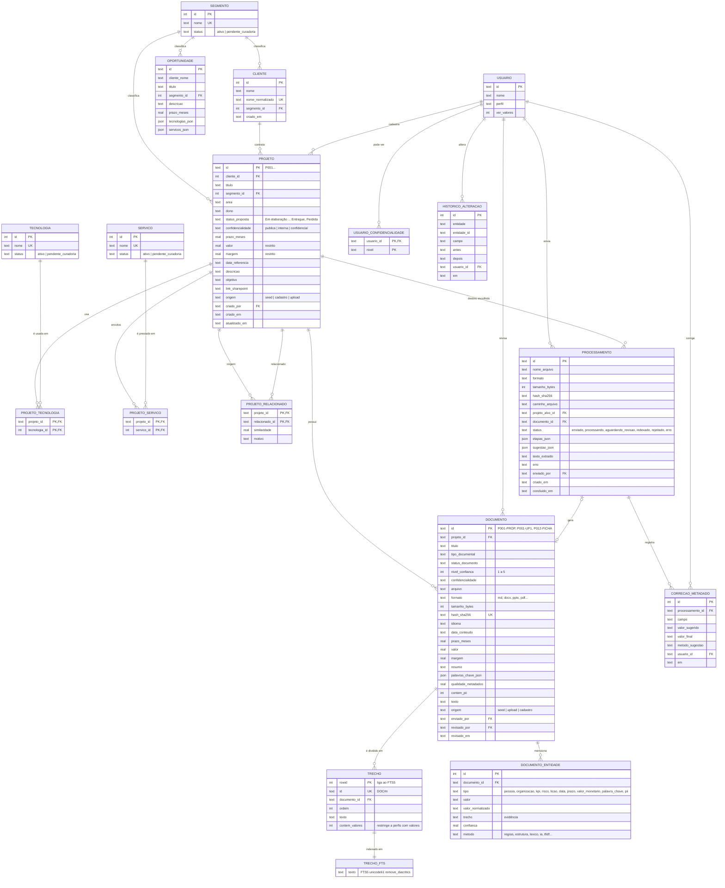

# MER — Base de conhecimento do Radar de Propostas & Cases

> Modelo entidade-relacionamento do protótipo `radar-v0`.
> Implementação física: SQLite embutido no Node (`node:sqlite`) com busca textual FTS5. DDL em `radar-v0/src/db/schema.sql`.
> Insumo para DEV-01 (arquitetura e modelo de dados) — não substitui o artefato da etapa, que depende do gate NB-04. No MVP, o banco tende a ser PostgreSQL com pgvector, com o mesmo desenho lógico.

## 1. Visão geral

A base é organizada em três camadas:

| Camada | Onde fica | Papel |
|---|---|---|
| Relacional (sistema de registro) | `data/radar.db` | Projetos, clientes, documentos, metadados, entidades, taxonomia, usuários, processamento de uploads, correções e histórico |
| Textual | Tabela virtual `trecho_fts` (FTS5) | Busca por palavras com ranking BM25, sem acento e sem diferença de maiúsculas |
| Vetorial (derivada) | `data/vectorstore/radar.json` | Embeddings dos trechos para busca por similaridade. É reconstruída a partir do banco por `npm run ingest` ou ao confirmar um upload ou cadastro |

Conversas do chat (`data/conversas/`) e auditoria das buscas (`data/auditoria/*.jsonl`) ficam em arquivos, fora deste modelo, como no V0 anterior.

## 2. Diagrama

## 3. Regras de negócio no modelo

| Regra | Como o modelo garante |
|---|---|
| **Permissão (UC03.5).** Ninguém vê o que não pode. | `projeto.confidencialidade` e `documento.confidencialidade` são cruzadas com `usuario_confidencialidade` em toda consulta: busca do chat, exploração, detalhe, insights e lista de clientes. O documento nunca é menos restrito que o projeto. Ao tornar o projeto confidencial, os documentos acompanham. |
| **Valores e margens.** | `projeto.valor/margem` e `documento.valor/margem` só saem para perfis com `ver_valores = 1`. `trecho.contem_valores` tira das buscas os trechos com preço. |
| **Hierarquia de fontes (UC03.8).** | `documento.nivel_confianca` é derivado do tipo e do status: 5 = proposta final aprovada ou SOW … 1 = rascunho. As divergências de prazo e valor entre documentos e cadastro são resolvidas por esse nível. |
| **Só indexa o que foi revisado (UC02).** | O upload vira `processamento` e fica em `aguardando_revisao`. Só a confirmação cria o `documento`, com os trechos, o FTS e o índice vetorial. |
| **Duplicidade.** | `documento.hash_sha256` é único, o que bloqueia o mesmo arquivo duas vezes. Arquivos quase idênticos (similaridade acima de 90%) geram alerta na revisão. |
| **Taxonomia controlada (RNF11).** | Segmento, tecnologia e serviço são tabelas próprias. Um termo novo entra como `pendente_curadoria` e aparece em Insights › Curadoria. |
| **Auditoria de correções (RNF08).** | Cada campo sugerido que o revisor altera gera uma linha em `correcao_metadado`, com o método que errou. |
| **Versionamento mínimo (UC01/UC07).** | Cada alteração de projeto gera uma linha em `historico_alteracao`: quem, quando, antes e depois. |
| **Projeto sem documentos também é encontrável.** | Projetos cadastrados ganham um `documento` do tipo `ficha_cadastro`, recriado a cada edição. |

## 4. Índices e consultas eficientes

- **Índices B-tree** em todas as chaves de filtro, cobrindo as facetas e os JOINs:
  - `projeto`: segmento, status, cliente, confidencialidade e data;
  - `projeto_tecnologia` e `projeto_servico`: o termo da taxonomia;
  - `documento`: projeto e tipo;
  - `documento_entidade`: (tipo, valor_normalizado);
  - `trecho`: documento;
  - `processamento`: (status, enviado_por).
- **Busca textual:** FTS5 com BM25 e trecho destacado (`snippet`). Uma *window function* escolhe o melhor trecho por projeto.
- **Modo "todas" / "qualquer"** em tecnologias e serviços: `GROUP BY ... HAVING count(DISTINCT) = N` contra `IN (...)`.
- **Facetas** contam sobre o conjunto já filtrado, com a mesma subconsulta de IDs.
- **Insights:** agregações (`GROUP BY`) com taxa de conversão, médias e co-ocorrência de tecnologias (auto-junção em `projeto_tecnologia`).
- **Desempenho medido na base piloto:**
  - consultas de exploração em 3 a 8 ms;
  - reindexação completa (51 documentos, 118 trechos) em cerca de 200 ms.
- **Concorrência:** WAL ligado, para leitura concorrente durante a gravação.
