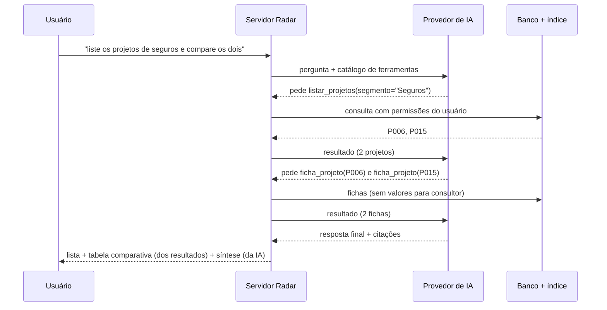

# NB-02 — Adendo 5: análise dos feedbacks do teste com o time (2026-11-03)

> Cópia versionada de `radar-v0/docs/CASOS-DE-USO-feedbacks-teste-2026-11-03.md` (protótipo), com os links ajustados para esta pasta.

> Demanda: **radar-propostas-cases** · Etapa: NB-02 — Especificação de Requisitos (adendo 5)
> Status: **Decisões do PO de 2026-11-03. F2, F3 e o card rápido do F1 implementados no protótipo em 2026-11-04 (seção 6).** O restante do F1 aguarda o discovery. Aguarda validação do comitê.
> Base: [`NB-02-adendo-upload-cadastro-consultas.md`](./NB-02-adendo-upload-cadastro-consultas.md) (UC02, UC07, UC08), [`NB-02-adendo-exportacao-permissoes-auditoria.md`](./NB-02-adendo-exportacao-permissoes-auditoria.md) (RN-V0-01) e a feature de busca conversacional (UC03).
> Evidências: registros do ambiente publicado (`turnos.jsonl`, `eventos.jsonl`, `conversas.json`) e banco de produção, consultados só para leitura.

## 0. Resumo

| # | Feedback | Causa encontrada | Solução decidida | Casos de uso |
|---|---|---|---|---|
| F1 | Cards de projeto com informação técnica pouco útil para executivos | O card mostra tecnologias. O sistema **não tem o conceito de "área do cliente"**: o campo `area` atual guarda a prática da NTT ("Data & Analytics"). | Taxonomia **Área do cliente** e visão Executiva / Técnica. **Antes, novo discovery da listagem e da ficha.** | UC12.1–UC12.5 (hipóteses) |
| F2 | Alertas de dados sensíveis chamativos demais, prejudicam a credibilidade | O aviso aparece em **três camadas a cada ação**: faixa fixa, caixa obrigatória e modal. Em 72 minutos o gestor confirmou o aviso **13 vezes**. | **Boas-vindas amigáveis** com termo no primeiro acesso, e **mascaramento automático sem bloqueio**: nada sensível vai para os metadados. | UC13.1–UC13.3 |
| F3 | O chat "se perde" em pedidos que não são "projetos parecidos" | Só existem as intenções `buscar`, `detalhar` e `fora_dominio`. **Toda pergunta cai na busca de semelhantes** (top 5 por similaridade), e a IA é instruída a sempre dar "insight para nova proposta". | **Roteador de intenção** (listagem, contagem, ficha), **ferramentas para perguntas compostas**, esclarecimento e sugestões na interface. | UC03.17–UC03.23 |

### Decisões do PO (2026-11-03)

| # | Decisão | Consequência |
|---|---|---|
| F1 | Opções **C** (taxonomia Área do cliente) **e D** (visão por perfil ou alternância Executivo / Técnico). **A listagem e a ficha do projeto voltam para discovery**, porque pode faltar informação relevante para gestores, executivos e consultores. | UC12 fica como hipótese. O conteúdo final do card e da ficha sai do discovery: [`NB-01-discovery-r2-projetos-listagem-ficha.md`](./NB-01-discovery-r2-projetos-listagem-ficha.md). |
| F2 | Opção **C** (termo no primeiro acesso), com **apresentação amigável e sem passar a ideia de risco**. Opção **D** (verificação automática) com **aviso leve, sem bloquear**: o envio segue, e o que for sensível **não é gravado nos metadados**. | UC13 reescrito. A forma de aplicar a RN-V0-01 muda: sai a confirmação a cada ação e entram o aceite único e o mascaramento automático. **A mudança precisa ser registrada como decisão** (DEC). |
| F3 | Opções **B, C, D e E**. O PO pediu o detalhamento da C. | Seção 3.6 explica a C. UC03.23 descreve a resposta com ferramentas. |

---

## 1. F1 — Cards de projeto para executivos

### 1.1 Feedback

> Na listagem de projetos, os cards trazem informações técnicas pouco relevantes para os executivos. Trazer segmentos do cliente e áreas do cliente (TI, RH, produção, canais de venda etc.).

### 1.2 Diagnóstico

**O que o card mostra hoje** (`public/projetos.js`, `renderResults`):
- status;
- ícones de confidencial e de origem;
- título e cliente;
- trecho encontrado;
- **até três chips de tecnologia** (Databricks, Azure…);
- número de documentos.

**O que os dados permitem:**

| Informação pedida | Existe hoje? | Onde |
|---|---|---|
| Segmento do cliente | **Sim** | `projeto.segmento_id` e `cliente.segmento_id`. Está no cadastro e no filtro, mas **não aparece no card**. |
| Áreas do cliente (TI, RH, produção, canais de venda) | **Não** | O campo `projeto.area` guarda a **prática da NTT** que conduz o projeto. Em produção os valores são "Data & Analytics", "AI & Automation", "Customer Experience", "Cloud & Data" e "Dados e IA". Não é a área do cliente atendida. |

**Ponto de atenção:** o rótulo "Área" no cadastro é ambíguo. Quem preenche pode entender "área do cliente" ou "área da NTT". Antes de criar o novo campo, é preciso separar os dois nomes.

### 1.3 Soluções possíveis

| Opção | Descrição | Prós | Contras |
|---|---|---|---|
| **A. Só reorganizar o card** | Mostrar o segmento no lugar das tecnologias. | Rápido, sem mudar dados. | Não atende "áreas do cliente". |
| **B. Área do cliente como texto livre** | Novo campo de texto no cadastro. | Simples. | Grafias diferentes ("RH", "Recursos Humanos", "Pessoas") quebram filtro e contagem. |
| **C. Taxonomia controlada, multivalorada** (recomendada) | Lista de áreas do cliente no mesmo padrão de segmento e tecnologia. Um projeto pode atender várias áreas. A IA sugere a área no envio e no cadastro, e o gestor cria opções novas. | Filtro, contagem e insights consistentes. Reaproveita o padrão de chips, as permissões e o registro de atividades. | Exige migração e um preenchimento inicial dos projetos existentes, revisado por humano. |
| **D. Visão por perfil** | Card executivo para gestor e card técnico para consultor. | Atende os dois públicos. | Dois layouts para manter. Pode ser uma alternância "Executivo / Técnico" em vez de depender do perfil. |

**Decisão do PO:** opções **C e D**, com um novo discovery da listagem e da ficha do projeto antes de fechar o conteúdo.
- Os casos UC12.1 a UC12.5 abaixo são **hipóteses**. Os campos exatos do card e da ficha, por perfil, saem do discovery ([`NB-01-discovery-r2-projetos-listagem-ficha.md`](./NB-01-discovery-r2-projetos-listagem-ficha.md)).
- As tecnologias continuam no modal de detalhe, na busca e nos filtros.

**Vocabulário inicial sugerido para Área do cliente**, a validar com o PO:
- TI;
- RH / Pessoas;
- Financeiro;
- Jurídico;
- Comercial / Vendas;
- Canais de venda / E-commerce;
- Marketing;
- Atendimento / SAC;
- Operações;
- Produção / Industrial;
- Logística / Supply chain;
- Compras / Suprimentos;
- Manutenção;
- Risco e compliance;
- Diretoria / Estratégia.

### 1.4 Casos de uso

#### UC12.1 — Ver card executivo na listagem de projetos

**Ator:** qualquer perfil.

**Fluxo principal:**
1. O usuário abre **Projetos**.
2. Cada card mostra, nesta ordem:
   - título;
   - cliente;
   - **segmento do cliente**;
   - **áreas do cliente**: até três chips e "+N" para as demais;
   - status da proposta;
   - **ano de referência** e **prazo** em meses;
   - **valor**, só para quem pode ver valores;
   - número de documentos.
3. Tecnologias e serviços **não aparecem no card**. Eles ficam no modal de detalhe (UC08) e continuam valendo na busca e nos filtros.
4. Quando a busca por texto está ativa, o trecho encontrado continua aparecendo.

**Fluxos alternativos:**
- **A1 — Sem área do cliente:** o card mostra "Área do cliente não informada", com estilo discreto. Para quem pode editar, há um atalho "Informar".
- **A2 — Sem segmento:** mesmo tratamento.

**Regras:**
- O valor segue a permissão `verValores`, como no resto do app.
- O card precisa caber em 375 px (celular) e passar no contraste dos dois temas.

**Critérios de aceite:**
- Dado um projeto com segmento "Varejo" e áreas "Canais de venda" e "Logística", quando o consultor abre Projetos, então o card mostra os dois chips de área e o segmento, e não mostra tecnologias nem valor.
- Dado o gestor, quando abre o mesmo card, então o valor aparece formatado em reais.

#### UC12.2 — Classificar a área do cliente no cadastro, no envio e na edição

**Ator:** gestor no cadastro. Qualquer perfil com edição de projeto ou de informações do documento.

**Fluxo principal:**
1. O formulário de projeto ganha o campo **Áreas do cliente**, com seleção múltipla e filtro (mesmo componente de chips de tecnologia).
2. O campo atual "Área" passa a se chamar **"Prática NTT responsável"**, para eliminar a ambiguidade.
3. No **"Preencher com IA"** (cadastro) e na extração do envio (UC02), o sistema sugere as áreas do cliente:
   - a partir de rótulos ("área demandante: RH");
   - e do significado ("redução de turnover" leva a RH, "força de vendas" leva a Comercial).
4. A sugestão aparece marcada como preenchida pela IA, e o usuário confirma ou corrige (revisão humana).

**Fluxos alternativos:**
- **A1 — Área nova:** só o gestor cria uma opção nova, seguindo a mesma regra de `criarTermo`. O consultor vê "Sugerir área". A sugestão fica registrada como `sugerir` no registro de atividades.

**Regras:**
- Toda inclusão ou remoção de área fica no registro de atividades (UC11).
- A sugestão da IA nunca é gravada sem a confirmação humana.

**Critérios de aceite:**
- Dado o texto "projeto para a diretoria de RH reduzir turnover", quando o gestor usa "Preencher com IA", então "RH / Pessoas" vem sugerida e marcada como preenchida pela IA.

#### UC12.3 — Filtrar e agrupar projetos por segmento e área do cliente

**Ator:** qualquer perfil.

**Fluxo principal:**
1. O painel de filtros ganha **Área do cliente**, com seleção múltipla, logo abaixo de Segmento.
2. Os chips de segmento e de área no card funcionam como atalho: um clique aplica o filtro.
3. Os insights (UC09) ganham a distribuição de projetos por área do cliente e o cruzamento segmento × área.

**Critérios de aceite:**
- Dado o filtro "Área do cliente = Logística", então só aparecem projetos com essa área, e o contador de filtros ativos aumenta em 1.

#### UC12.4 — Preencher a área do cliente nos projetos existentes

**Ator:** gestor (curador).

**Fluxo principal:**
1. Depois da migração, o sistema roda a sugestão de áreas para os projetos já cadastrados, usando os documentos de cada um.
2. O gestor vê uma **fila de revisão** com a sugestão de cada projeto e aprova, corrige ou descarta.
3. As aprovações ficam no registro de atividades.

**Regras:**
- Nada é gravado sem aprovação.
- Projetos sem sugestão ficam como "não informada" (UC12.1, A1).

#### UC12.5 — Alternar entre visão Executiva e Técnica (opção D)

**Ator:** qualquer perfil.

**Fluxo principal:**
1. A tela de Projetos tem uma alternância **Executiva / Técnica** no topo da lista.
2. **Executiva:** o card de UC12.1.
3. **Técnica:** o card mostra também tecnologias, serviços e prática NTT responsável.
4. O padrão vem do perfil, e a escolha do usuário fica salva no navegador:
   - gestor e executivo começam na Executiva;
   - consultor começa na Técnica, a confirmar no discovery.

**Regras:**
- A alternância muda só o que aparece no card. Filtros, ordem e paginação continuam os mesmos.
- Os campos de cada visão saem do discovery.

**Critérios de aceite:**
- Dado o consultor na visão Técnica, quando ele troca para Executiva e recarrega a página, então a visão Executiva continua ativa.

**Impacto no modelo de dados (MER):**
- nova tabela `area_cliente (id, nome, nome_normalizado)`;
- nova tabela associativa `projeto_area_cliente (projeto_id, area_cliente_id)`;
- `documento_entidade` passa a aceitar o tipo `area_cliente`;
- a coluna `projeto.area` continua existindo, com o rótulo de interface "Prática NTT responsável".

---

## 2. F2 — Avisos de dados sensíveis mais discretos

### 2.1 Feedback

> Os alertas para não subir documentos confidenciais poderiam ser mais discretos, pois estão gerando uma possível quebra de credibilidade da nossa solução.

### 2.2 Diagnóstico

**Onde o aviso aparece hoje:**

| Ponto | Forma | Frequência |
|---|---|---|
| Área de envio | Faixa fixa, sempre visível. Fala em "versão de demonstração" e "IA externa (DeepSeek)". | Sempre |
| Envio de arquivos | **Modal** com lista do que não enviar e caixa obrigatória | **A cada envio** |
| Formulário de projeto | Faixa fixa e caixa obrigatória | **A cada cadastro** |
| "Preencher com IA" | Exige a mesma caixa marcada | **A cada sugestão** |

**Evidência em produção (13h32–14h44):** o gestor registrou **13 aceites** em 72 minutos:
- 9 na sugestão;
- 2 no cadastro;
- 2 no envio.

É um caso típico de **fadiga de alerta**. O usuário passa a marcar a caixa sem ler, o que reduz a proteção real. E o tom de alarme ("versão de demonstração", destaque em cor de atenção) sugere a quem avalia que a solução não é confiável.

**O que não pode mudar:** a regra **RN-V0-01** (nenhum dado sensível da NTT enquanto houver LLM externa) e a verificação no servidor (`cienteDadosSensiveis` em `/api/upload`, `/api/projetos` e `/api/projetos/sugerir`). A mudança é **de forma e de frequência**, não de política.

### 2.3 Soluções possíveis

| Opção | Descrição | Prós | Contras |
|---|---|---|---|
| **A. Só suavizar o visual** | Cor neutra, texto menor, sem ícone de alarme. | Rápido. | Mantém a repetição, que é a causa principal. |
| **B. Ciência por sessão** (recomendada) | Uma confirmação na **primeira** ação de envio, cadastro ou sugestão da sessão. Depois, só um lembrete discreto. | Acaba com a repetição e mantém o registro de aceite. | Depois do aceite, o lembrete pode passar despercebido. |
| **C. Termo de uso no primeiro acesso** | Aceite das regras de uso de dados uma vez por usuário e por versão do termo, com uma página "Política de dados" no menu. | Postura de produto corporativo, aceite rastreável e versionado. | Se for o único controle, o usuário esquece com o tempo. Melhor combinar com B. |
| **D. Verificação automática do conteúdo** | Antes de mandar o conteúdo à IA, o sistema procura padrões sensíveis (CPF, CNPJ, e-mail, telefone, valores em R$, "confidencial") e só avisa se encontrar. | O alerta passa a ser **contextual e raro**. Protege de verdade. | Mais esforço. Pode dar falso positivo. A extração já acontece hoje, então o reaproveitamento é bom. |
| **E. Rótulo de ambiente** | Selo pequeno no topo ("Piloto · IA externa"), com explicação ao passar o mouse e link para a política. | Transparente, sem alarme. | Sozinho não é controle suficiente. |

**Decisão do PO:** opção **C** com apresentação amigável, mais a opção **D** com aviso leve e sem bloqueio.
- O app se apresenta como um **piloto**, com boas práticas escritas em tom positivo. Nada de "risco", "vazamento" ou cor de alerta.
- O usuário pode enviar mesmo que o conteúdo pareça sensível. O sistema **mascara o que encontrar e não grava esses dados nos metadados**.
- As opções B (ciência por sessão) e E (selo de ambiente) deixam de ser necessárias. O selo pode virar só um link "Política de dados" no menu.

**Ponto de atenção (para registrar na decisão):** não gravar nos metadados protege a base, mas **não impede que o texto chegue ao provedor de IA**. Hoje o conteúdo vai para a IA na extração e no "Preencher com IA". Para a proteção valer também ali, o mascaramento precisa acontecer **antes da chamada à IA** (UC13.2, passo 2). Também é preciso decidir o que fazer com o **arquivo original** guardado para download, que continua com o conteúdo completo (questão 2.5).

### 2.4 Casos de uso

#### UC13.1 — Boas-vindas e termo de uso no primeiro acesso

**Ator:** qualquer perfil.

**Fluxo principal:**
1. No primeiro acesso depois do login, ou quando o termo muda de versão, aparece uma tela de **boas-vindas** curta, no visual do app:
   - título: "Bem-vindo ao Radar";
   - uma frase sobre o que o Radar faz;
   - **três boas práticas em tom positivo**, por exemplo:
     - "Nesta fase piloto, use documentos de exemplo ou públicos.";
     - "Revise os metadados sugeridos antes de salvar.";
     - "Na dúvida sobre um documento, fale com o curador.";
   - o link "Política de dados";
   - o botão **"Começar"**.
2. O clique em "Começar" grava o aceite com usuário, versão do termo e data.
3. A página **Política de dados** fica no menu. É ali, e só ali, que aparecem os detalhes técnicos: provedor de IA, onde os dados ficam e o que é mascarado.

**Regras:**
- O texto não usa as palavras "risco", "vazamento", "proibido" nem "demonstração", nem cor ou ícone de alerta.
- Sem o aceite, o usuário só consulta. O envio, o cadastro e o "Preencher com IA" levam de volta à tela de boas-vindas, e o servidor recusa o pedido.
- O aceite fica no registro de auditoria.

**Critérios de aceite:**
- Dado um usuário que já aceitou a versão 1, quando ele entra de novo, então a tela não aparece.
- Dada a publicação da versão 2, então a tela aparece uma vez para todos.

#### UC13.2 — Identificar e mascarar conteúdo sensível, com aviso leve e sem bloqueio

**Ator:** sistema, no envio de documento, no cadastro ou edição de projeto e no "Preencher com IA".

**Fluxo principal:**
1. O servidor procura padrões sensíveis no texto recebido:
   - CPF e RG;
   - e-mail e telefone de pessoas;
   - número de cartão;
   - senhas, chaves e tokens;
   - nomes de clientes reais de uma lista mantida pelo gestor (opcional).
2. **Antes de qualquer chamada ao provedor de IA**, o sistema troca cada item encontrado por um marcador, como `[e-mail removido]` ou `[CPF removido]`.
3. O processamento segue normalmente: extração, revisão e cadastro.
4. Metadados, entidades, trechos indexados e o texto da busca são gravados **já mascarados**.
5. Na tela, aparece uma **nota leve** perto do resultado, sem modal e sem cor de alerta: "Removemos 2 dados pessoais (e-mail, telefone) antes de processar. [Ver o quê]". "Ver o quê" mostra só o tipo e a posição, nunca o valor.
6. Se o documento tiver marcadores como "confidencial" ou "uso interno", a nota sugere marcar o documento como confidencial. O usuário decide.

**Regras:**
- Nunca bloqueia o envio.
- O registro de auditoria guarda o **tipo** e a **quantidade** do que foi encontrado, nunca o valor.
- Valores em R$ **não são mascarados**: são metadados de negócio do projeto, como valor e margem, e seguem a permissão `verValores`.
- A lista de padrões é configurável e versionada.

**Critérios de aceite:**
- Dado um documento com "contato: joao@cliente.com.br, CPF 123.456.789-09", quando ele é enviado, então:
  - o envio é concluído;
  - nenhum metadado, trecho ou índice contém o e-mail ou o CPF;
  - o texto enviado à IA contém os marcadores;
  - a nota mostra "2 dados pessoais removidos".
- Dado um documento sem padrões sensíveis, então não aparece nenhuma nota.

#### UC13.3 — Remover a confirmação a cada ação

**Ator:** sistema.

**Fluxo principal:**
1. Saem da interface:
   - a faixa fixa da área de envio;
   - o modal de confirmação a cada envio;
   - a caixa obrigatória do cadastro e do "Preencher com IA".
2. No lugar, fica no máximo uma linha discreta perto do botão de envio: "Política de dados".
3. O servidor deixa de exigir `cienteDadosSensiveis` em cada pedido. Passa a exigir o aceite do termo (UC13.1) e aplica sempre o mascaramento (UC13.2).

**Critérios de aceite:**
- Dado um usuário que aceitou o termo, quando ele envia 5 arquivos e usa "Preencher com IA" 10 vezes, então não aparece nenhum modal nem caixa de confirmação.

### 2.5 Questões sobre o F2

1. **Arquivo original:** o arquivo enviado é guardado como veio e pode ser baixado. Há três caminhos:
   - guardar só a versão mascarada, quando o formato for texto;
   - guardar o original, mas restringir o download ao gestor quando houver itens mascarados;
   - manter como está.
2. **Mascaramento antes da IA:** confirmar que vale também para o texto enviado ao provedor. A recomendação é que sim.
3. **Lista de clientes reais:** usar ou não, e quem mantém.


---

## 3. F3 — O chat "se perde" em pedidos que não são "projetos parecidos"

### 3.1 Feedback

> A busca semântica hoje tem uma skill de listar projetos semelhantes. Porém, quando peço outras coisas, ela acaba se perdendo e fazendo a listagem, gerando uma experiência ruim e quebra de expectativa. Algumas perguntas feitas entre 14h e 15h30 ficaram estranhas.

### 3.2 Perguntas reais da janela de 14h a 15h30

| Hora | Pergunta | O que o usuário queria | O que o Radar fez | Avaliação |
|---|---|---|---|---|
| 14:33 | "já fizemos algum projeto relacionado com seguros?" | Saber se existe (sim/não) e quais | Respondeu "Sim", citou P006 e P015 e mostrou os cards | **Bom.** Um detalhe: P015 é um projeto de teste ("TESTE X") e apareceu como referência. |
| 14:34 | "faça um consolidado de todos os projetos que estão no seu banco" | **Inventário completo** da base | "Não encontrei evidência suficiente…", sem nenhum resultado | **Falha.** A pergunta é sobre a base em si, e a busca por similaridade não encontrou nada parecido com "todos os projetos". |
| 14:34 | "preciso de uma listagem de todas as áreas que existem projetos" | **Lista distinta** de áreas ou segmentos | Mostrou 5 projetos e respondeu "Reaproveite as referências de Energia e Telecom…" | **Falha.** Resposta fora da pergunta e lista incompleta (o limite é 5 resultados). |
| 14:35 | "preciso saber quais são as áreas que possuem projetos salvos" | Mesma coisa | 5 projetos e "As áreas se repetem em diferentes contextos…" | **Falha.** Mesma causa. |
| 14:43 | "Quais são o prazo, o valor estimado, a margem e o responsável pelo projeto Gestão Hospitalar Analítica? Informe também o link do repositório." | **Ficha** de um projeto específico | Deu prazo e valor e disse que "margem, responsável e link do repositório não constam" | **Falha factual.** O cadastro do P019 tem margem 20%, responsável e link. O chat só lê frases de documentos e ignora os campos estruturados do projeto. |

### 3.3 Causas

1. **Poucas intenções.** O interpretador (`src/deepseek.js`) só conhece `buscar`, `detalhar` e `fora_dominio`. Inventário, contagem, lista distinta, ficha de projeto e comparação viram todos `buscar`.
2. **Recuperação top-k.** `buscar` sempre faz busca vetorial e devolve **no máximo 5 projetos** parecidos com a frase. Perguntas sobre "todos" ou "quantos" não têm resposta certa por similaridade: precisam de uma consulta ao banco.
3. **Prompt de resposta enviesado.** O analista recebe a instrução de sempre trazer "o principal insight para a nova proposta: quais referências reaproveitar". Por isso a resposta a "liste as áreas" vira "reaproveite Energia e Telecom".
4. **Fatos estruturados fora do contexto.** A IA só recebe frases dos documentos. Campos do cadastro (margem, responsável, link, área, data) não entram. A IA então diz corretamente que "não constam nas frases", mas a resposta está errada para o usuário.
5. **Projetos de teste na base.** P013 "Teste" e P015 "TESTE X" aparecem como referências.

### 3.4 Soluções possíveis

| Opção | Descrição | Prós | Contras |
|---|---|---|---|
| **A. Ajustar só o prompt** | Pedir à IA que responda exatamente o que foi perguntado. | Barato. | Não resolve inventário, contagem nem ficha: os dados certos nunca chegam à IA. |
| **B. Roteamento de intenção com respostas especializadas** (recomendada) | O interpretador classifica em mais intenções, e cada uma tem um "executor" com consulta própria: SQL para listagem, contagem e ficha; busca semântica para semelhantes. A IA só redige a resposta com os dados certos. | Respostas corretas e completas. Sem alucinação, porque os números vêm do banco. Reaproveita filtros, permissões e o registro de atividades. | Mais intenções para testar. Exige um conjunto de perguntas de avaliação. |
| **C. Ferramentas para a IA (tool calling)** | A IA escolhe ferramentas como `listar_projetos(filtros)`, `contar_por(campo)`, `ficha_projeto(id)` e `buscar_semelhantes(texto)`. | Flexível. Combina passos ("liste os de seguros e compare os dois"). | Menos previsível. Mais chamadas à IA, mais custo e mais tempo. Exige mais cuidado com permissões em cada ferramenta. |
| **D. Esclarecer quando houver dúvida** | Se a confiança na intenção for baixa, o Radar pergunta: "Você quer a lista de áreas ou projetos parecidos com…?" | Evita resposta errada. | Mais um passo para o usuário. Usar só como reserva. |
| **E. Expectativa na interface** | Sugestões de pergunta por tipo ("Liste…", "Quantos…", "Ficha do projeto…", "Compare…") e um rótulo na resposta ("Tipo: listagem"). | Ensina o que o Radar sabe fazer. | Não corrige nada sozinho. |

**Decisão do PO:** opções **B, C, D e E**.
- **B** (roteador com executores) atende as perguntas simples e frequentes.
- **C** (ferramentas) atende as perguntas compostas.
- **D** (esclarecimento) atende as ambíguas.
- **E** (sugestões e tipo de resposta na interface) ajusta a expectativa do usuário.
- O detalhamento da C está na seção 3.6. Antes de implementar:
  - criar um **conjunto de avaliação** com as perguntas reais e cerca de 30 variações;
  - fazer o spike da seção 3.6.
- Separar os **projetos de teste** com uma marcação "teste/rascunho", fora da busca por padrão.

### 3.5 Casos de uso

Os casos de uso complementam a feature UC03 (busca conversacional).

#### UC03.17 — Classificar a intenção da pergunta

**Ator:** sistema.

**Fluxo principal:**
1. O interpretador devolve uma **intenção** entre:
   - `semelhantes`: o `buscar` atual;
   - `listar`;
   - `agregar`: contar ou agrupar;
   - `ficha`;
   - `comparar`;
   - `detalhar`;
   - `fora_dominio`;
   - `esclarecer`.
2. Junto com a intenção, devolve os **parâmetros**:
   - filtros: segmento, área do cliente, tecnologia, serviço, status, período e cliente;
   - campo de agrupamento;
   - projeto citado pelo nome;
   - campos pedidos.
3. O interpretador devolve também uma **confiança** de 0 a 1.

**Regras:**
- Confiança abaixo do limite leva a `esclarecer` (UC03.22).
- Sem IA disponível, regras de palavras-chave fazem a classificação como reserva. Exemplos: "quantos", "liste todos", "quais são os/as", "ficha", "compare".
- A intenção e a confiança ficam em `turnos.jsonl` para medir a qualidade.

**Critérios de aceite:**
- Dadas as 5 perguntas reais da seção 3.2, então as intenções são, nesta ordem:
  - `semelhantes`;
  - `listar`;
  - `agregar` por segmento;
  - `agregar` por segmento;
  - `ficha`.

#### UC03.18 — Listar projetos da base (inventário)

**Ator:** qualquer perfil.
**Exemplos:** "faça um consolidado de todos os projetos", "liste os projetos de seguros ganhos em 2026".

**Fluxo principal:**
1. O sistema consulta o banco com os filtros extraídos e com as **permissões do usuário**: confidencial, valores e projetos de teste excluídos.
2. A resposta traz:
   - o total;
   - uma tabela resumida com título, cliente, segmento, status e ano;
   - um link **"Abrir na tela de Projetos com esses filtros"**.
3. A IA escreve no máximo 2 frases de síntese **sobre a lista**, como a distribuição por status ou o segmento predominante. Sem conselho de reaproveitamento.

**Regras:**
- A lista no chat mostra no máximo 20 itens. Acima disso, mostra "e mais N", com o link para a tela de Projetos.
- Os números vêm sempre da consulta, nunca da IA.

**Critérios de aceite:**
- Dada a pergunta "consolidado de todos os projetos", então a resposta mostra o total da base visível ao usuário e nunca "não encontrei evidência".

#### UC03.19 — Contar e agrupar (agregação)

**Ator:** qualquer perfil.
**Exemplos:** "quais áreas têm projetos?", "quantos projetos por segmento?", "quantas propostas perdemos em varejo?".

**Fluxo principal:**
1. O sistema agrupa pelo campo pedido:
   - segmento;
   - área do cliente (UC12);
   - prática NTT;
   - tecnologia;
   - serviço;
   - status;
   - ano;
   - cliente.
2. A resposta traz a **lista distinta com contagem**, ordenada da maior para a menor. Cada item é clicável e abre Projetos filtrado.
3. Se o termo pedido for ambíguo (por exemplo, "áreas" pode ser segmento, área do cliente ou prática NTT), o sistema responde pelo campo mais provável e oferece os outros: "Mostrei por segmento. Ver por área do cliente · por prática NTT".

**Regras:**
- Valores financeiros agregados (soma, média) só para quem tem `verValores`.

**Critérios de aceite:**
- Dada "quais são as áreas que possuem projetos salvos", então a resposta lista todos os segmentos com a contagem de cada um, sem limite de 5 e sem o texto "reaproveite".

#### UC03.20 — Ficha de um projeto citado pelo nome

**Ator:** qualquer perfil.
**Exemplo:** "qual o prazo, valor, margem, responsável e link do projeto Gestão Hospitalar Analítica?".

**Fluxo principal:**
1. O sistema identifica o projeto pelo título ou pelo cliente, com correspondência aproximada.
2. Monta a resposta a partir dos **campos estruturados do cadastro**, completados pelas frases dos documentos. Cada valor indica a sua fonte: "cadastro" ou documento citado.
3. Responde só os campos pedidos e oferece "Abrir detalhe" e "Exportar".

**Fluxos alternativos:**
- **A1 — Mais de um projeto com nome parecido:** o sistema pergunta qual deles.
- **A2 — Campo vazio no cadastro e nos documentos:** "não informado", com o atalho "Editar projeto" para quem pode editar.
- **A3 — Campo restrito:** valor e margem para quem não tem `verValores` aparecem como "restrito ao seu perfil", nunca como "não consta".

**Critérios de aceite:**
- Dada a pergunta real do gestor sobre o P019, então a resposta traz:
  - prazo de 10 meses;
  - valor de R$ 2.200.000;
  - margem de 20%;
  - responsável Rafael Costa;
  - o link cadastrado.
- Dado o consultor fazendo a mesma pergunta, então valor e margem aparecem como restritos.

#### UC03.21 — Comparar projetos

**Ator:** qualquer perfil.
**Exemplo:** "compare o P006 com o P015", "qual a diferença entre os projetos de churn da ConectaFibra?".

**Fluxo principal:**
1. O sistema identifica de 2 a 4 projetos, por código, nome ou pelos resultados anteriores da conversa.
2. Monta uma **tabela lado a lado** com:
   - segmento e áreas do cliente;
   - objetivo;
   - tecnologias e serviços;
   - prazo;
   - status;
   - valor, conforme a permissão;
   - resultados.
3. A IA escreve 2 ou 3 frases sobre as **diferenças relevantes**, citando as fontes.

#### UC03.22 — Pedir esclarecimento quando a intenção é incerta

**Ator:** sistema.

**Fluxo principal:**
1. Com confiança baixa, o Radar responde com uma pergunta curta e de 2 a 3 opções clicáveis. Exemplo: "Você quer **a lista de segmentos atendidos** ou **projetos parecidos com 'áreas de dados'**?"
2. A escolha do usuário segue para o executor correspondente e fica registrada para melhorar a classificação.

**Regras:**
- No máximo um esclarecimento seguido. Se a dúvida continuar, o Radar usa `semelhantes` e avisa.

#### Regra transversal — Responder ao que foi perguntado

- O texto da resposta segue a intenção:
  - `semelhantes` mantém o insight de reaproveitamento;
  - `listar`, `agregar` e `ficha` respondem objetivamente, sem conselho;
  - `comparar` destaca as diferenças.
- Números, contagens e valores vêm de consultas, nunca da redação da IA.
- Cada resposta mostra o tipo: "Projetos parecidos", "Listagem", "Contagem", "Ficha" ou "Comparação". A interface oferece sugestões de pergunta por tipo.

#### UC03.23 — Responder perguntas compostas com ferramentas (opção C)

**Ator:** sistema.
**Exemplos:** "liste os projetos de seguros e compare os dois", "quais segmentos têm propostas perdidas, e qual a lição mais comum?".

**Fluxo principal:**
1. O roteador (UC03.17) identifica que a pergunta pede **mais de um passo**, ou não se encaixa em um executor único.
2. O sistema chama a IA com a pergunta e o **catálogo de ferramentas** (seção 3.6).
3. A IA pede uma ou mais ferramentas. O servidor executa cada uma com as permissões do usuário da sessão e devolve o resultado.
4. Os passos 2 e 3 se repetem até a IA escrever a resposta final, com no máximo 4 chamadas de ferramenta.
5. Tabelas, listas e números aparecem na tela **a partir dos resultados das ferramentas**. O texto da IA é a síntese.
6. Durante o processamento, a interface mostra os passos em linguagem simples: "Consultando projetos de seguros…", "Montando a comparação…".

**Fluxos alternativos:**
- **A1 — Provedor sem suporte a ferramentas, erro ou tempo esgotado:** o sistema cai para o roteador B com a melhor intenção identificada e avisa "resposta simplificada".
- **A2 — Limite de passos atingido:** responde com o que já tem e oferece "continuar".

**Regras:** as da seção 3.6, item "Proteções".

**Critérios de aceite:**
- Dada "liste os projetos de seguros e compare os dois", então o sistema chama `listar_projetos` com segmento Seguros e depois `ficha_projeto` para cada um. A resposta traz a lista e a tabela comparativa.
- Dado um consultor, então nenhuma ferramenta devolve valor, margem ou projeto confidencial, mesmo que a IA peça.

### 3.6 Opção C em detalhe: a IA usando ferramentas

#### Como funciona hoje

Hoje o caminho é **fixo**, sempre o mesmo, seja qual for a pergunta:

```
pergunta → IA interpreta → busca vetorial + texto (top 5) → IA analisa e escreve
```

Se a pergunta não for "ache projetos parecidos", o caminho continua o mesmo, e daí vêm as respostas estranhas.

#### O que muda com ferramentas

Com ferramentas (*tool calling* ou *function calling*), **o caminho é decidido pela IA a cada pergunta**, mas ela só pode usar funções que nós escrevemos e controlamos:

1. O servidor manda à IA a pergunta e um **catálogo de ferramentas**. Cada ferramenta tem nome, descrição e parâmetros em JSON Schema.
2. A IA responde de uma de duas formas:
   - **um pedido de ferramenta**, como `contar_por({"campo": "segmento"})`;
   - **ou a resposta final em texto**.
3. Se houver pedido, **o servidor executa a função**, com o usuário e as permissões da sessão, e devolve o resultado em JSON para a IA.
4. A IA lê o resultado e decide de novo: pede outra ferramenta ou responde.

**A IA nunca acessa o banco.** Ela só pede, e o nosso código decide o que executar e o que devolver.



#### Catálogo de ferramentas proposto

| Ferramenta | O que faz | Parâmetros | Devolve |
|---|---|---|---|
| `buscar_semelhantes` | O pipeline atual: busca híbrida com score e análise semântica | `texto`, `filtros?`, `limite?` (até 5) | projetos com score, fatores e frase de evidência |
| `listar_projetos` | Inventário com filtros | `filtros` (segmento, área do cliente, tecnologia, serviço, status, ano, cliente), `ordenar?`, `limite?` (até 20) | total e itens resumidos |
| `contar_por` | Lista distinta com contagem | `campo` (enum: segmento, area_cliente, pratica, tecnologia, servico, status, ano, cliente), `filtros?` | `[{valor, quantidade}]` |
| `localizar_projeto` | Acha um projeto pelo nome, pelo cliente ou pelo código | `nome` | até 5 candidatos com grau de correspondência |
| `ficha_projeto` | Campos estruturados do cadastro | `projeto_id`, `campos?` | os campos pedidos, com a fonte "cadastro" |
| `buscar_trechos` | Frases dos documentos de um projeto sobre um assunto | `projeto_id`, `assunto` (resultados, riscos, lições, escopo…) | frases numeradas com o documento de origem |

A **comparação** não precisa de ferramenta própria: a IA chama `ficha_projeto` para cada projeto, e a interface monta a tabela.

**Os executores da opção B são estas mesmas funções.** Fazer a B primeiro já constrói a C: a C só acrescenta o laço em que a IA escolhe quais funções chamar.

#### Exemplos com as perguntas reais

| Pergunta | Chamadas esperadas | Resultado |
|---|---|---|
| "faça um consolidado de todos os projetos" | `listar_projetos({})` | Total, mais a lista e o link para Projetos |
| "quais são as áreas que possuem projetos salvos" | `contar_por({"campo": "segmento"})` | Segmentos com contagem, com a oferta "ver por área do cliente" |
| "prazo, valor, margem, responsável e link do Gestão Hospitalar Analítica" | `localizar_projeto({"nome": "Gestão Hospitalar Analítica"})` e depois `ficha_projeto({"projeto_id": "P019", "campos": ["prazo_meses", "valor", "margem", "dono", "link_sharepoint"]})` | Todos os campos, com valor e margem só para quem tem `verValores` |
| "já fizemos algum projeto de seguros?" | `buscar_semelhantes({"texto": "seguros"})` ou `listar_projetos({"filtros": {"segmento": "Seguros"}})` | Sim, com P006 |

#### Proteções

1. **Permissões dentro de cada ferramenta.** O usuário vem da sessão, e nenhum parâmetro permite escolher outro usuário. As regras de confidencialidade e de `verValores` são aplicadas no servidor antes de devolver qualquer coisa à IA.
2. **Somente leitura e sem consulta livre.** Não existe ferramenta de SQL aberta. Campos e filtros são listas fechadas (enum), e parâmetros inválidos voltam para a IA como erro.
3. **Limites:**
   - até 4 chamadas de ferramenta por pergunta;
   - até 20 segundos no total;
   - até 20 itens por resultado, com campos resumidos.
   Os limites controlam custo e tempo e reduzem a quantidade de dados enviada ao provedor.
4. **Números vêm dos resultados.** A tela monta listas, contagens e fichas a partir do JSON das ferramentas. Se a IA citar um projeto que nenhuma ferramenta devolveu, a citação é removida, como já acontece hoje com `onlyCitedResults`.
5. **Auditoria.** Cada chamada fica em `turnos.jsonl`: ferramenta, parâmetros, quantidade de itens devolvidos e tempo.
6. **Plano B.** Sem suporte a ferramentas ou com falha do provedor, o sistema volta para o roteador B (UC03.23, A1).
7. **Dados enviados ao provedor.** Com ferramentas, chegam mais dados estruturados à IA (listas e fichas). Isso continua sujeito à política de dados (F2) e ao mascaramento (UC13.2).

#### Custo e tempo

| | Hoje | Opção B (roteador) | Opção C (ferramentas) |
|---|---|---|---|
| Chamadas à IA por pergunta | 2 | 1 a 2 (listar, contar e ficha podem usar só a interpretação) | 2 a 5 |
| Tempo típico | 4,6 a 4,9 s (medido em produção) | 2 a 5 s | 5 a 12 s (estimado) |
| Previsibilidade | Alta, mas errada fora de "semelhantes" | Alta | Média: depende da escolha da IA |
| Perguntas compostas | Não | Não | **Sim** |

Por isso a recomendação é **B na frente e C só para o que a B não resolve**:
- intenção simples e clara: executor direto (B);
- pergunta composta: ferramentas (C);
- ambígua: esclarecer (D).

#### Provedor de IA

- A API do DeepSeek é compatível com o formato OpenAI e oferece *function calling*.
- Os provedores avaliados para a versão definitiva também oferecem, como Azure OpenAI e Claude.
- O contrato das ferramentas não depende do provedor.
- O suporte e a qualidade da escolha de ferramentas precisam ser **medidos no spike**, não presumidos.

#### Spike proposto (2 a 3 dias, antes de implementar)

1. Implementar `listar_projetos`, `contar_por`, `localizar_projeto` e `ficha_projeto`.
2. Montar o conjunto de avaliação: as 5 perguntas reais e cerca de 30 variações, incluindo compostas e ambíguas.
3. Medir B e C no mesmo conjunto:
   - acerto de intenção;
   - resposta correta;
   - tempo;
   - custo por pergunta.
4. Levar o resultado ao comitê, com a recomendação de onde usar cada um.

---

## 4. Questões para o PO

1. **F1:** as questões passam para o discovery ([`NB-01-discovery-r2-projetos-listagem-ficha.md`](./NB-01-discovery-r2-projetos-listagem-ficha.md)).
2. **F2:** as questões da seção 2.5: arquivo original, mascaramento antes da IA e lista de clientes reais.
3. **F3:**
   - Aprovar o spike de B × C (2 a 3 dias).
   - O que fazer com os projetos de teste já cadastrados (P013, P015): marcar como teste ou excluir?

## 5. Proposta de priorização (para o NB-03 ou o próximo incremento)

| Ordem | Item | Esforço estimado | Motivo |
|---|---|---|---|
| 1 | UC03.17 a UC03.20 (roteador B: intenção, listar, agregar, ficha), UC03.22 (D) e sugestões na interface (E) | Médio | Corrige as falhas vistas no teste e é o maior risco de credibilidade. |
| 2 | UC13.1 a UC13.3 (boas-vindas, mascaramento sem bloqueio, fim da confirmação a cada ação) | Baixo a médio | Remove o atrito e melhora a proteção real. Depende do registro da decisão sobre a RN-V0-01. |
| 3 | Spike e UC03.23 (ferramentas, C) | Médio | Reaproveita os executores da B. Atende as perguntas compostas. |
| 4 | Discovery da listagem e da ficha, depois UC12 (C + D) | Discovery de 1 a 2 semanas, depois médio | O conteúdo do card e da ficha depende do discovery. |

---

## 6. Implementação no protótipo (2026-11-04)

O PO pediu para aplicar as correções de F2 e F3 e a parte do F1 que não depende do discovery. O restante do F1 (taxonomia Área do cliente, visão Executiva/Técnica, ficha completa) continua aguardando o discovery.

### 6.1 F3 — Chat por intenção (UC03.17 a UC03.23)

| Item | Onde | Situação |
|---|---|---|
| Classificação em `buscar`, `listar`, `agregar`, `ficha`, `comparar`, `composta`, `detalhar`, `fora_dominio` e `esclarecer`, com confiança e parâmetros | `src/deepseek.js` (IA) e `src/intents.js` (`classificar`, regras sem IA) | Implementado |
| Executores com permissões: `listar`, `contar`, `localizar`, `ficha`, `trechos` | `src/intents.js` (`IntentTools`) | Implementado |
| Roteador (opção B), com segunda opinião por regras para listagem e contagem | `src/search.js` (`route`) | Implementado |
| Ferramentas para a IA (opção C): 6 ferramentas em JSON Schema, no máximo 4 chamadas e 20 s, citações sem fonte removidas, plano B pelo roteador | `src/deepseek.js` (`runTools`), `src/search.js` (`composite`) | Implementado |
| Esclarecimento (opção D), nunca duas vezes seguidas | `src/search.js` | Implementado |
| Interface (opção E): selo do tipo de resposta, tabelas, contagem com barras, ficha, comparação, opções clicáveis, sugestões por tipo | `public/respostas.js`, `public/app.js` | Implementado |
| "Compare os dois" usa os projetos mostrados no turno anterior | `src/conversations.js` (`mostrados`) | Implementado |
| Registro do tipo de resposta, da confiança e das ferramentas usadas | `src/audit.js` | Implementado |

**Avaliação** (`test/avaliacao-intencoes.js`: as 5 perguntas reais e 25 variações):

| Modo | Intenção certa | Tempo médio |
|---|---|---|
| Só regras (sem IA) | 30/30 (100%) | 3 ms |
| DeepSeek (roteador B) | 30/30 (100%) | 2,8 s (listagem, contagem e ficha: 1,2 a 2 s; parecidos: 5,1 a 5,9 s) |
| DeepSeek, perguntas compostas (C) | 3/3 com as ferramentas certas | 6 a 8 s |

As quatro falhas da seção 3.2 foram corrigidas:
- **Consolidado:** passa a trazer a listagem completa com distribuição por status.
- **"Áreas com projetos" (duas perguntas):** passam a trazer a contagem completa, com botões para ver por segmento, prática NTT ou serviço.
- **Ficha do P019:** passa a trazer prazo, valor, margem, responsável e link do cadastro.

**Ajustes feitos durante a implementação:**
- **"Áreas":** a IA às vezes lê como prática NTT. A resposta sempre oferece as outras leituras.
- **"Seu banco":** era lido como segmento bancário pelas regras e passou a ser tratado como a base do Radar.

### 6.2 F2 — Política de dados (UC13.1 a UC13.3)

| Item | Onde | Situação |
|---|---|---|
| Boas-vindas com boas práticas e termo, uma vez por perfil e por versão; página "Política de dados" no menu | `public/aviso.js`, `GET /api/termo`, `POST /api/termo/aceitar` | Implementado |
| Mascaramento de CPF, RG, e-mail, telefone, cartão (com dígito verificador), senhas e chaves | `src/sensitive.js` | Implementado |
| Aplicado antes de gravar e antes da IA: envio, revisão, cadastro, edição de projeto e de documento, "Preencher com IA" e perguntas do chat | `src/uploads.js`, `src/server.js` | Implementado |
| Download de arquivo de texto sai mascarado | `src/server.js` (`download`) | Implementado |
| Fim do modal e da caixa obrigatória; o servidor exige o termo aceito em vez de `cienteDadosSensiveis` | `public/upload.js`, `public/projetos.js`, `src/server.js` | Implementado |
| Nota leve "Removemos N dados sensíveis…" e evento `mascaramento` só com tipo e quantidade | `public/aviso.js`, `src/server.js` | Implementado |

**Ainda em aberto (questão 2.5):** arquivos PDF, DOCX, PPTX e XLSX originais continuam guardados como foram enviados. O texto extraído deles é mascarado. A lista de clientes reais (UC13.2, opcional) não foi implementada.

### 6.3 F1 — Card rápido (parte de UC12.1, sem cadastro novo)

| Item | Situação |
|---|---|
| Segmento do cliente no card | Implementado |
| Kit de documentos (P, A, E, C, T, At), com nomes ao passar o mouse | Implementado |
| Porte: valor para quem vê valores; faixa P, M, G ou GG para os demais | Implementado (`FAIXAS_VALOR` em `src/db/repo.js`) |
| Relação com o cliente: "N projetos com o cliente" | Implementado |
| Tecnologias saem do card e ficam no detalhe, nos filtros e no texto ao passar o mouse no título | Implementado |
| Área do cliente, visão Executiva/Técnica e demais informações do catálogo | Aguardando o discovery |

### 6.4 Testes

- A suíte passou de 41 para 48 testes, todos passando.
- Os testes novos cobrem:
  - mascaramento;
  - envio com dados pessoais;
  - roteador;
  - listagem e contagem com permissão;
  - ficha com valor restrito;
  - "compare os dois";
  - pergunta composta com IA falsa, para verificar permissões e citações.
