# NB-02 — Fluxos da Feature: Busca e Recuperação Conversacional (UC03)

> Demanda: **radar-propostas-cases** · Etapa: NB-02 — Especificação de Requisitos (addendum de fluxos)
> Status: **RASCUNHO EXPLORATÓRIO** — mesmo regime de [`NB-02-feature-busca-conversacional.md`](./NB-02-feature-busca-conversacional.md): depende da aprovação conjunta de NB-01/NB-02 (ver `GATE-NB-02.md`, `DECISIONS.md` DEC-0002/DEC-0003).
> Base: [`NB-02-feature-busca-conversacional.md`](./NB-02-feature-busca-conversacional.md) (UC03.1–UC03.15)

Este documento traduz em diagramas os 15 sub-casos de uso já descritos textualmente no addendum de requisitos. Não introduz nenhum requisito novo — é uma visualização de apoio para NB-03 (viabilidade) e DEV-01 (arquitetura).

## 1. Visão geral — pipeline ponta a ponta de UC03

Fluxo único mostrando a sequência completa de um turno de busca, do início da sessão até o registro de auditoria.

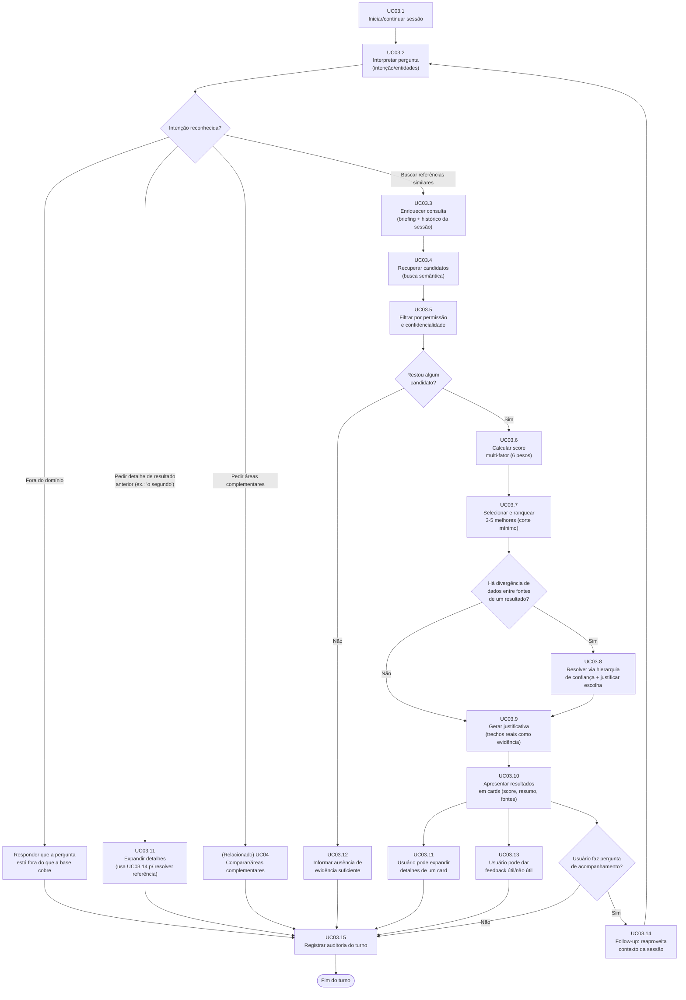

## 2. UC03.1 — Iniciar/continuar sessão de busca conversacional

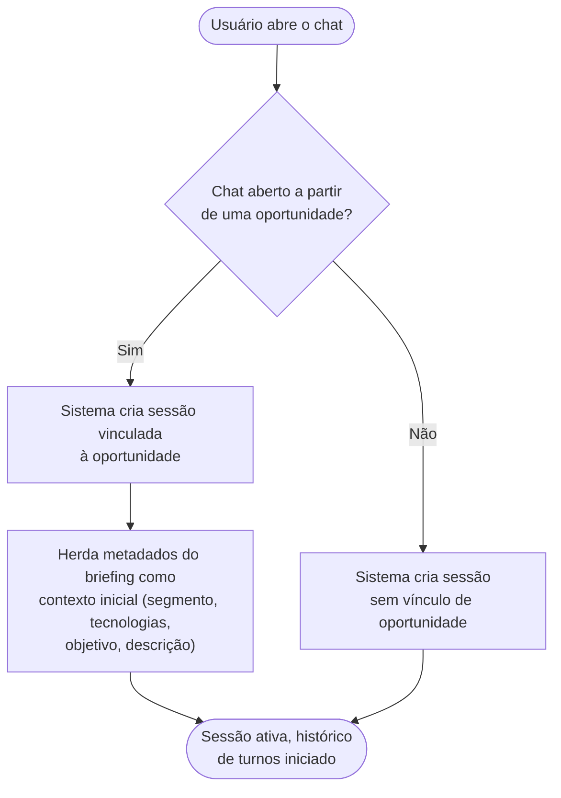

## 3. UC03.2 — Interpretar pergunta e extrair intenção/entidades

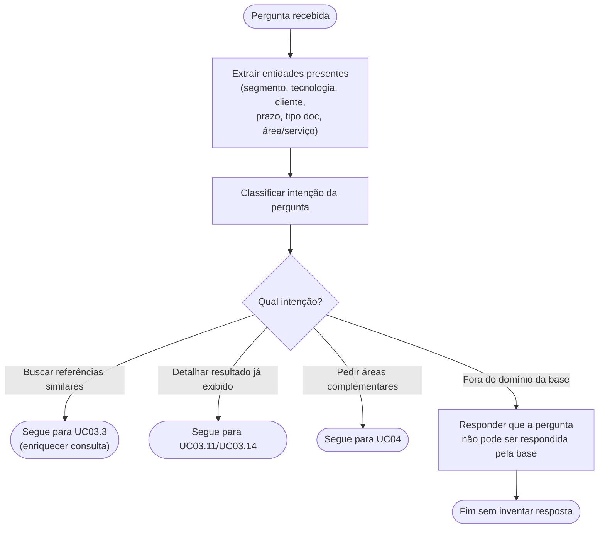

## 4. UC03.3 + UC03.4 — Enriquecer consulta e recuperar candidatos

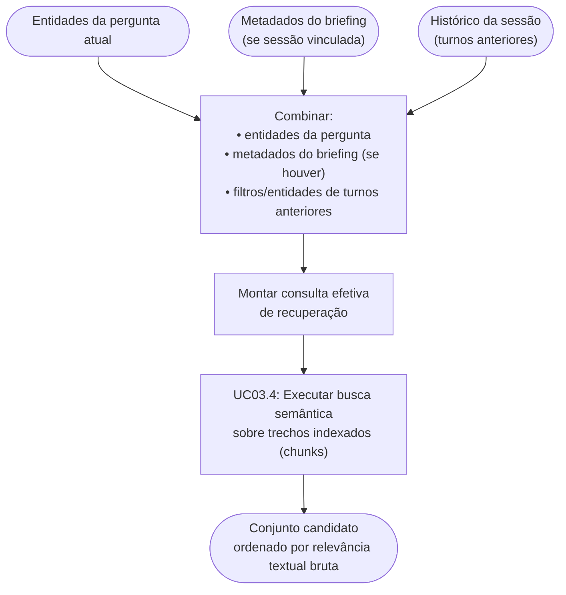

## 5. UC03.5 — Aplicar filtro de permissão e confidencialidade

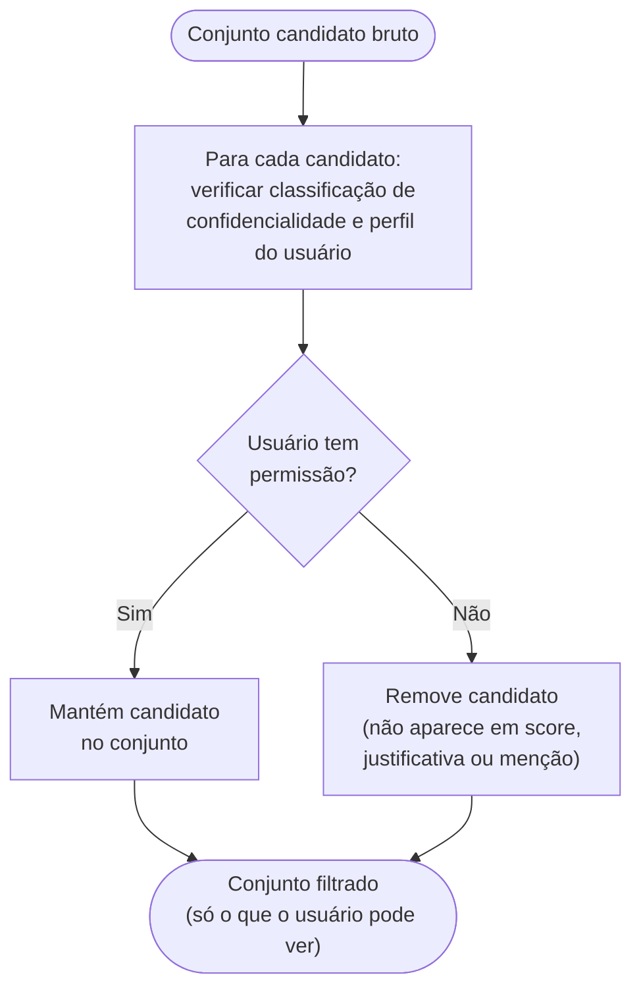

> Regra crítica (RNF01/RF22): este filtro ocorre **antes** de qualquer cálculo de score, geração de justificativa ou exibição — nunca depois.

## 6. UC03.6 + UC03.7 — Calcular score multi-fator e ranquear

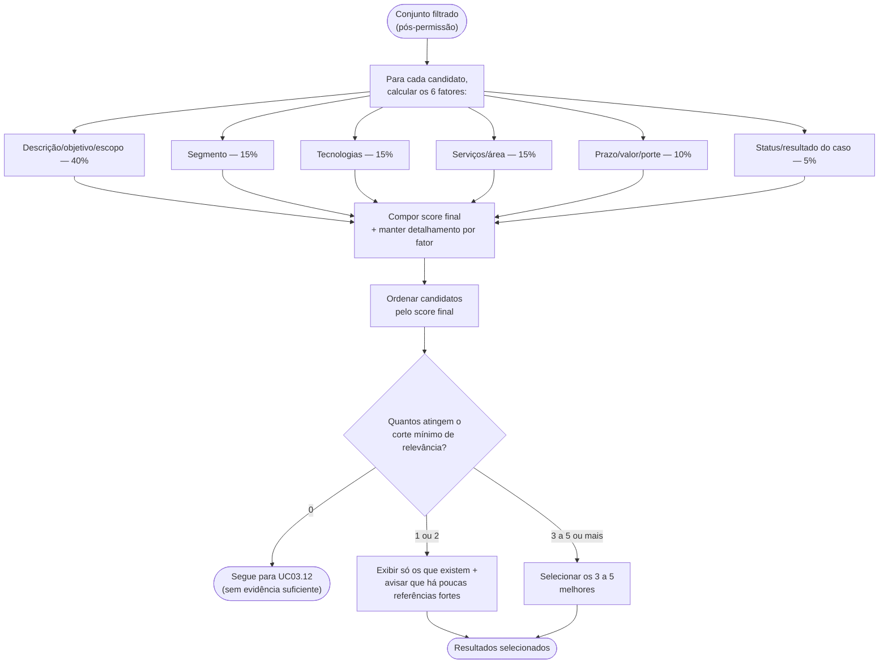

## 7. UC03.8 — Resolver divergência entre fontes (hierarquia de confiança)

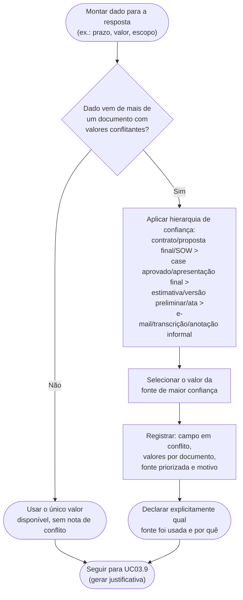

## 8. UC03.9 + UC03.10 — Gerar justificativa e apresentar resultados

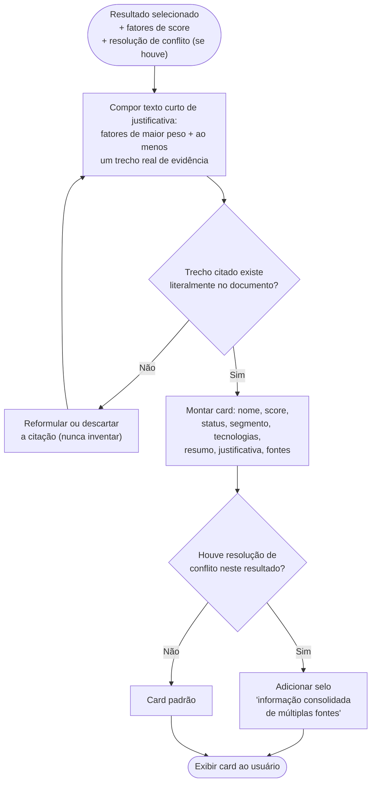

## 9. UC03.11 — Expandir detalhes de um resultado

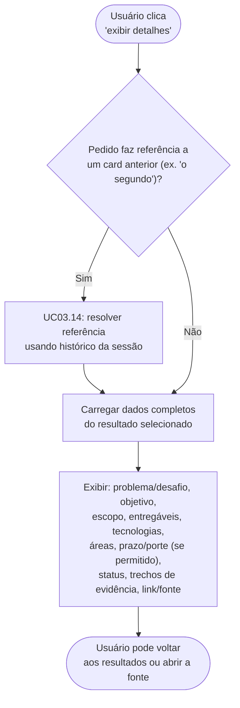

## 10. UC03.12 — Informar ausência de evidência suficiente

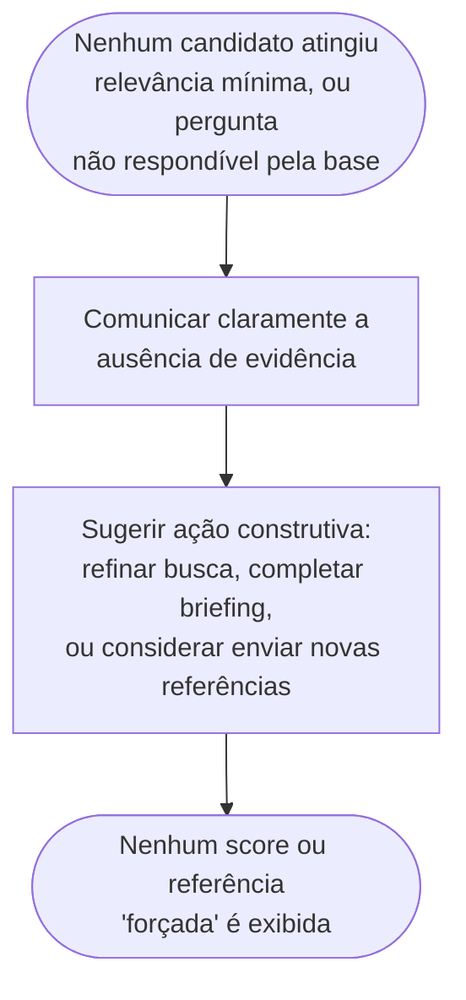

## 11. UC03.13 — Capturar feedback de utilidade por resultado

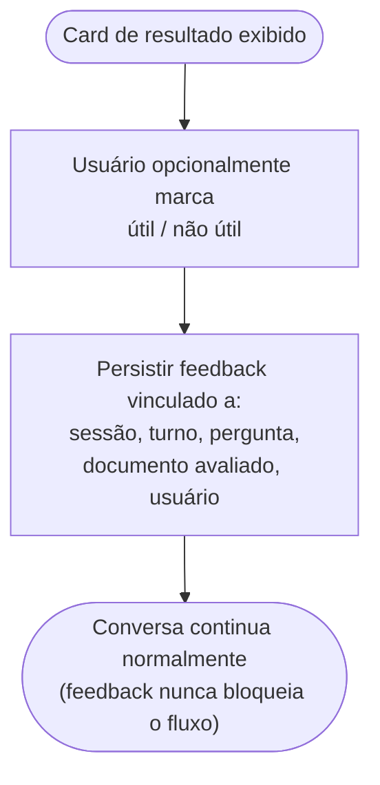

## 12. UC03.14 — Continuar a conversa (follow-up) refinando a busca

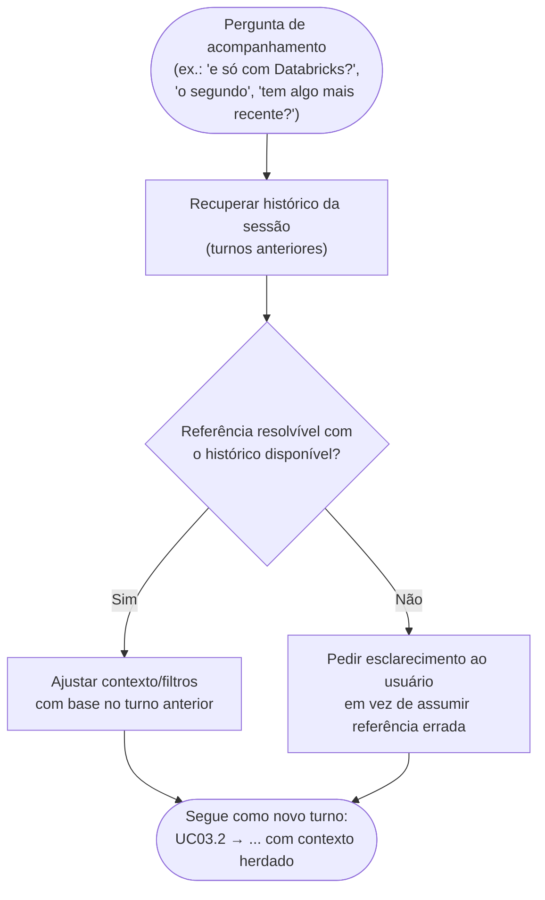

## 13. UC03.15 — Registrar auditoria da busca

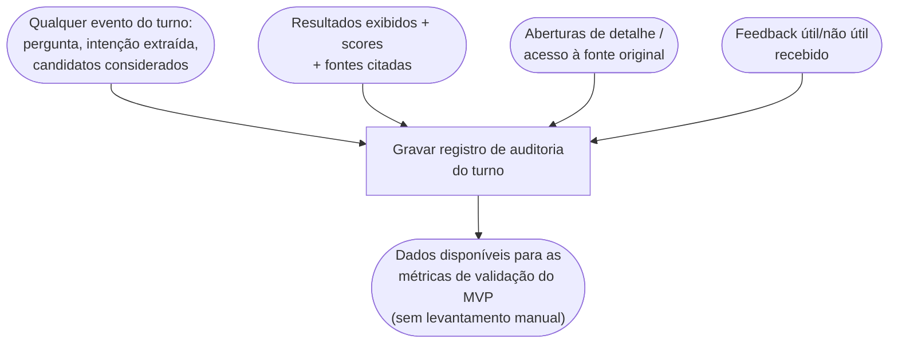

## 14. Diagrama de sequência — turno completo (ator × sistema)

Visão complementar, mostrando a troca de mensagens entre o usuário e os componentes lógicos do sistema ao longo de um turno de busca.

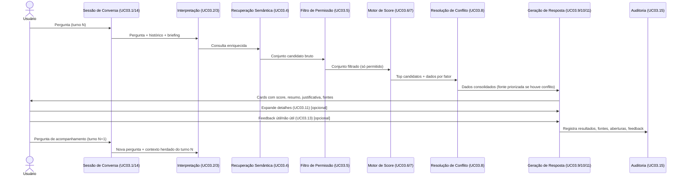

## 15. Rastreabilidade

Todos os diagramas acima representam exatamente os sub-casos de uso UC03.1–UC03.15 definidos em [`NB-02-feature-busca-conversacional.md`](./NB-02-feature-busca-conversacional.md) — nenhum comportamento novo foi introduzido. Este documento é material de apoio visual para a avaliação do gate NB-02 e para o desenho técnico em DEV-01 (arquitetura/sequência de chamadas/modelo de dados).
